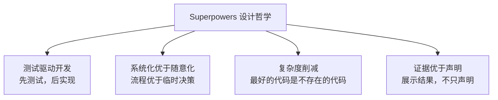
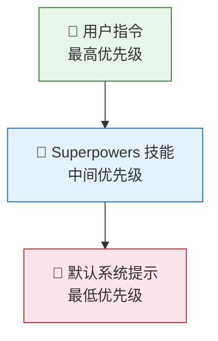

# Phase 1: 文档框架与概述 — Executable Plan

**Goal:** 建立文档结构，完成索引页和概述章节
**Deliverables:** `docs/zh/README.md`, `docs/zh/01-overview.md`
**Requirements:** FR-1 (1.1–1.4), FR-2 (2.1–2.5), NFR-1, NFR-2, NFR-3

---

## Task 1: Create directory structure

**File:** `docs/zh/` (directory)
**Requirements:** FR-1.1

### What to do

Create the `docs/zh/` directory. This is a prerequisite for all subsequent tasks.

```bash
mkdir -p docs/zh
```

### Acceptance criteria

- [ ] `docs/zh/` directory exists

### Verification

```bash
test -d docs/zh && echo "PASS" || echo "FAIL"
```

---

## Task 2: Write `docs/zh/README.md` — 文档索引与目录页

**File:** `docs/zh/README.md`
**Requirements:** FR-1.1, FR-1.4

### What to write

Write the full index page for the Superpowers 中文技术文档. The document must follow this exact structure:

#### 1. Title and introduction block

```markdown
# Superpowers 中文技术文档

> Superpowers 是一个面向 AI 编程助手（AI Coding Assistant）的技能库（Skills Library），
> 通过结构化的 Markdown 文档为 AI 智能体（Agent）注入开发工作流和最佳实践。
>
> 版本：5.0.x | 作者：Jesse Vincent / Prime Radiant
```

#### 2. "What is this documentation" section

Write a brief paragraph (3–5 sentences) explaining:
- This documentation is a Chinese technical deep-dive into the Superpowers project
- It covers architecture, workflow, skill system, and platform integration
- Each chapter is a standalone `.md` file that can be read independently or sequentially
- Target audience: developers who want to understand, use, or extend Superpowers

#### 3. Chapter index table

Create a table with columns: 章节 (chapter link), 内容简介 (description), 核心概念 (key concepts).

| 章节 | 内容简介 | 核心概念 |
|------|---------|---------|
| [01 — 概述与设计哲学](./01-overview.md) | Superpowers 是什么、为什么需要它、四大设计哲学 | 技能即文档（Skills-as-Documents）、指令优先级（Instruction Priority） |
| [02 — 系统架构](./02-architecture.md) | 整体架构、引导注入模式、目录结构 | 引导注入（Bootstrap Injection）、会话钩子（Session Hook） |
| [03 — 核心工作流](./03-workflow.md) | 从头脑风暴到分支完成的完整开发流水线 | 工作流流水线（Workflow Pipeline）、Git 工作树（Worktree） |
| [04 — 技能系统详解](./04-skills-system.md) | 技能文档的结构、加载机制、组合方式 | YAML 前言（Frontmatter）、技能组合（Composition） |
| [05 — 反合理化设计模式](./05-anti-rationalization.md) | 防止 AI 自我合理化的铁律、红旗与硬门 | 铁律（Iron Laws）、红旗表（Red Flags）、硬门（Hard Gates） |
| [06 — 子智能体编排](./06-subagent-orchestration.md) | 主智能体如何拆分任务并协调子智能体 | 子智能体驱动开发（Subagent-Driven Development） |
| [07 — 平台适配层](./07-platform-adapters.md) | 五大平台的适配机制与差异 | 平台适配器（Platform Adapter）、钩子注入（Hook Injection） |
| [08 — Brainstorm Companion Server](./08-brainstorm-server.md) | 内置 WebSocket 服务器的设计与实现 | WebSocket、零依赖（Zero Dependencies） |
| [09 — 技能开发指南](./09-writing-skills.md) | 如何编写、测试和发布自定义技能 | 技能模板（Skill Template）、精神条款（Spirit-over-Letter） |
| [10 — 对比分析](./10-comparison.md) | Superpowers 与其他 AI 工作流方案的对比 | 差异化优势（Differentiators） |
| [11 — 附录](./11-appendix.md) | 术语表、技能清单、参考链接 | — |

#### 4. Quick-start reading paths section

Provide 3 recommended reading paths:

- **快速了解**（10 分钟）：01 概述 → 03 核心工作流
- **深入理解**（30 分钟）：01 概述 → 02 架构 → 04 技能系统 → 05 反合理化
- **完整阅读**：按顺序 01 → 11

#### 5. Conventions section (约定说明)

Explain the documentation conventions:
- 术语处理：技术术语首次出现时以"中文（English Original）"格式标注，后续使用中文
- 图表：使用 Mermaid 语法，可在 GitHub / VS Code 中直接渲染
- 代码示例：来自代码库实际文件，标注文件路径
- 导航：每篇文末提供"上一篇 / 下一篇"链接

#### 6. Footer with project link

```markdown
---
本文档基于 [Superpowers](https://github.com/superpowers-ai/superpowers) 代码库分析撰写。
```

### Acceptance criteria

- [ ] File exists at `docs/zh/README.md`
- [ ] Contains links to all 11 chapter files (01 through 11)
- [ ] Each chapter link has a content description and key concepts
- [ ] Includes reading path recommendations
- [ ] Includes conventions section explaining term handling (中英文对照)
- [ ] All technical terms on first use have English in parentheses (e.g. 技能库（Skills Library）)
- [ ] Written entirely in Chinese (except English terms in parentheses and proper nouns)
- [ ] No translation-ese — reads naturally as Chinese technical writing

### Verification

```bash
# File exists
test -f docs/zh/README.md && echo "PASS" || echo "FAIL"

# Contains all 11 chapter links
for i in 01 02 03 04 05 06 07 08 09 10 11; do
  grep -q "$i-" docs/zh/README.md && echo "PASS: chapter $i linked" || echo "FAIL: chapter $i missing"
done

# Contains convention/term-handling section
grep -q "约定" docs/zh/README.md && echo "PASS: conventions" || echo "FAIL: conventions missing"

# First-use English annotations present
grep -q "Skills Library" docs/zh/README.md && echo "PASS: bilingual terms" || echo "FAIL: bilingual terms missing"
```

---

## Task 3: Write `docs/zh/01-overview.md` — 概述与设计哲学

**File:** `docs/zh/01-overview.md`
**Requirements:** FR-2.1, FR-2.2, FR-2.3, FR-2.4, FR-2.5, FR-1.3, FR-1.4, NFR-1, NFR-2, NFR-3

### What to write

This is the most content-rich deliverable of Phase 1. The document must be comprehensive, technically accurate, and read well as standalone Chinese technical writing. Follow this exact structure:

---

#### Header

```markdown
# 概述与设计哲学

> Superpowers 不是一个传统意义上的软件框架——它是一组 Markdown 文档，
> 但这些文档能从根本上改变 AI 编程助手的工作方式。
```

---

#### Section 1: 什么是 Superpowers（FR-2.1）

Write 3–4 paragraphs covering:

1. **Definition paragraph:** Superpowers 是一个技能库（Skills Library），由约 70 个 Markdown 技能文档（Skill Documents）组成。它为 AI 编程助手（如 Claude Code、Cursor、Gemini CLI 等）提供结构化的开发工作流（Development Workflow）。Mention it supports 5 platforms: Claude Code, Cursor, Gemini CLI, Codex, OpenCode.

2. **How it works paragraph:** 当 AI 编程助手启动会话时，Superpowers 通过引导注入（Bootstrap Injection）将相关技能文档注入智能体的上下文（Context）中。这些文档成为智能体的"操作手册"，指导它如何执行开发任务。

3. **Concrete example paragraph:** Give a concrete example — when an agent loads the `using-superpowers/SKILL.md`, the session-start hook reads it and injects instructions into the agent context. The agent then follows structured workflows instead of ad-hoc responses.

4. **Include a Mermaid diagram** showing the basic injection flow:


---

#### Section 2: 核心洞察——为什么需要结构化流程（FR-2.2）

Write 2–3 paragraphs covering:

1. **The insight:** AI 智能体（Agent）在有结构化流程指导时，表现远优于接收随意指令时。This is not theoretical — it's an empirical observation from extensive use.

2. **The problem it solves:** Without structure, AI assistants tend to: skip tests, make assumptions without verification, over-engineer or under-engineer, lose track of multi-step tasks, and rationalize incorrect behavior. Superpowers addresses each of these systematically.

3. **The approach:** Rather than trying to make the AI "smarter," Superpowers makes it more disciplined by providing explicit workflows, checklists, and guardrails. The key metaphor: it's like giving a skilled developer a well-written runbook rather than vague instructions.

---

#### Section 3: 四大设计哲学（FR-2.3）

This is the centerpiece section. For each philosophy, write a subsection with:
- A clear statement of the principle
- Why it matters for AI-assisted development
- How Superpowers implements it

**3.1 测试驱动开发（Test-Driven Development, TDD）**

- Principle: 先写测试，再写实现。测试是规范（Specification），不仅仅是验证。
- Why it matters for AI: AI agents tend to write code that "looks right" but has subtle bugs. TDD forces verification before moving forward. It creates an objective measure of progress.
- How implemented: The TDD skill enforces a strict red-green-refactor cycle. Hard Gates prevent skipping test steps. Tests must actually run and fail before implementation begins.

**3.2 系统化优于随意化（Systematic over Ad-hoc）**

- Principle: 可重复的流程优于临时决策。每个开发活动都有对应的结构化工作流。
- Why it matters for AI: AI agents can be inconsistent across sessions. Systematic workflows ensure consistent quality regardless of context window state.
- How implemented: Superpowers defines explicit pipelines — brainstorming → planning → execution → finishing. Each stage has defined inputs, outputs, and quality gates.

**3.3 复杂度削减（Complexity Reduction）**

- Principle: 最好的代码是不存在的代码。每次修改都应该寻求减少而非增加复杂度。
- Why it matters for AI: AI agents have a tendency to over-engineer solutions, add unnecessary abstractions, and introduce dependencies. Complexity reduction counteracts this.
- How implemented: Skills include explicit warnings against over-engineering. The project itself practices what it preaches — zero external runtime dependencies, hand-rolled WebSocket server, custom test framework.

**3.4 证据优于声明（Evidence over Claims）**

- Principle: 不要说"测试通过了"——展示测试输出。不要说"我检查过了"——展示检查结果。
- Why it matters for AI: AI agents are prone to "hallucinating" completion — claiming tasks are done without actually verifying. This is the anti-rationalization（反合理化）principle at its core.
- How implemented: Skills require agents to show actual command output, test results, and verification steps. Iron Laws（铁律）and Red Flags（红旗）tables make violations explicit and detectable.

**Include a Mermaid diagram** summarizing the four philosophies:



---

#### Section 4: 技能即文档（Skills-as-Documents）（FR-2.4）

Write 2–3 paragraphs covering:

1. **The core concept:** In Superpowers, Markdown documents ARE the code. Each skill is a `.md` file with YAML frontmatter（YAML 前言）defining metadata and a Markdown body containing instructions. There is no compilation, no runtime — the document itself is directly consumed by the AI agent.

2. **Structure of a skill:** Explain the anatomy — YAML frontmatter contains metadata (name, description, dependencies), Markdown body contains the actual instructions, guidelines, checklists, and Hard Gates. Skills are independently loadable and composable（可组合的）.

3. **Why this matters:** This design means anyone who can write Markdown can extend Superpowers. It's radically accessible. It also means skills are version-controlled, diff-able, reviewable — all the benefits of code without the overhead of a programming language.

**Include a code block** showing an example skill structure:

```markdown
---
name: example-skill
description: 示例技能
depends_on:
  - base-skill
---

# 技能标题

## 工作流程
1. 步骤一
2. 步骤二

## 硬门（Hard Gates）
- [ ] 必须满足的条件
```

---

#### Section 5: 指令优先级系统（FR-2.5）

Write 2–3 paragraphs covering:

1. **The priority hierarchy:** 明确的三级优先级：
   - 🥇 用户指令（User Instructions）— 最高优先级，用户明确说的话
   - 🥈 Superpowers 技能（Skills）— 中间优先级，技能文档中的指导
   - 🥉 默认系统提示（Default System Prompt）— 最低优先级，AI 平台的默认行为

2. **Why this matters:** When conflicts arise, the priority system provides a clear resolution mechanism. If a user says "skip tests this time," that overrides the TDD skill's requirement. But if the user hasn't said anything specific, Superpowers skills override the AI's default tendencies.

3. **Practical implications:** This means Superpowers never "locks you in" — the user is always in control. But it also means that when the user doesn't specify, the AI follows best practices rather than its own defaults.

**Include a Mermaid diagram:**



---

#### Section 6: 下一步（Next steps）

A brief 2–3 sentence paragraph pointing the reader to the next chapter (02 — 系统架构) for a deeper dive into how Superpowers is technically structured.

---

#### Footer navigation (FR-1.3)

```markdown
---

[⬅️ 返回目录](./README.md) | [下一篇：系统架构 ➡️](./02-architecture.md)
```

---

### Key writing guidelines for this task

1. **Tone:** Authoritative but approachable. Think senior engineer explaining to a competent peer, not a textbook lecturing a student.
2. **Terms:** Every technical term gets English in parentheses ON FIRST USE ONLY. After that, use the Chinese term. Track what's been introduced.
3. **No translation-ese:** Write naturally. "这种方式让..." is better than "通过这种方式...". Avoid stacking long attributive clauses.
4. **Mermaid diagrams:** Must use the exact `mermaid` code fence syntax. Keep diagrams clean — no more than 8 nodes per diagram.
5. **Length target:** ~1200–1800 words (Chinese characters + English terms). Comprehensive but not paddy.
6. **Accuracy:** All technical claims must be based on the project context provided above. Do not invent features or capabilities.

### Acceptance criteria

- [ ] File exists at `docs/zh/01-overview.md`
- [ ] Section 1 explains what Superpowers is (FR-2.1) — skill library, ~70 documents, 5 platforms
- [ ] Section 2 explains the core insight about structured processes (FR-2.2)
- [ ] Section 3 covers all four design philosophies with subsections (FR-2.3): TDD, systematic over ad-hoc, complexity reduction, evidence over claims
- [ ] Section 4 explains skills-as-documents concept (FR-2.4) with example skill structure
- [ ] Section 5 explains the three-level priority system (FR-2.5) with clear hierarchy
- [ ] Contains at least 3 Mermaid diagrams (NFR-2)
- [ ] All technical terms have English annotations on first use (FR-1.4)
- [ ] Footer has navigation links: back to README + next chapter (FR-1.3)
- [ ] Written in natural Chinese, no translation-ese (NFR-1)
- [ ] All technical claims are accurate per project context (NFR-3)
- [ ] Length is between 1200–1800 words

### Verification

```bash
# File exists
test -f docs/zh/01-overview.md && echo "PASS" || echo "FAIL"

# Contains all required sections
for section in "什么是 Superpowers" "核心洞察" "设计哲学" "技能即文档" "指令优先级"; do
  grep -q "$section" docs/zh/01-overview.md && echo "PASS: $section" || echo "FAIL: $section missing"
done

# Contains Mermaid diagrams (at least 3)
MERMAID_COUNT=$(grep -c '```mermaid' docs/zh/01-overview.md)
test "$MERMAID_COUNT" -ge 3 && echo "PASS: $MERMAID_COUNT mermaid diagrams" || echo "FAIL: only $MERMAID_COUNT mermaid diagrams"

# Contains navigation footer
grep -q "README.md" docs/zh/01-overview.md && echo "PASS: back link" || echo "FAIL: back link missing"
grep -q "02-architecture.md" docs/zh/01-overview.md && echo "PASS: next link" || echo "FAIL: next link missing"

# Four philosophies present
for phil in "测试驱动" "系统化" "复杂度" "证据"; do
  grep -q "$phil" docs/zh/01-overview.md && echo "PASS: $phil" || echo "FAIL: $phil missing"
done

# Bilingual term annotations
grep -q "Skills Library" docs/zh/01-overview.md && echo "PASS: bilingual" || echo "FAIL: bilingual missing"

# Priority system levels
grep -q "用户指令" docs/zh/01-overview.md && echo "PASS: priority" || echo "FAIL: priority missing"
```

---

## Execution Order

```
Task 1 (mkdir)
    ↓
Task 2 (README.md)  ←→  Task 3 (01-overview.md)   [parallel, no dependency]
```

Tasks 2 and 3 can be executed in parallel after Task 1 completes. They have no content dependencies on each other.

---

## Phase 1 Completion Checklist

- [ ] `docs/zh/` directory exists
- [ ] `docs/zh/README.md` — complete index with all 11 chapter links, descriptions, reading paths, conventions
- [ ] `docs/zh/01-overview.md` — complete overview covering FR-2.1 through FR-2.5
- [ ] All technical terms have bilingual annotations on first use
- [ ] At least 3 Mermaid diagrams in overview document
- [ ] Navigation links present (README ↔ 01-overview, 01-overview → 02-architecture)
- [ ] Natural Chinese writing quality, no translation-ese
- [ ] All verification scripts pass
