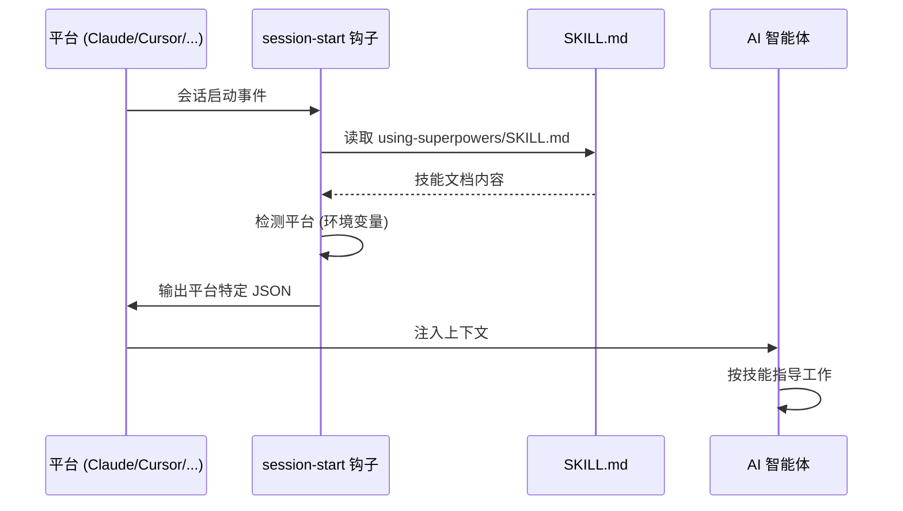
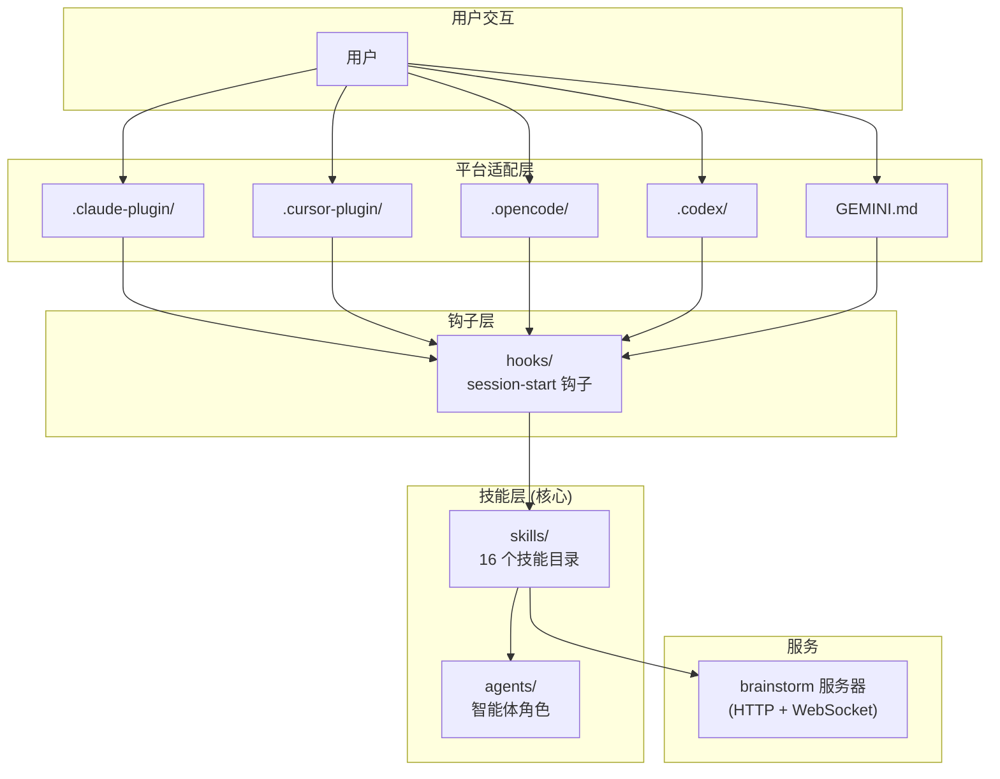
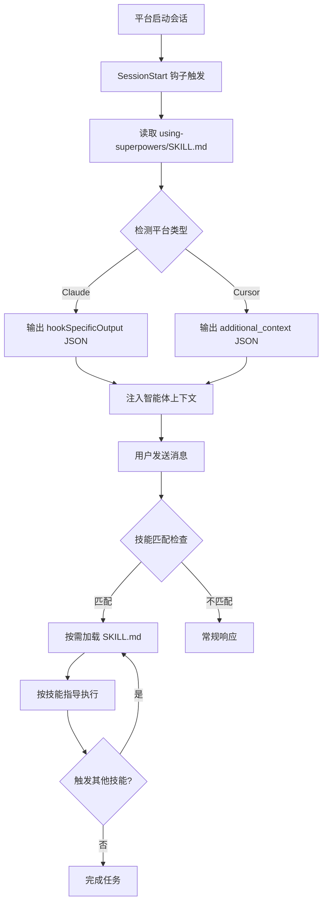
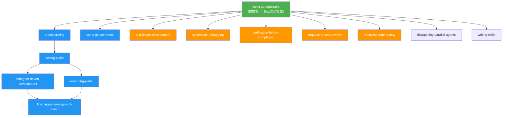
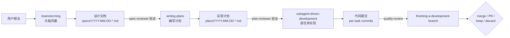
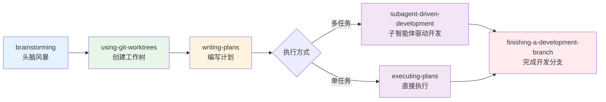
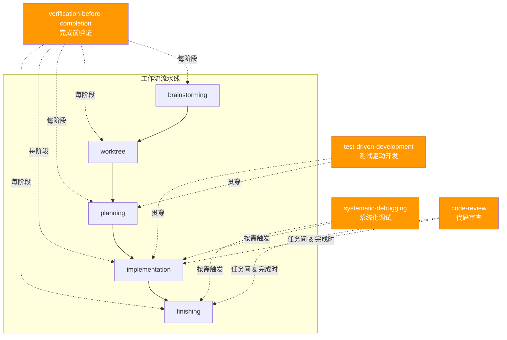
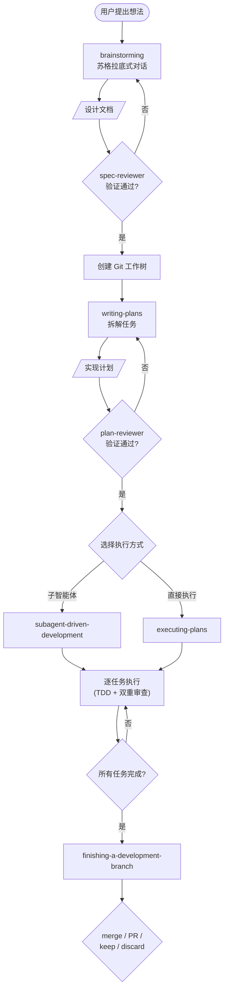

# Phase 2: 架构与工作流 — Executable Plan

**Goal:** 完成系统架构和核心工作流两个技术核心章节
**Deliverables:** `docs/zh/02-architecture.md`, `docs/zh/03-workflow.md`
**Requirements:** FR-3 (3.1–3.6), FR-4 (4.1–4.4), NFR-1, NFR-2, NFR-3, NFR-4

---

## Task 1: Write `docs/zh/02-architecture.md` — 系统架构

**File:** `docs/zh/02-architecture.md`
**Requirements:** FR-3.1, FR-3.2, FR-3.3, FR-3.4, FR-3.5, FR-3.6

### What to write

Write a comprehensive Chinese technical document covering the full system architecture of Superpowers. Follow this exact structure:

---

#### Header

```markdown
# 系统架构

> Superpowers 的核心创新在于：它不修改 AI 的能力，而是通过上下文注入（Context Injection）
> 改变 AI 的行为方式——用 Markdown 文档"编程"智能体。
```

---

#### Section 1: 架构模式——Prompt Injection Plugin（FR-3.1）

Write 2–3 paragraphs covering:

1. **Pattern definition:** Superpowers 采用"提示注入插件（Prompt Injection Plugin）"架构模式。它不是传统的代码库或 SDK，而是通过会话钩子（Session Hook）在 AI 智能体启动时将结构化指令注入上下文窗口（Context Window）。

2. **How it works technically:** 当会话启动时，平台触发 `session-start` 钩子，钩子脚本读取 `skills/using-superpowers/SKILL.md` 文件内容，然后以平台特定的 JSON 格式输出。智能体接收这些指令后，它们成为智能体行为的一部分。

3. **Platform-specific JSON formats:** Show actual code examples of the two output formats:
   - Claude Code: `{ "hookSpecificOutput": { "additionalContext": "..." } }`
   - Cursor: `{ "additional_context": "..." }`

4. **Why this pattern matters:** This is zero-runtime — no processes, no daemons, no dependencies. The entire system is "just documents" injected at the right time.

Include a **Mermaid sequence diagram** showing the injection flow:



---

#### Section 2: 系统层次结构（FR-3.2）

Write a paragraph introducing the layered architecture, then describe each layer:

**Layer 1: 技能层（Skills Layer）** — `skills/` 目录
- 16 个技能目录，每个包含 `SKILL.md` 及辅助文件
- 这是系统的核心——所有行为规范都定义在这一层
- 技能按功能分为：核心工作流技能、横切关注点技能、元技能

**Layer 2: 平台适配层（Platform Integration Layer）**
- `.claude-plugin/` — Claude Code 适配
- `.cursor-plugin/` — Cursor 适配
- `.opencode/` — OpenCode 适配
- `.codex/` — Codex 适配
- `GEMINI.md` — Gemini CLI 适配
- 每个适配器将统一的技能系统映射为平台特定的配置格式

**Layer 3: 钩子层（Hooks Layer）** — `hooks/` 目录
- `hooks.json` / `hooks-cursor.json` — 钩子配置
- `session-start` 钩子脚本——系统引导入口
- `run-hook.cmd` — 跨平台（polyglot）执行脚本

**Layer 4: Brainstorm 服务器** — `skills/brainstorming/scripts/server.cjs`
- 零依赖（Zero Dependencies）HTTP + WebSocket 服务器
- 提供 brainstorming 阶段的实时交互界面

**Layer 5: 智能体（Agents）** — `agents/` 目录
- 可复用的智能体角色定义（如 `code-reviewer.md`）

**Layer 6: 命令（Commands）** — `commands/` 目录
- 已废弃的斜杠命令（Deprecated Slash Commands）

Include a **Mermaid layered architecture diagram**:



---

#### Section 3: 会话启动生命周期（FR-3.3）

Write a detailed walkthrough of the 10-step session lifecycle. Present it as a numbered process, with each step getting 2–3 sentences of explanation:

1. **平台启动 AI 智能体会话** — 用户在 Claude Code / Cursor 等平台中开始新对话
2. **SessionStart 钩子触发** — 平台检测到 `hooks.json`（或 `hooks-cursor.json`）中的 `session-start` 事件配置，执行对应脚本
3. **钩子读取引导技能** — 脚本读取 `skills/using-superpowers/SKILL.md`，这是整个技能系统的入口文件
4. **平台检测** — 钩子通过环境变量（`CLAUDE_PLUGIN_ROOT`、`CURSOR_PLUGIN_ROOT`）判断当前平台，选择对应 JSON 输出格式
5. **JSON 输出注入** — 钩子以平台特定格式输出 JSON，平台将其内容注入智能体上下文
6. **智能体上下文就绪** — 智能体现在"知道"Superpowers 技能系统的存在和规则
7. **用户发送消息** — 用户提出开发需求或问题
8. **技能匹配检查** — 智能体评估："是否有任何技能适用？"——哪怕只有 1% 的可能性，也应加载对应技能
9. **按需加载技能** — 智能体通过平台的 Skill 工具加载相关 `SKILL.md` 文件（非预加载，是按需加载）
10. **技能执行与级联** — 智能体严格按技能指导执行，技能可能触发其他技能，子智能体可能被派遣

Include a **Mermaid flowchart** of the lifecycle:



---

#### Section 4: 技能依赖图（FR-3.4）

Write 2–3 paragraphs explaining the skill dependency model:

1. **Root skill:** `using-superpowers` 是根技能（Root Skill），在会话启动时自动加载。它定义了技能系统的基本规则，并引用所有其他技能。

2. **Dependency structure:** Explain the main workflow chain (brainstorming → writing-plans → subagent-driven-development/executing-plans → finishing-a-development-branch) and how cross-cutting skills (TDD, debugging, verification, code review) attach to the chain.

3. **Loading model:** Skills are NOT pre-loaded. The root skill tells the agent about available skills and when to load them. Actual loading happens on-demand via the platform's Skill tool.

Include a **Mermaid dependency graph**:



Add a legend: green = root, blue = workflow chain, orange = cross-cutting skills.

---

#### Section 5: 数据与工件流向（FR-3.5）

Write 2–3 paragraphs explaining how user ideas flow through the system and become concrete artifacts:

1. **The flow:** User idea → brainstorming session → design spec → plan document → implementation (per-task commits) → branch finishing (merge/PR)

2. **Specific file outputs at each stage:**
   - Brainstorming → `docs/superpowers/specs/YYYY-MM-DD-<topic>-design.md`
   - spec-document-reviewer validates the spec
   - Writing plans → `docs/superpowers/plans/YYYY-MM-DD-<feature>.md`
   - plan-document-reviewer validates the plan
   - Subagent-driven development → per-task: implement → spec-review → quality-review → commit
   - Finishing → merge / PR / keep / discard decision

3. **Quality gates:** Each transition has a validation step — specs are reviewed by spec-document-reviewer, plans by plan-document-reviewer, code by quality-review.

Include a **Mermaid artifact flow diagram**:



---

#### Section 6: 系统边界（FR-3.6）

Write 2–3 paragraphs clearly delineating what Superpowers controls and what it does not:

**Superpowers 控制：**
- 智能体行为（Agent Behavior）— 通过技能文档规范智能体的工作方式
- 工作流推进（Workflow Progression）— 定义阶段间的转换条件
- 质量门控（Quality Gates）— 在关键节点设置检查点
- 子智能体编排（Subagent Orchestration）— 指导主智能体如何拆分和委派任务

**Superpowers 不控制：**
- AI 核心能力（AI Core Capabilities）— 不改变模型本身的推理能力
- 平台工具实现（Platform Tool Implementations）— 不控制文件读写、终端执行等底层工具
- 用户项目代码（User's Project Code）— 不直接修改用户代码，只指导智能体如何修改
- Git 操作（Git Operations）— 不直接执行 git 命令，而是指导智能体执行

Present this as a clear table or two-column layout for easy scanning.

---

#### Section 7: 下一步

A brief 2–3 sentence paragraph pointing the reader to the next chapter (03 — 核心工作流) for a detailed walkthrough of the development pipeline.

---

#### Footer navigation

```markdown
---

[⬅️ 上一篇：概述与设计哲学](./01-overview.md) | [返回目录](./README.md) | [下一篇：核心工作流 ➡️](./03-workflow.md)
```

---

### Key writing guidelines

1. **Tone:** Technical and precise. This is an architecture document — clarity over narrative.
2. **Terms:** Every technical term gets English in parentheses ON FIRST USE ONLY. After that, use the Chinese term. Examples: 上下文注入（Context Injection）, 会话钩子（Session Hook）, 环境变量（Environment Variable）.
3. **No translation-ese:** Write naturally as Chinese technical documentation. Avoid stiff phrasing.
4. **Mermaid diagrams:** Must use the exact ` ```mermaid ` code fence syntax. This document requires at least 5 diagrams (injection flow, layer architecture, session lifecycle, skill dependency, artifact flow).
5. **Code examples:** Show actual JSON output formats for Claude and Cursor platforms. Reference actual file paths from the codebase (`skills/using-superpowers/SKILL.md`, `hooks/hooks.json`, etc.).
6. **Length target:** ~1500–2200 Chinese characters + English terms. Comprehensive architecture coverage.
7. **Accuracy:** All file paths, environment variables, JSON formats must match the project context provided. Do not invent.

### Acceptance criteria

- [ ] File exists at `docs/zh/02-architecture.md`
- [ ] Section 1 describes Prompt Injection Plugin pattern (FR-3.1) with platform-specific JSON examples
- [ ] Section 2 shows system layers with descriptions of all 6 layers (FR-3.2)
- [ ] Section 3 covers full 10-step session lifecycle (FR-3.3)
- [ ] Section 4 presents skill dependency graph from root to all skills (FR-3.4)
- [ ] Section 5 describes artifact flow from idea to merge (FR-3.5) with file path patterns
- [ ] Section 6 clearly delineates system boundaries — controls vs. does not control (FR-3.6)
- [ ] Contains at least 5 Mermaid diagrams (NFR-2)
- [ ] All technical terms have English annotations on first use (NFR-1)
- [ ] Footer has navigation links: prev (01-overview) + index (README) + next (03-workflow)
- [ ] References actual file paths: `skills/using-superpowers/SKILL.md`, `hooks/hooks.json`, `.claude-plugin/`, `.cursor-plugin/`
- [ ] Shows both Claude and Cursor JSON output formats
- [ ] Written in natural Chinese (NFR-1), technically accurate (NFR-3)

### Verification

```bash
# File exists
test -f docs/zh/02-architecture.md && echo "PASS" || echo "FAIL"

# Contains all required sections
for section in "架构模式" "系统层次" "会话启动生命周期" "技能依赖" "数据" "工件" "系统边界"; do
  grep -q "$section" docs/zh/02-architecture.md && echo "PASS: $section" || echo "FAIL: $section missing"
done

# Contains Mermaid diagrams (at least 5)
MERMAID_COUNT=$(grep -c '```mermaid' docs/zh/02-architecture.md)
test "$MERMAID_COUNT" -ge 5 && echo "PASS: $MERMAID_COUNT mermaid diagrams" || echo "FAIL: only $MERMAID_COUNT mermaid diagrams (need >= 5)"

# Contains platform-specific JSON formats
grep -q "hookSpecificOutput" docs/zh/02-architecture.md && echo "PASS: Claude JSON format" || echo "FAIL: Claude JSON format missing"
grep -q "additional_context" docs/zh/02-architecture.md && echo "PASS: Cursor JSON format" || echo "FAIL: Cursor JSON format missing"

# Contains key file paths
for path in "using-superpowers/SKILL.md" "hooks.json" ".claude-plugin" ".cursor-plugin"; do
  grep -q "$path" docs/zh/02-architecture.md && echo "PASS: path $path" || echo "FAIL: path $path missing"
done

# Contains navigation footer
grep -q "01-overview.md" docs/zh/02-architecture.md && echo "PASS: prev link" || echo "FAIL: prev link missing"
grep -q "03-workflow.md" docs/zh/02-architecture.md && echo "PASS: next link" || echo "FAIL: next link missing"
grep -q "README.md" docs/zh/02-architecture.md && echo "PASS: index link" || echo "FAIL: index link missing"

# Contains system boundary section
grep -q "不控制" docs/zh/02-architecture.md && echo "PASS: boundaries" || echo "FAIL: boundaries missing"

# Contains environment variable references
grep -q "CLAUDE_PLUGIN_ROOT\|CURSOR_PLUGIN_ROOT" docs/zh/02-architecture.md && echo "PASS: env vars" || echo "FAIL: env vars missing"

# Bilingual term annotations present
grep -q "Context Injection\|Session Hook\|Bootstrap Injection" docs/zh/02-architecture.md && echo "PASS: bilingual terms" || echo "FAIL: bilingual terms missing"
```

---

## Task 2: Write `docs/zh/03-workflow.md` — 核心工作流

**File:** `docs/zh/03-workflow.md`
**Requirements:** FR-4.1, FR-4.2, FR-4.3, FR-4.4

### What to write

Write a comprehensive Chinese technical document covering the complete development workflow pipeline. Follow this exact structure:

---

#### Header

```markdown
# 核心工作流

> 从一个模糊的想法到一个经过测试、审查、可合并的代码分支——
> Superpowers 将整个过程编排为一条结构化的流水线（Pipeline）。
```

---

#### Section 1: 工作流概览（FR-4.1 introduction）

Write 2–3 paragraphs introducing the workflow pipeline concept:

1. **Pipeline concept:** Superpowers 定义了一条完整的开发工作流流水线（Development Workflow Pipeline），从头脑风暴（Brainstorming）到分支完成（Branch Finishing）。每个阶段都有明确的输入、输出和门控条件（Gate Conditions）。

2. **Why a pipeline:** Without structure, AI agents tend to jump directly to coding. The pipeline ensures that design happens before implementation, tests exist before code, and verification happens before claims of completion.

3. **Overview of stages:** List the 5 main stages briefly: brainstorming → using-git-worktrees → writing-plans → subagent-driven-development / executing-plans → finishing-a-development-branch.

Include a **Mermaid overview flowchart** (FR-4.4 — the main pipeline flowchart):



---

#### Section 2: 流水线各阶段详解（FR-4.1, FR-4.2）

For EACH of the following stages, write a subsection with this exact structure:
- **描述（Description）** — 2–3 sentences on what this stage does
- **输入（Input）** — what goes into this stage
- **输出（Output）** — what this stage produces
- **门控条件（Gate Condition）** — what must be true before proceeding to next stage
- **产出物（Deliverable）** — the specific artifact(s) created

---

**Stage 1: brainstorming — 头脑风暴**

- **描述:** 通过苏格拉底式对话（Socratic Dialogue）与用户共同完善设计想法。使用 brainstorm companion server 提供实时交互界面。智能体引导用户思考需求、边界条件和实现方案。
- **输入:** 用户的初始想法或需求描述
- **输出:** 结构化的设计文档（Design Spec）
- **门控:** spec-document-reviewer 验证通过——设计文档必须完整、清晰、可执行
- **产出物:** `docs/superpowers/specs/YYYY-MM-DD-<topic>-design.md`

---

**Stage 2: using-git-worktrees — 创建 Git 工作树**

- **描述:** 在开始任何实现工作前，创建隔离的 Git 工作树（Git Worktree）。这确保开发工作在独立分支上进行，不影响主分支。
- **输入:** 设计文档（来自 brainstorming 阶段）
- **输出:** 新的 Git 工作树和分支
- **门控:** 工作树创建成功，分支已切换
- **产出物:** 新的 Git 分支 + 工作目录

---

**Stage 3: writing-plans — 编写实现计划**

- **描述:** 将设计文档拆解为可执行的任务列表。每个任务应该是"一口大小"（Bite-sized）——2–5 分钟可完成。计划文档是后续执行的蓝图。
- **输入:** 设计文档
- **输出:** 结构化的实现计划
- **门控:** plan-document-reviewer 验证通过——计划必须任务粒度适当、依赖关系清晰
- **产出物:** `docs/superpowers/plans/YYYY-MM-DD-<feature>.md`

---

**Stage 4a: subagent-driven-development — 子智能体驱动开发**

- **描述:** 主智能体将计划中的任务分派给子智能体（Subagent）执行。每个子智能体处理一个任务，完成后经过 spec-review 和 quality-review 两阶段审查。适用于多任务并行场景。
- **输入:** 实现计划
- **输出:** 经过审查的代码提交
- **门控:** 每个任务必须通过 spec-review（符合规范）和 quality-review（代码质量）
- **产出物:** Per-task commits（每个任务一个提交）

**Stage 4b: executing-plans — 直接执行计划**

- **描述:** 主智能体直接按计划逐任务执行，不使用子智能体。适用于简单或顺序依赖强的任务。
- **输入:** 实现计划
- **输出:** 代码提交
- **门控:** 每个任务完成后需验证
- **产出物:** Code commits

---

**Stage 5: finishing-a-development-branch — 完成开发分支**

- **描述:** 所有任务完成后，进入分支收尾流程。智能体评估工作成果，与用户确认最终处理方式。
- **输入:** 已完成所有任务的开发分支
- **输出:** 最终处理决定
- **门控:** 所有计划任务已完成，所有测试通过，代码审查通过
- **产出物:** 四种结果之一：merge（合并到主分支）/ PR（创建 Pull Request）/ keep（保留分支）/ discard（丢弃分支）

---

#### Section 3: 横切关注点技能（FR-4.3）

Write an introduction paragraph explaining that cross-cutting concerns（横切关注点）are skills that apply across ALL pipeline stages, not just one specific stage. Then cover each:

**3.1 test-driven-development — 测试驱动开发**

- **贯穿方式:** TDD 不只在实现阶段生效——brainstorming 阶段考虑可测试性，planning 阶段为每个任务标注测试策略，implementation 阶段严格执行红-绿-重构（Red-Green-Refactor）循环。
- **核心规则:** 先写失败的测试（Red），再写最少代码让测试通过（Green），最后重构（Refactor）。
- **硬门（Hard Gate）:** 不允许跳过测试步骤。测试必须实际运行并显示结果。

**3.2 systematic-debugging — 系统化调试**

- **贯穿方式:** 任何阶段遇到 bug 或失败时触发。不允许"猜测修复"——必须先观察（Observe）、建立假设（Hypothesize）、设计实验（Experiment）、验证（Verify）。
- **触发条件:** 测试失败、意外行为、构建错误等

**3.3 verification-before-completion — 完成前验证**

- **贯穿方式:** 每个阶段声称完成前，必须提供证据（Evidence）。不接受"我检查过了"这样的声明——必须展示实际输出。
- **核心规则:** 展示命令输出、测试结果、diff 内容等可验证的证据。

**3.4 requesting-code-review / receiving-code-review — 代码审查**

- **贯穿方式:** 在任务间和分支完成时触发。requesting-code-review 定义如何请求审查（提供上下文、变更摘要），receiving-code-review 定义如何处理审查反馈（逐条回应、不忽略）。

Include a **Mermaid diagram** showing how cross-cutting skills intersect with the pipeline:



---

#### Section 4: 工作流完整流程图（FR-4.4 — detailed version）

Provide a comprehensive Mermaid flowchart that combines the main pipeline with gate conditions and cross-cutting concerns. This is the "big picture" diagram:



---

#### Section 5: 下一步

A brief 2–3 sentence paragraph pointing the reader to the next chapter (04 — 技能系统详解) for a deep dive into how individual skills are structured and loaded.

---

#### Footer navigation

```markdown
---

[⬅️ 上一篇：系统架构](./02-architecture.md) | [返回目录](./README.md) | [下一篇：技能系统详解 ➡️](./04-skills-system.md)
```

---

### Key writing guidelines

1. **Tone:** Practical and process-oriented. This is a workflow guide — the reader should feel they can follow these steps.
2. **Terms:** Every technical term gets English in parentheses ON FIRST USE ONLY. Key terms for this doc: 流水线（Pipeline）, 头脑风暴（Brainstorming）, 工作树（Worktree）, 门控条件（Gate Condition）, 横切关注点（Cross-Cutting Concerns）, 红-绿-重构（Red-Green-Refactor）.
3. **No translation-ese:** Write naturally.
4. **Mermaid diagrams:** At least 3 diagrams — overview pipeline, cross-cutting intersection, detailed complete flowchart.
5. **Stage format consistency:** Each pipeline stage MUST have the same 5-part structure: 描述、输入、输出、门控条件、产出物. Use consistent formatting (bold labels).
6. **File path patterns:** Use actual artifact path patterns (`docs/superpowers/specs/YYYY-MM-DD-<topic>-design.md`, etc.).
7. **Length target:** ~1500–2200 Chinese characters + English terms.
8. **Accuracy:** All workflow stages, gate conditions, and artifact paths must match the project context.

### Acceptance criteria

- [ ] File exists at `docs/zh/03-workflow.md`
- [ ] Section 1 provides workflow pipeline overview (FR-4.1)
- [ ] Section 2 covers all 5 pipeline stages (brainstorming, worktree, planning, subagent/executing, finishing) (FR-4.1)
- [ ] Each stage has exactly 5 parts: 描述、输入、输出、门控条件、产出物 (FR-4.2)
- [ ] Section 3 covers all 4 cross-cutting skills: TDD, debugging, verification, code review (FR-4.3)
- [ ] Contains at least 3 Mermaid diagrams including a complete pipeline flowchart (FR-4.4, NFR-2)
- [ ] All technical terms have English annotations on first use (NFR-1)
- [ ] Footer has navigation links: prev (02-architecture) + index (README) + next (04-skills-system)
- [ ] Artifact file path patterns are accurate (`docs/superpowers/specs/...`, `docs/superpowers/plans/...`)
- [ ] Gate conditions mention specific reviewers (spec-document-reviewer, plan-document-reviewer)
- [ ] Cross-cutting skills section explains HOW each skill applies across stages, not just WHAT it does
- [ ] Written in natural Chinese (NFR-1), technically accurate (NFR-3)

### Verification

```bash
# File exists
test -f docs/zh/03-workflow.md && echo "PASS" || echo "FAIL"

# Contains all pipeline stages
for stage in "brainstorming" "worktree" "writing-plans" "subagent-driven-development" "executing-plans" "finishing"; do
  grep -q "$stage" docs/zh/03-workflow.md && echo "PASS: stage $stage" || echo "FAIL: stage $stage missing"
done

# Contains stage structure elements (input/output/gate/deliverable for each)
for element in "输入" "输出" "门控" "产出物"; do
  COUNT=$(grep -c "$element" docs/zh/03-workflow.md)
  test "$COUNT" -ge 5 && echo "PASS: $element appears $COUNT times" || echo "FAIL: $element appears only $COUNT times (need >= 5)"
done

# Contains cross-cutting skills
for skill in "test-driven-development" "systematic-debugging" "verification-before-completion" "code-review"; do
  grep -q "$skill" docs/zh/03-workflow.md && echo "PASS: cross-cutting $skill" || echo "FAIL: cross-cutting $skill missing"
done

# Contains Mermaid diagrams (at least 3)
MERMAID_COUNT=$(grep -c '```mermaid' docs/zh/03-workflow.md)
test "$MERMAID_COUNT" -ge 3 && echo "PASS: $MERMAID_COUNT mermaid diagrams" || echo "FAIL: only $MERMAID_COUNT mermaid diagrams (need >= 3)"

# Contains navigation footer
grep -q "02-architecture.md" docs/zh/03-workflow.md && echo "PASS: prev link" || echo "FAIL: prev link missing"
grep -q "04-skills-system.md" docs/zh/03-workflow.md && echo "PASS: next link" || echo "FAIL: next link missing"
grep -q "README.md" docs/zh/03-workflow.md && echo "PASS: index link" || echo "FAIL: index link missing"

# Contains artifact path patterns
grep -q "specs/YYYY-MM-DD" docs/zh/03-workflow.md && echo "PASS: spec path pattern" || echo "FAIL: spec path pattern missing"
grep -q "plans/YYYY-MM-DD" docs/zh/03-workflow.md && echo "PASS: plan path pattern" || echo "FAIL: plan path pattern missing"

# Contains reviewer references
grep -q "spec.*reviewer\|spec-document-reviewer" docs/zh/03-workflow.md && echo "PASS: spec reviewer" || echo "FAIL: spec reviewer missing"
grep -q "plan.*reviewer\|plan-document-reviewer" docs/zh/03-workflow.md && echo "PASS: plan reviewer" || echo "FAIL: plan reviewer missing"

# Bilingual term annotations present
grep -q "Pipeline\|Brainstorming\|Cross-Cutting\|Gate" docs/zh/03-workflow.md && echo "PASS: bilingual terms" || echo "FAIL: bilingual terms missing"
```

---

## Execution Order

```
Task 1 (02-architecture.md)  ←→  Task 2 (03-workflow.md)   [parallel, no dependency]
```

Tasks 1 and 2 are fully independent and can be executed in parallel. Neither references content from the other.

---

## Phase 2 Completion Checklist

- [ ] `docs/zh/02-architecture.md` — complete architecture doc covering FR-3.1 through FR-3.6
- [ ] `docs/zh/03-workflow.md` — complete workflow doc covering FR-4.1 through FR-4.4
- [ ] At least 5 Mermaid diagrams in architecture doc
- [ ] At least 3 Mermaid diagrams in workflow doc
- [ ] All pipeline stages have input/output/gate/deliverable structure
- [ ] Cross-cutting concerns explained with how they intersect the pipeline
- [ ] All technical terms have bilingual annotations on first use
- [ ] Navigation links correct (01 ← 02 → 03, 02 ← 03 → 04)
- [ ] Natural Chinese writing quality, no translation-ese
- [ ] All verification scripts pass
