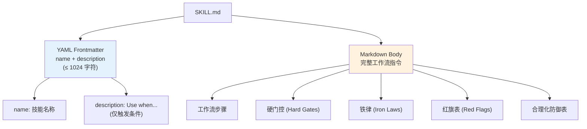
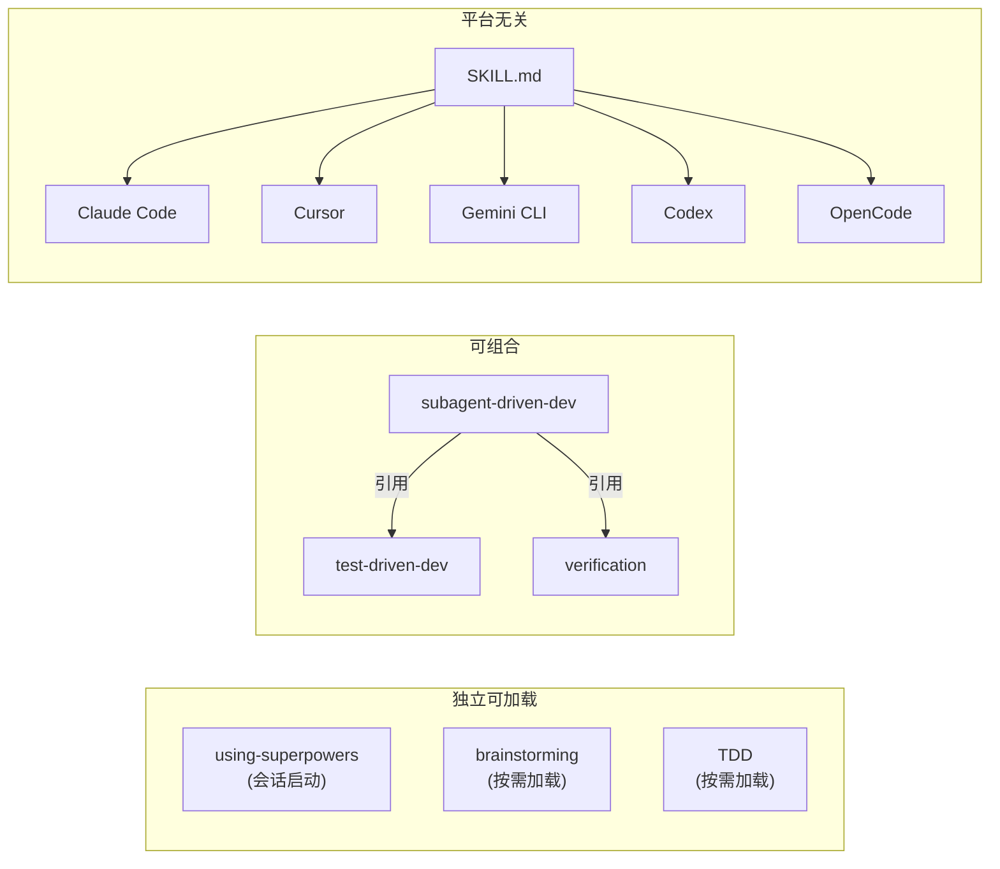
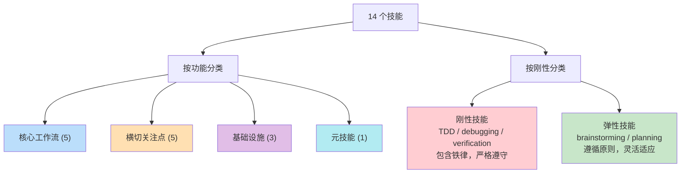
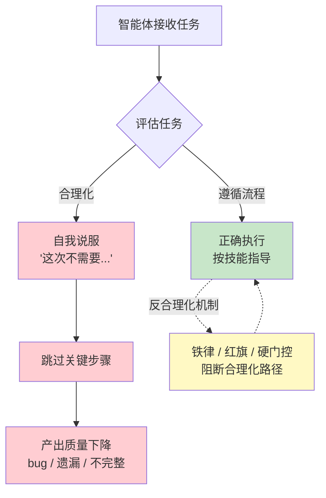
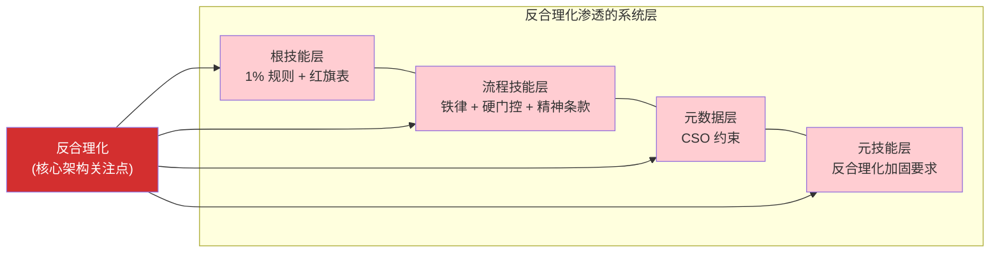

# Phase 3: 技能系统与反合理化 — Executable Plan

**Goal:** 完成技能系统详解和反合理化设计模式两个特色章节
**Deliverables:** `docs/zh/04-skills-system.md`, `docs/zh/05-anti-rationalization.md`
**Requirements:** FR-5 (5.1–5.5), FR-6 (6.1–6.5), NFR-1, NFR-2, NFR-3, NFR-4

---

## Task 1: Write `docs/zh/04-skills-system.md` — 技能系统详解

**File:** `docs/zh/04-skills-system.md`
**Requirements:** FR-5.1, FR-5.2, FR-5.3, FR-5.4, FR-5.5

### What to write

Write a comprehensive Chinese technical document covering the Superpowers skill system in full detail. Follow this exact structure:

---

#### Header

```markdown
# 技能系统详解

> 技能（Skill）是 Superpowers 的原子单元——一个自包含的 Markdown 文档，
> 既是人类可读的规范，也是 AI 智能体直接执行的指令。
```

---

#### Section 1: 技能定义与解剖（FR-5.1）

Write 2–3 paragraphs covering:

1. **What is a skill:** 每个技能是一个自包含文档（Self-Contained Document），由 YAML frontmatter 和 Markdown body 两部分组成。技能文件存放在 `skills/<skill-name>/SKILL.md` 路径下。

2. **YAML frontmatter 结构:** Frontmatter 只支持两个字段：
   - `name` — 技能名称
   - `description` — 以 "Use when..." 开头的触发条件描述
   - 总长度限制：1024 字符
   - **关键约束：** `description` 只描述触发条件（Triggering Conditions），绝不总结工作流内容。这一点至关重要，原因将在第 05 章（反合理化设计模式）的 CSO 部分详述。

3. **Markdown body 结构:** Body 包含完整的工作流指令——步骤、检查清单、硬门控（Hard Gates）、铁律（Iron Laws）、红旗表（Red Flags）等。这是智能体实际遵循的内容。

**Include a code block** showing a real skill anatomy:

```markdown
---
name: verification-before-completion
description: >-
  Use when completing any task, finishing implementation,
  or before claiming something works or is done.
---

# Verification Before Completion

## Iron Law

\`\`\`
NO COMPLETION CLAIMS WITHOUT FRESH VERIFICATION EVIDENCE
\`\`\`

## Workflow
1. Run all relevant tests
2. Show actual output
3. ...

## Red Flags
- "Should work now" — STOP. Run the verification.
- ...
```

**Include a Mermaid diagram** showing skill anatomy:



---

#### Section 2: 三大特性（FR-5.2）

Write a subsection for each property, each with 2–3 sentences of explanation and a concrete example:

**2.1 独立可加载（Independently Loadable）**

- 每个技能是独立的文档单元，可以按需单独加载到智能体上下文中
- 技能不是在会话开始时全部预加载的——根技能 `using-superpowers` 告诉智能体有哪些可用技能，实际加载在用户请求匹配时按需进行
- 这意味着上下文窗口（Context Window）中只包含当前任务真正需要的技能，避免浪费有限的上下文空间

**2.2 可组合（Composable）**

- 技能之间通过 `superpowers:<name>` 格式相互引用，形成组合关系
- 例如：`subagent-driven-development` 引用 `superpowers:test-driven-development`，要求每个子任务遵循 TDD 流程
- 组合是声明式的——技能 A 声明需要技能 B，智能体负责在合适时机加载技能 B

**2.3 平台无关（Platform-Agnostic）**

- 技能文档使用 Claude Code 的工具名称（Tool Names）编写，其他平台通过映射引用（Mapping References）适配
- 同一个 `SKILL.md` 文件被 Claude Code、Cursor、Gemini CLI、Codex、OpenCode 五个平台共用
- 平台差异由平台适配层（Platform Integration Layer）处理，技能层完全无感知

**Include a Mermaid diagram** showing the three properties:



---

#### Section 3: 触发机制（FR-5.3）

Write 3–4 paragraphs covering the complete trigger mechanism:

**3.1 1% 可能性规则（1% Possibility Rule）**

- 核心规则："如果你认为某个技能哪怕有 1% 的可能性适用，你就**必须**加载该技能"
- 这是一个极低的触发阈值——宁可多加载一个不需要的技能，也不能漏掉一个需要的技能
- 这个规则定义在 `using-superpowers` 根技能中，是整个技能系统的基础约束

**3.2 红旗表（Red Flags Table）**

Present the red flags table from `using-superpowers` skill. Show at least 6 representative entries in a table format:

| 你的想法 | 正确反应 |
|---------|---------|
| "这只是一个简单问题" | "问题也是任务。检查是否有适用技能。" |
| "我需要先了解更多上下文" | "技能检查在澄清问题之前。" |
| "这个技能用在这里太重了" | "简单的事情会变复杂。用它。" |
| "我已经知道该怎么做了" | "知道怎么做 ≠ 不需要流程。" |
| "就这一次跳过吧" | "这正是合理化的表现。" |
| "用户没有要求用这个技能" | "用户不需要明确要求。1% 规则。" |

**3.3 优先级顺序（Priority Order）**

- 技能触发有明确的优先级：先检查流程技能（Process Skills），再检查实现技能（Implementation Skills）
- 流程技能（如 brainstorming、writing-plans）定义"做什么"和"按什么顺序做"
- 实现技能（如 TDD、debugging）定义"怎么做"
- 这确保智能体先确定工作流程，再进入具体实现

---

#### Section 4: 分类体系（FR-5.4）

Write subsections for both classification dimensions:

**4.1 按功能分类**

Present four categories with brief descriptions:

| 分类 | 技能 | 职责 |
|------|-----|------|
| 核心工作流（Core Workflow） | brainstorming, writing-plans, subagent-driven-development, executing-plans, finishing-a-development-branch | 定义开发流水线的各个阶段 |
| 横切关注点（Cross-Cutting） | test-driven-development, systematic-debugging, verification-before-completion, requesting-code-review, receiving-code-review | 贯穿多个阶段的质量保障技能 |
| 基础设施（Infrastructure） | using-superpowers, using-git-worktrees, dispatching-parallel-agents | 提供系统级支撑能力 |
| 元技能（Meta） | writing-skills | 用于创建新技能的技能 |

**4.2 按刚性分类**

Present with explanations:

**刚性技能（Rigid Skills）** — 必须严格遵守，包含铁律和硬门控：
- test-driven-development — 铁律：先测试后实现，无例外
- systematic-debugging — 铁律：先找根因后修复，无例外
- verification-before-completion — 铁律：先验证后声称完成，无例外

**弹性技能（Flexible Skills）** — 遵循原则但允许适应具体情况：
- brainstorming — 对话方式可灵活调整
- writing-plans — 任务粒度可根据复杂度调整

**Include a Mermaid diagram** showing the classification:



---

#### Section 5: 完整技能目录（FR-5.5）

List all 14 skills in a comprehensive table. For each skill, provide: name, Chinese name, category, rigidity, one-sentence description.

| # | 技能名称 | 中文名 | 功能分类 | 刚性 | 说明 |
|---|---------|-------|---------|------|------|
| 1 | using-superpowers | 根技能 | 基础设施 | — | 根技能，会话启动时自动加载。定义技能系统规则、1% 触发规则、红旗表 |
| 2 | brainstorming | 头脑风暴 | 核心工作流 | 弹性 | 苏格拉底式设计对话。硬门控：设计未批准前不得进入实现 |
| 3 | writing-plans | 编写计划 | 核心工作流 | 弹性 | 将设计拆解为 2–5 分钟的细粒度任务。plan-document-reviewer 验证 |
| 4 | subagent-driven-development | 子智能体驱动开发 | 核心工作流 | 弹性 | 主执行引擎。每任务独立子智能体 + 两阶段审查（spec-review + quality-review） |
| 5 | executing-plans | 直接执行计划 | 核心工作流 | 弹性 | 不使用子智能体的替代执行方式 |
| 6 | test-driven-development | 测试驱动开发 | 横切关注点 | 刚性 | 铁律：`NO PRODUCTION CODE WITHOUT A FAILING TEST FIRST`。红-绿-重构循环 |
| 7 | systematic-debugging | 系统化调试 | 横切关注点 | 刚性 | 铁律：`NO FIXES WITHOUT ROOT CAUSE INVESTIGATION FIRST`。四阶段根因分析。精神条款 |
| 8 | verification-before-completion | 完成前验证 | 横切关注点 | 刚性 | 铁律：`NO COMPLETION CLAIMS WITHOUT FRESH VERIFICATION EVIDENCE`。合理化防御表。红旗清单 |
| 9 | requesting-code-review | 请求代码审查 | 横切关注点 | 弹性 | 审查前准备——提供完整上下文和变更摘要 |
| 10 | receiving-code-review | 接收代码审查 | 横切关注点 | 弹性 | 严格处理审查反馈——逐条回应，不忽略 |
| 11 | using-git-worktrees | Git 工作树 | 基础设施 | 弹性 | 创建隔离的工作空间，确保开发在独立分支进行 |
| 12 | finishing-a-development-branch | 完成开发分支 | 核心工作流 | 弹性 | 分支收尾决策：merge / PR / keep / discard |
| 13 | dispatching-parallel-agents | 派遣并行智能体 | 基础设施 | 弹性 | 并发子智能体派遣，用于多任务并行执行 |
| 14 | writing-skills | 编写技能 | 元技能 | 弹性 | 元技能——使用 TDD 方法论创建新技能。包含 CSO、反合理化加固、压力测试 |

---

#### Section 6: 下一步

A brief 2–3 sentence paragraph pointing the reader to the next chapter (05 — 反合理化设计模式) to understand Superpowers 最独特的创新——如何防止 AI 智能体自我合理化跳过关键步骤。

---

#### Footer navigation

```markdown
---

[⬅️ 上一篇：核心工作流](./03-workflow.md) | [返回目录](./README.md) | [下一篇：反合理化设计模式 ➡️](./05-anti-rationalization.md)
```

---

### Key writing guidelines

1. **Tone:** Technical reference with explanatory depth. This is the skill system deep-dive — be precise and complete.
2. **Terms:** Every technical term gets English in parentheses ON FIRST USE ONLY. Key terms for this doc: 自包含文档（Self-Contained Document）, 触发条件（Triggering Conditions）, 上下文窗口（Context Window）, 可组合（Composable）, 硬门控（Hard Gates）, 铁律（Iron Laws）, 红旗表（Red Flags）.
3. **No translation-ese:** Write naturally as Chinese technical documentation. Avoid stiff phrasing.
4. **Mermaid diagrams:** Must use the exact ` ```mermaid ` code fence syntax. This document requires at least 2 diagrams (skill anatomy, classification system). The three-properties diagram and others are encouraged.
5. **Tables:** Use tables generously — the skill catalog, red flags table, and classification tables should all be Markdown tables.
6. **Code examples:** Show actual skill file structure with realistic content based on real skills.
7. **Length target:** ~1500–2200 Chinese characters + English terms. Comprehensive skill system coverage.
8. **Accuracy:** All skill names, descriptions, Iron Laws, and classifications must match the project context provided. Do not invent.

### Acceptance criteria

- [ ] File exists at `docs/zh/04-skills-system.md`
- [ ] Section 1 explains skill definition: YAML frontmatter (name + description only, ≤1024 chars) + Markdown body (FR-5.1)
- [ ] Section 1 includes code block showing real skill anatomy with frontmatter and body
- [ ] Section 2 covers all three properties: independently loadable, composable, platform-agnostic (FR-5.2)
- [ ] Section 3 explains 1% possibility rule, red flags table (≥6 entries), and priority order (FR-5.3)
- [ ] Section 4 presents both classification dimensions: by function (4 categories) and by rigidity (rigid vs flexible) (FR-5.4)
- [ ] Section 5 lists all 14 skills with name, category, rigidity, and description (FR-5.5)
- [ ] Contains at least 2 Mermaid diagrams (NFR-2)
- [ ] All technical terms have English annotations on first use (NFR-1)
- [ ] Footer has navigation links: prev (03-workflow) + index (README) + next (05-anti-rationalization)
- [ ] All 3 Iron Laws are quoted accurately
- [ ] The description constraint (triggering conditions only, never workflow summary) is clearly explained
- [ ] Written in natural Chinese (NFR-1), technically accurate (NFR-3)

### Verification

```bash
# File exists
test -f docs/zh/04-skills-system.md && echo "PASS" || echo "FAIL"

# Contains all required sections
for section in "技能定义" "独立可加载" "可组合" "平台无关" "触发机制" "1%" "红旗" "分类" "技能目录"; do
  grep -q "$section" docs/zh/04-skills-system.md && echo "PASS: $section" || echo "FAIL: $section missing"
done

# Contains all 14 skill names
for skill in "using-superpowers" "brainstorming" "writing-plans" "subagent-driven-development" "executing-plans" "test-driven-development" "systematic-debugging" "verification-before-completion" "requesting-code-review" "receiving-code-review" "using-git-worktrees" "finishing-a-development-branch" "dispatching-parallel-agents" "writing-skills"; do
  grep -q "$skill" docs/zh/04-skills-system.md && echo "PASS: skill $skill" || echo "FAIL: skill $skill missing"
done

# Contains Iron Laws
grep -q "NO PRODUCTION CODE WITHOUT A FAILING TEST FIRST" docs/zh/04-skills-system.md && echo "PASS: TDD iron law" || echo "FAIL: TDD iron law missing"
grep -q "NO FIXES WITHOUT ROOT CAUSE INVESTIGATION FIRST" docs/zh/04-skills-system.md && echo "PASS: debugging iron law" || echo "FAIL: debugging iron law missing"
grep -q "NO COMPLETION CLAIMS WITHOUT FRESH VERIFICATION EVIDENCE" docs/zh/04-skills-system.md && echo "PASS: verification iron law" || echo "FAIL: verification iron law missing"

# Contains Mermaid diagrams (at least 2)
MERMAID_COUNT=$(grep -c '```mermaid' docs/zh/04-skills-system.md)
test "$MERMAID_COUNT" -ge 2 && echo "PASS: $MERMAID_COUNT mermaid diagrams" || echo "FAIL: only $MERMAID_COUNT mermaid diagrams (need >= 2)"

# Contains navigation footer
grep -q "03-workflow.md" docs/zh/04-skills-system.md && echo "PASS: prev link" || echo "FAIL: prev link missing"
grep -q "05-anti-rationalization.md" docs/zh/04-skills-system.md && echo "PASS: next link" || echo "FAIL: next link missing"
grep -q "README.md" docs/zh/04-skills-system.md && echo "PASS: index link" || echo "FAIL: index link missing"

# Contains classification categories
for cat in "核心工作流" "横切关注点" "基础设施" "元技能"; do
  grep -q "$cat" docs/zh/04-skills-system.md && echo "PASS: category $cat" || echo "FAIL: category $cat missing"
done

# Contains rigidity classification
grep -q "刚性" docs/zh/04-skills-system.md && echo "PASS: rigid classification" || echo "FAIL: rigid classification missing"
grep -q "弹性" docs/zh/04-skills-system.md && echo "PASS: flexible classification" || echo "FAIL: flexible classification missing"

# Description constraint explained
grep -q "触发条件" docs/zh/04-skills-system.md && echo "PASS: triggering conditions" || echo "FAIL: triggering conditions missing"

# Bilingual term annotations present
grep -q "Self-Contained Document\|Triggering Conditions\|Context Window\|Composable\|Hard Gates\|Iron Laws" docs/zh/04-skills-system.md && echo "PASS: bilingual terms" || echo "FAIL: bilingual terms missing"
```

---

## Task 2: Write `docs/zh/05-anti-rationalization.md` — 反合理化设计模式

**File:** `docs/zh/05-anti-rationalization.md`
**Requirements:** FR-6.1, FR-6.2, FR-6.3, FR-6.4, FR-6.5

### What to write

Write a comprehensive Chinese technical document covering Superpowers' anti-rationalization design patterns — the project's most distinctive architectural innovation. Follow this exact structure:

---

#### Header

```markdown
# 反合理化设计模式

> AI 智能体最危险的行为不是犯错——而是为跳过正确步骤找到一个听起来合理的理由。
> Superpowers 的反合理化系统正是为了对抗这种倾向而设计的。
```

---

#### Section 1: 为什么需要反合理化（FR-6.1）

Write 3–4 paragraphs covering:

1. **The core problem:** AI 智能体（特别是大语言模型驱动的智能体）有一种固有倾向：为跳过步骤找到合理化理由（Rationalization）。这不是偶发的 bug，而是模型的系统性行为特征。

2. **Concrete manifestations:** 给出具体表现——
   - 智能体会想"这个改动太简单了，不需要写测试"（跳过 TDD）
   - 智能体会想"错误很明显，直接修就好"（跳过调试流程）
   - 智能体会想"我刚才检查过了，没问题"（跳过验证）
   - 智能体会想"这个需求太简单了，不需要头脑风暴"（跳过设计）

3. **Why traditional approaches fail:** 简单的"请遵守规则"指令不足以对抗合理化。原因：合理化发生在"遵守规则"的判断过程中——智能体不是不遵守规则，而是说服自己当前情况是规则的合理例外。

4. **Superpowers' approach:** 反合理化不是事后补丁，而是核心架构关注点（Core Architectural Concern）。Superpowers 预见了每一种常见的合理化模式，并为每种模式预置了反驳。

**Include a Mermaid diagram** showing the rationalization cycle:



---

#### Section 2: 五种反合理化手段（FR-6.2, FR-6.3）

This is the core section. For each mechanism, write a subsection with:
- **定义** — what the mechanism is
- **工作原理** — how it works
- **真实示例** — real examples extracted from actual skills (use exact quotes where possible)

---

**2.1 铁律（Iron Laws）**

- **定义：** 用代码块格式（Code Block）声明的不可违反的绝对规则。铁律没有例外、没有灰色地带。

- **工作原理：** 铁律用全大写英文书写在代码块中，视觉上极为醒目。它们故意使用绝对化措辞——"NO...WITHOUT..."——不给智能体任何解释空间。

- **真实示例（提取自实际技能）：**

  **test-driven-development 技能：**
  ```
  NO PRODUCTION CODE WITHOUT A FAILING TEST FIRST
  ```
  含义：在有一个失败的测试之前，绝不编写任何产品代码。如果发现先写了代码再补测试——删除代码，重新开始。

  **systematic-debugging 技能：**
  ```
  NO FIXES WITHOUT ROOT CAUSE INVESTIGATION FIRST
  ```
  含义：在完成根因调查之前，绝不尝试任何修复。即使"修复看起来很明显"。

  **verification-before-completion 技能：**
  ```
  NO COMPLETION CLAIMS WITHOUT FRESH VERIFICATION EVIDENCE
  ```
  含义：在有新鲜的验证证据之前，绝不声称任务完成。"刚才运行过"不算——必须现在运行并展示输出。

---

**2.2 红旗表（Red Flags Tables）**

- **定义：** 列出智能体内部可能产生的具体想法（Specific Thoughts），并将其标记为偏离信号。当智能体"想到"这些内容时，应当立即警觉。

- **工作原理：** 红旗表直接列出合理化的具体措辞，让智能体能够"识别自己的合理化思维"。这是一种元认知（Meta-Cognition）技术——教智能体监控自己的思维过程。

- **真实示例：**

  **using-superpowers 技能（12 条红旗，列举代表性条目）：**

  | 如果你在想... | 那么你应该... |
  |-------------|-------------|
  | "这只是一个简单问题" | "问题也是任务。检查是否有适用技能。" |
  | "这个技能用在这里太重了" | "简单的事情会变复杂。用它。" |
  | "就这一次跳过吧" | "这正是合理化的表现。" |

  **verification-before-completion 技能：**
  - 使用 "should"、"probably"、"seems to" 等模糊词汇 → 红旗：缺乏确定性，需要实际验证

  **test-driven-development 技能：**
  - "就这一次跳过 TDD？停下。这就是合理化。"

---

**2.3 合理化防御表（Rationalization Prevention Tables）**

- **定义：** 预先列出智能体可能使用的借口（Excuses），并为每个借口提供预设的反驳（Rebuttals）。

- **工作原理：** 不同于红旗表（标识想法），合理化防御表直接拆解借口的逻辑。格式为"借口 → 现实"配对。

- **真实示例（提取自 verification-before-completion 技能）：**

  | 借口 | 现实 |
  |------|------|
  | "应该能用了" | "运行验证。" |
  | "我刚才改的内容很小" | "小改动也会造成大故障。验证它。" |
  | "我检查过代码了" | "检查代码 ≠ 运行代码。执行验证。" |
  | "测试之前是通过的" | "之前 ≠ 现在。重新运行。" |

  TDD 技能中也有隐式的合理化防御："无例外"块（No Exceptions blocks）预先否定了所有"但是这种情况不一样"的借口。

---

**2.4 硬门控（Hard Gates）**

- **定义：** 用显式的 `<HARD-GATE>` 标记声明的阻断点。在满足特定前置条件之前，智能体不得继续进行下一步。

- **工作原理：** 硬门控在工作流中设置不可跳过的检查点。它不是"建议"——是"阻断"。

- **真实示例：**

  **brainstorming 技能：**
  > "在你向用户展示设计方案并获得用户明确批准之前，**不要**调用任何实现技能（implementation skill）。"
  >
  > 反模式："太简单了，不需要设计"——这正是需要设计的信号。

  **systematic-debugging 技能：**
  > 阶段门控——必须完成第 1 阶段（观察和假设）之后，才能进入第 2 阶段（提出修复方案）。

---

**2.5 精神条款（Spirit-over-Letter Clauses）**

- **定义：** 明确声明"违反规则的字面含义就是违反规则的精神"。预防智能体通过技术性合规（Technical Compliance）来规避规则本意。

- **工作原理：** AI 智能体有时会找到符合规则字面意思但违反规则意图的做法。精神条款直接封堵这条路。

- **真实示例：**

  **test-driven-development 技能：**
  > "违反规则的字面含义就是违反规则的精神。"（Violating the letter of the rules is violating the spirit of the rules.）

  **systematic-debugging 技能：**
  > "违反此流程的字面含义就是违反调试的精神。"（Violating the letter of this process is violating the spirit of debugging.）

  **verification-before-completion 技能：**
  > 在合理化防御表中包含"精神高于字面"（Spirit over letter）条目。

**Include a Mermaid diagram** showing how the five mechanisms layer together:


---

#### Section 3: CSO——Claude 搜索优化（FR-6.4）

Write 3–4 paragraphs covering the CSO discovery:

1. **What is CSO:** CSO（Claude Search Optimization，Claude 搜索优化）是一个来自实践的发现——技能的 `description` 字段不能总结工作流，只能描述触发条件。

2. **The discovery story:** 在测试中发现，当 `description` 总结了工作流（例如"为每个任务派遣子智能体，任务间进行代码审查"），智能体会走捷径——直接按照 `description` 中的摘要执行，而不读取完整的技能 body。这导致关键细节（如两阶段审查流程）被跳过。

3. **The fix:** 将 description 从工作流摘要改为纯触发条件。例如从 "dispatches subagent per task with code review between tasks" 改为 "Use when executing implementation plans with independent tasks"。修改后，智能体正确地读取了完整技能内容，包括两阶段审查流程。

4. **The architectural lesson:** 这说明反合理化需要在每个层面都保持警惕。即使是看似无害的元数据字段（description），如果设计不当，也会成为智能体跳过步骤的捷径。CSO 不是一个优化技巧——它是反合理化思维在元数据层面的体现。

---

#### Section 4: 独特性分析——核心架构关注点（FR-6.5）

Write 3–4 paragraphs making the case that anti-rationalization is THE defining innovation:

1. **Not incidental:** 反合理化不是 Superpowers 的附加功能，而是它的核心架构关注点（Core Architectural Concern）。在大多数 AI 工作流系统中，"遵守规则"被视为理所当然。Superpowers 的独特之处在于：它认为"不遵守规则"才是默认状态——必须主动对抗。

2. **Pervasiveness:** 反合理化机制渗透到系统的每一层：
   - 根技能层：1% 规则 + 12 条红旗（using-superpowers）
   - 流程技能层：铁律 + 硬门控（TDD、debugging、verification）
   - 元数据层：CSO 约束（description 字段设计）
   - 元技能层：writing-skills 要求新技能也包含反合理化加固

3. **Comparison with alternatives:** 大多数 AI 提示工程（Prompt Engineering）方案依赖"请你仔细遵守以下规则"。这相当于把门锁上但把钥匙放在门垫下面——对一个会自我合理化的智能体来说毫无意义。Superpowers 不是锁门——而是预测智能体会从哪些窗户翻进来，然后提前把窗户也封上。

4. **The meta-skill connection:** `writing-skills` 元技能要求新创建的技能也必须经过反合理化加固（Anti-Rationalization Hardening）和压力测试（Pressure Testing）。这意味着反合理化是自我传播的——系统要求每个新增的部分都遵循同样的防御标准。

**Include a Mermaid diagram** showing the pervasiveness across layers:



---

#### Section 5: 下一步

A brief 2–3 sentence paragraph pointing the reader to the next chapter (06 — 子智能体编排) to see how these anti-rationalization patterns play out in the most complex execution model — subagent-driven development.

---

#### Footer navigation

```markdown
---

[⬅️ 上一篇：技能系统详解](./04-skills-system.md) | [返回目录](./README.md) | [下一篇：子智能体编排 ➡️](./06-subagent-orchestration.md)
```

---

### Key writing guidelines

1. **Tone:** Analytical and insightful. This document explains a design philosophy — the reader should understand not just "what" but "why" and "why it's unique."
2. **Terms:** Every technical term gets English in parentheses ON FIRST USE ONLY. Key terms for this doc: 合理化（Rationalization）, 核心架构关注点（Core Architectural Concern）, 铁律（Iron Laws）, 红旗表（Red Flags）, 合理化防御表（Rationalization Prevention Tables）, 硬门控（Hard Gates）, 精神条款（Spirit-over-Letter Clauses）, 元认知（Meta-Cognition）.
3. **No translation-ese:** Write naturally. Use strong, confident language — this is about a fundamental design decision, not a mild suggestion.
4. **Mermaid diagrams:** At least 2 required — the rationalization cycle and the five-mechanism layers. The pervasiveness diagram is strongly encouraged.
5. **Real examples:** Every mechanism MUST include real quotes or close paraphrases from actual skills. Do not use generic placeholder examples. The verification script checks for actual Iron Law text.
6. **Tables:** Use tables for red flags and rationalization prevention pairs — they are most readable in table format.
7. **Length target:** ~1500–2200 Chinese characters + English terms. This is a deep analytical chapter.
8. **Accuracy:** All Iron Laws, red flags, rationalization pairs, and CSO details must match the project context provided exactly. Do not invent.

### Acceptance criteria

- [ ] File exists at `docs/zh/05-anti-rationalization.md`
- [ ] Section 1 explains why anti-rationalization is needed — AI tendency to rationalize skipping steps (FR-6.1)
- [ ] Section 1 gives at least 4 concrete manifestations of rationalization
- [ ] Section 2 covers all 5 mechanisms: Iron Laws, Red Flags, Rationalization Prevention Tables, Hard Gates, Spirit-over-Letter Clauses (FR-6.2)
- [ ] Each mechanism has definition, how it works, and REAL examples from actual skills (FR-6.3)
- [ ] All 3 Iron Laws are quoted exactly (FR-6.3)
- [ ] Red Flags table includes ≥3 entries from using-superpowers skill (FR-6.3)
- [ ] Rationalization Prevention table includes ≥4 excuse/reality pairs from verification skill (FR-6.3)
- [ ] Section 3 explains CSO with the actual discovery story — description shortcut problem and the fix (FR-6.4)
- [ ] Section 4 argues anti-rationalization is core architectural concern, not incidental (FR-6.5)
- [ ] Section 4 shows pervasiveness across system layers (FR-6.5)
- [ ] Contains at least 2 Mermaid diagrams (NFR-2)
- [ ] All technical terms have English annotations on first use (NFR-1)
- [ ] Footer has navigation links: prev (04-skills-system) + index (README) + next (06-subagent-orchestration)
- [ ] Written in natural Chinese (NFR-1), technically accurate (NFR-3)

### Verification

```bash
# File exists
test -f docs/zh/05-anti-rationalization.md && echo "PASS" || echo "FAIL"

# Contains all required sections
for section in "为什么需要反合理化" "铁律" "红旗" "合理化防御" "硬门控" "精神条款" "CSO" "独特性" "核心架构"; do
  grep -q "$section" docs/zh/05-anti-rationalization.md && echo "PASS: $section" || echo "FAIL: $section missing"
done

# Contains all 3 Iron Laws exactly
grep -q "NO PRODUCTION CODE WITHOUT A FAILING TEST FIRST" docs/zh/05-anti-rationalization.md && echo "PASS: TDD iron law" || echo "FAIL: TDD iron law missing"
grep -q "NO FIXES WITHOUT ROOT CAUSE INVESTIGATION FIRST" docs/zh/05-anti-rationalization.md && echo "PASS: debugging iron law" || echo "FAIL: debugging iron law missing"
grep -q "NO COMPLETION CLAIMS WITHOUT FRESH VERIFICATION EVIDENCE" docs/zh/05-anti-rationalization.md && echo "PASS: verification iron law" || echo "FAIL: verification iron law missing"

# Contains red flags table entries
grep -q "简单问题" docs/zh/05-anti-rationalization.md && echo "PASS: red flag entry" || echo "FAIL: red flag entry missing"

# Contains rationalization prevention table entries
grep -q "应该能用" docs/zh/05-anti-rationalization.md && echo "PASS: rationalization table entry" || echo "FAIL: rationalization table entry missing"

# Contains CSO content
grep -q "CSO\|Claude Search Optimization\|Claude 搜索优化" docs/zh/05-anti-rationalization.md && echo "PASS: CSO" || echo "FAIL: CSO missing"
grep -q "Use when" docs/zh/05-anti-rationalization.md && echo "PASS: CSO trigger example" || echo "FAIL: CSO trigger example missing"

# Contains Hard Gate example
grep -q "brainstorming\|HARD-GATE\|硬门控" docs/zh/05-anti-rationalization.md && echo "PASS: hard gate example" || echo "FAIL: hard gate example missing"

# Contains Spirit-over-Letter
grep -q "spirit\|Spirit\|精神.*字面\|字面.*精神" docs/zh/05-anti-rationalization.md && echo "PASS: spirit clause" || echo "FAIL: spirit clause missing"

# Contains Mermaid diagrams (at least 2)
MERMAID_COUNT=$(grep -c '```mermaid' docs/zh/05-anti-rationalization.md)
test "$MERMAID_COUNT" -ge 2 && echo "PASS: $MERMAID_COUNT mermaid diagrams" || echo "FAIL: only $MERMAID_COUNT mermaid diagrams (need >= 2)"

# Contains navigation footer
grep -q "04-skills-system.md" docs/zh/05-anti-rationalization.md && echo "PASS: prev link" || echo "FAIL: prev link missing"
grep -q "06-subagent-orchestration.md" docs/zh/05-anti-rationalization.md && echo "PASS: next link" || echo "FAIL: next link missing"
grep -q "README.md" docs/zh/05-anti-rationalization.md && echo "PASS: index link" || echo "FAIL: index link missing"

# Five mechanisms all present
for mech in "铁律" "红旗表" "合理化防御表" "硬门控" "精神条款"; do
  grep -q "$mech" docs/zh/05-anti-rationalization.md && echo "PASS: mechanism $mech" || echo "FAIL: mechanism $mech missing"
done

# Bilingual term annotations present
grep -q "Rationalization\|Core Architectural Concern\|Iron Laws\|Meta-Cognition\|Spirit-over-Letter" docs/zh/05-anti-rationalization.md && echo "PASS: bilingual terms" || echo "FAIL: bilingual terms missing"

# Uniqueness analysis present
grep -q "不是偶" docs/zh/05-anti-rationalization.md || grep -q "核心架构关注点" docs/zh/05-anti-rationalization.md && echo "PASS: uniqueness analysis" || echo "FAIL: uniqueness analysis missing"
```

---

## Execution Order

```
Task 1 (04-skills-system.md)  ←→  Task 2 (05-anti-rationalization.md)   [parallel, no dependency]
```

Tasks 1 and 2 are fully independent and can be executed in parallel. Task 1 references Task 2 only via a forward pointer ("详见第 05 章"), and Task 2 does not depend on Task 1's content.

---

## Phase 3 Completion Checklist

- [ ] `docs/zh/04-skills-system.md` — complete skill system doc covering FR-5.1 through FR-5.5
- [ ] `docs/zh/05-anti-rationalization.md` — complete anti-rationalization doc covering FR-6.1 through FR-6.5
- [ ] At least 2 Mermaid diagrams in skills system doc
- [ ] At least 2 Mermaid diagrams in anti-rationalization doc
- [ ] All 14 skills listed with category, rigidity, and description
- [ ] All 5 anti-rationalization mechanisms covered with real examples
- [ ] All 3 Iron Laws quoted exactly
- [ ] CSO explained with actual discovery story
- [ ] Anti-rationalization analyzed as core architectural concern (not incidental)
- [ ] All technical terms have bilingual annotations on first use
- [ ] Navigation links correct (03 ← 04 → 05, 04 ← 05 → 06)
- [ ] Natural Chinese writing quality, no translation-ese
- [ ] All verification scripts pass
