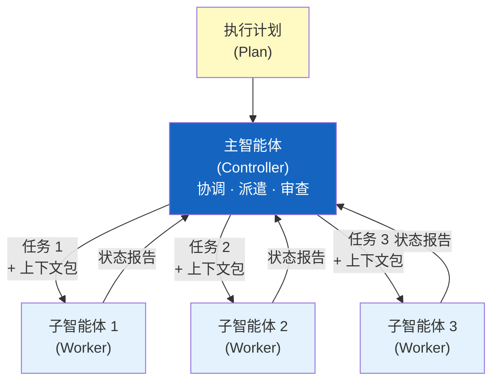
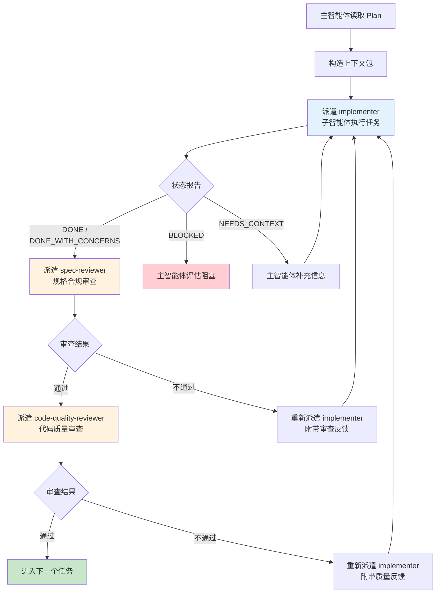
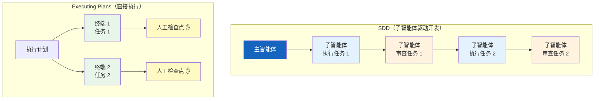
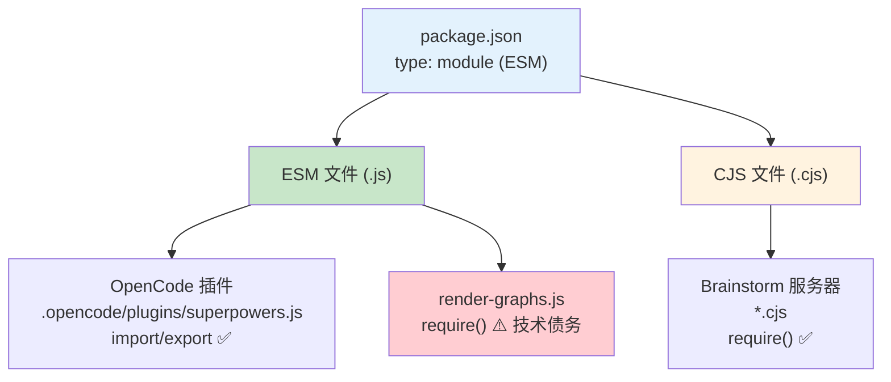
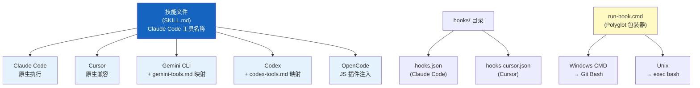

# Phase 4: 子智能体与平台适配 — Executable Plan

**Goal:** 完成子智能体编排和平台适配层两个实现细节章节
**Deliverables:** `docs/zh/06-subagent-orchestration.md`, `docs/zh/07-platform-adapters.md`
**Requirements:** FR-7 (7.1–7.6), FR-8 (8.1–8.5)

---

## Task 1: Write `docs/zh/06-subagent-orchestration.md` — 子智能体编排

**File:** `docs/zh/06-subagent-orchestration.md`
**Requirements:** FR-7.1, FR-7.2, FR-7.3, FR-7.4, FR-7.5, FR-7.6

### What to write

Write a comprehensive Chinese technical document covering the Superpowers subagent orchestration system. Follow this exact structure:

---

#### Header

```markdown
# 子智能体编排

> 子智能体驱动开发（Subagent-Driven Development, SDD）是 Superpowers 的主执行引擎——
> 主智能体负责协调，子智能体负责执行，每个子智能体拥有独立的、精心构造的上下文。
```

---

#### Section 1: Controller-Worker 模式（FR-7.1）

Write 3–4 paragraphs covering:

1. **Pattern definition:** Controller-Worker 模式是 SDD 的核心架构。主智能体（Controller）充当项目经理角色——它不直接编写代码，而是协调多个子智能体（Worker）来完成具体任务。每个子智能体是一个独立的执行单元，只负责一个明确的任务。

2. **Why not single-agent:** 单个智能体处理复杂项目时，上下文窗口会逐渐被历史信息填满，导致注意力分散、指令遵从度下降。Controller-Worker 模式通过任务隔离（Task Isolation）解决这个问题。

3. **Controller responsibilities:** 主智能体负责：读取执行计划（Plan）、为每个任务构造完整的上下文包、派遣子智能体、收集结果、处理审查反馈、决定是否需要重做。

4. **Worker responsibilities:** 子智能体负责：接收上下文包、执行单个任务（通常结合 TDD 流程）、报告状态（使用标准状态协议）。子智能体不知道也不关心其他任务的存在。

**Include a Mermaid diagram** showing the Controller-Worker pattern:



---

#### Section 2: "新鲜上下文"原则（FR-7.2）

Write 2–3 paragraphs covering:

1. **Core principle:** "新鲜上下文"原则（Fresh Context Principle）是 SDD 最重要的设计决策——每个子智能体**绝不继承**主智能体的会话历史。子智能体的上下文由主智能体精心构造，只包含该任务真正需要的信息。

2. **What goes into the context package:** 主智能体为每个子智能体构造的上下文包（Context Package）包含：
   - 当前任务的具体规格（从 Plan 中提取）
   - 相关的代码文件内容（主智能体预先读取并传入）
   - 适用的技能引用（如 TDD 技能）
   - 项目级约束和约定

3. **Why this matters:** 不继承历史意味着每个子智能体都以最大的注意力和指令遵从度开始工作。它不会受到前面任务的干扰、不会因为上下文过长而"遗忘"关键指令。这也是为什么 SDD 在大型任务上比单智能体执行更可靠。

---

#### Section 3: 两阶段审查（FR-7.3）

Write 3–4 paragraphs covering the two-stage review system:

1. **Overview:** 每个子智能体完成任务后，不是直接进入下一个任务——而是经过两阶段审查（Two-Stage Review）。这是 SDD 质量保证的核心机制。

2. **Stage 1 — 规格合规审查（Spec Review）：** 第一个审查子智能体（spec-reviewer）检查：实现是否匹配任务规格？是否遗漏了 Plan 中定义的要求？是否引入了 Plan 未要求的内容？这个阶段关注"做对了没有"。

3. **Stage 2 — 代码质量审查（Code Quality Review）：** 第二个审查子智能体（code-quality-reviewer）检查：代码质量如何？是否有重复、命名不当、潜在 bug？测试覆盖是否充分？这个阶段关注"做好了没有"。

4. **Why two stages:** 两个关注点故意分开——规格合规和代码质量是不同维度的评估。合并为一个审查会导致两方面都被稀释。每个审查者有自己的专用 Prompt 模板，确保审查聚焦。

**Include a Mermaid diagram** showing the full task lifecycle with two-stage review:



---

#### Section 4: Prompt 模板系统（FR-7.4）

Write 2–3 paragraphs covering the three prompt templates:

1. **Template overview:** SDD 使用三个专用的 Prompt 模板（Prompt Templates），存放在 `skills/subagent-driven-development/` 目录下。每个模板定义了一个角色的完整行为规范。

2. **The three templates:**

   | 模板文件 | 角色 | 职责 | 模型选择 |
   |---------|------|------|---------|
   | `implementer-prompt.md` | 实现者（Implementer） | 执行具体编码任务，遵循 TDD 流程 | 根据任务复杂度选择——机械任务用低成本模型，集成任务用标准模型 |
   | `spec-reviewer-prompt.md` | 规格审查者（Spec Reviewer） | 审查实现是否匹配规格要求 | 高能力模型——需要理解规格和代码的对应关系 |
   | `code-quality-reviewer-prompt.md` | 代码质量审查者（Quality Reviewer） | 审查代码质量、测试覆盖、最佳实践 | 高能力模型——需要架构和代码质量判断 |

3. **Model selection principle:** 模型选择遵循"最低能力匹配"（Least Powerful Model）原则——用能完成任务的最便宜的模型。机械性任务（如按模板生成代码）→ 低成本模型；集成任务（如多组件协调）→ 标准模型；架构决策和审查 → 最强模型。这在保证质量的同时优化了成本。

---

#### Section 5: 状态报告协议（FR-7.5）

Write 1–2 paragraphs introducing the status protocol, then present as a table:

**Overview:** 子智能体完成任务后，必须使用标准化的状态报告协议（Status Protocol）向主智能体报告结果。这四种状态构成了主智能体决策树的输入。

| 状态码 | 含义 | 主智能体响应 |
|--------|------|-------------|
| `DONE` | 任务完成，可以审查 | 派遣 spec-reviewer 进行规格合规审查 |
| `DONE_WITH_CONCERNS` | 任务完成但有顾虑 | 先阅读顾虑内容，再决定是否进入审查 |
| `NEEDS_CONTEXT` | 缺少必要信息，无法继续 | 主智能体提供所需信息，重新派遣 |
| `BLOCKED` | 遇到阻塞，无法完成 | 主智能体评估阻塞原因——可能需要修改 Plan 或调整任务 |

Add a note: 状态协议确保了子智能体与主智能体之间的通信是结构化的、可预测的。主智能体不需要解析自由文本来判断任务状态。

---

#### Section 6: SDD 与直接执行对比（FR-7.6）

Write 2–3 paragraphs comparing SDD and executing-plans, then present as a table:

1. **Two execution modes:** Superpowers 提供两种执行模式——子智能体驱动开发（SDD）和直接执行计划（Executing Plans）。选择取决于任务性质和团队偏好。

2. **Comparison table:**

   | 维度 | SDD（子智能体驱动开发） | Executing Plans（直接执行） |
   |------|----------------------|--------------------------|
   | 会话模式 | 同一会话内派遣子智能体 | 并行独立会话（如多个终端） |
   | 子智能体 | 使用子智能体 | 不使用子智能体 |
   | 审查方式 | 自动两阶段审查（spec + quality） | 人工检查点（Human Checkpoints） |
   | 上下文 | 每个子智能体新鲜上下文 | 每个并行会话独立上下文 |
   | 适用场景 | 任务间有依赖、需要自动质量控制 | 任务完全独立、人工可以高效审查 |
   | 成本 | 较高（多个子智能体 + 审查） | 较低（无审查子智能体开销） |

3. **When to use which:** SDD 适合复杂项目、任务间有依赖关系、希望自动化质量控制的场景。Executing Plans 适合任务完全独立、开发者愿意在每个检查点亲自审查的场景。两者不是互斥的——同一个项目的不同阶段可以混合使用。

**Include a Mermaid diagram** comparing the two execution flows side by side:



---

#### Section 7: 下一步

A brief 2–3 sentence paragraph pointing the reader to the next chapter (07 — 平台适配层) to understand how the subagent orchestration system and all other skills work across five different AI coding platforms.

---

#### Footer navigation

```markdown
---

[⬅️ 上一篇：反合理化设计模式](./05-anti-rationalization.md) | [返回目录](./README.md) | [下一篇：平台适配层 ➡️](./07-platform-adapters.md)
```

---

### Key writing guidelines

1. **Tone:** Technical and precise. This is a system architecture deep-dive — the reader should understand the exact mechanics of subagent orchestration.
2. **Terms:** Every technical term gets English in parentheses ON FIRST USE ONLY. Key terms for this doc: 子智能体驱动开发（Subagent-Driven Development, SDD）, 任务隔离（Task Isolation）, 上下文包（Context Package）, 两阶段审查（Two-Stage Review）, 状态报告协议（Status Protocol）, 最低能力匹配（Least Powerful Model）.
3. **No translation-ese:** Write naturally as Chinese technical documentation. Use clear, direct technical language.
4. **Mermaid diagrams:** This document requires at least 3 diagrams: Controller-Worker pattern, two-stage review flow, and SDD vs executing-plans comparison.
5. **Tables:** Use tables for prompt templates, status protocol, and SDD vs EP comparison — they are most readable in table format.
6. **Length target:** ~1500–2200 Chinese characters + English terms. Comprehensive subagent orchestration coverage.
7. **Accuracy:** All template names, status codes, and architectural patterns must match the project context provided. Do not invent.

### Acceptance criteria

- [ ] File exists at `docs/zh/06-subagent-orchestration.md`
- [ ] Section 1 explains Controller-Worker pattern with controller/worker responsibilities (FR-7.1)
- [ ] Section 1 includes Mermaid diagram of Controller-Worker architecture
- [ ] Section 2 explains fresh context principle — subagents never inherit session history (FR-7.2)
- [ ] Section 2 describes what goes into a context package
- [ ] Section 3 explains two-stage review: spec-reviewer then code-quality-reviewer (FR-7.3)
- [ ] Section 3 includes Mermaid diagram showing full task lifecycle with two-stage review
- [ ] Section 4 lists all 3 prompt templates with file names, roles, and model selection (FR-7.4)
- [ ] Section 5 presents all 4 status codes (DONE, DONE_WITH_CONCERNS, NEEDS_CONTEXT, BLOCKED) in a table (FR-7.5)
- [ ] Section 6 compares SDD vs executing-plans with comparison table (FR-7.6)
- [ ] Section 6 includes Mermaid diagram comparing the two execution flows
- [ ] Contains at least 3 Mermaid diagrams
- [ ] All technical terms have English annotations on first use
- [ ] Footer has navigation links: prev (05-anti-rationalization) + index (README) + next (07-platform-adapters)
- [ ] Written in natural Chinese, technically accurate

### Verification

```bash
# File exists
test -f docs/zh/06-subagent-orchestration.md && echo "PASS" || echo "FAIL"

# Contains all required sections
for section in "Controller-Worker" "新鲜上下文" "两阶段审查" "Prompt 模板" "状态报告" "直接执行"; do
  grep -q "$section" docs/zh/06-subagent-orchestration.md && echo "PASS: $section" || echo "FAIL: $section missing"
done

# Contains all 3 prompt template file names
for tmpl in "implementer-prompt.md" "spec-reviewer-prompt.md" "code-quality-reviewer-prompt.md"; do
  grep -q "$tmpl" docs/zh/06-subagent-orchestration.md && echo "PASS: template $tmpl" || echo "FAIL: template $tmpl missing"
done

# Contains all 4 status codes
for status in "DONE" "DONE_WITH_CONCERNS" "NEEDS_CONTEXT" "BLOCKED"; do
  grep -q "$status" docs/zh/06-subagent-orchestration.md && echo "PASS: status $status" || echo "FAIL: status $status missing"
done

# Contains SDD vs EP comparison
grep -q "Executing Plans\|executing-plans\|直接执行" docs/zh/06-subagent-orchestration.md && echo "PASS: EP comparison" || echo "FAIL: EP comparison missing"

# Contains spec-reviewer and code-quality-reviewer
grep -q "spec-reviewer" docs/zh/06-subagent-orchestration.md && echo "PASS: spec-reviewer" || echo "FAIL: spec-reviewer missing"
grep -q "code-quality-reviewer" docs/zh/06-subagent-orchestration.md && echo "PASS: code-quality-reviewer" || echo "FAIL: code-quality-reviewer missing"

# Contains Mermaid diagrams (at least 3)
MERMAID_COUNT=$(grep -c '```mermaid' docs/zh/06-subagent-orchestration.md)
test "$MERMAID_COUNT" -ge 3 && echo "PASS: $MERMAID_COUNT mermaid diagrams" || echo "FAIL: only $MERMAID_COUNT mermaid diagrams (need >= 3)"

# Contains navigation footer
grep -q "05-anti-rationalization.md" docs/zh/06-subagent-orchestration.md && echo "PASS: prev link" || echo "FAIL: prev link missing"
grep -q "07-platform-adapters.md" docs/zh/06-subagent-orchestration.md && echo "PASS: next link" || echo "FAIL: next link missing"
grep -q "README.md" docs/zh/06-subagent-orchestration.md && echo "PASS: index link" || echo "FAIL: index link missing"

# Fresh context principle mentioned
grep -q "新鲜上下文\|Fresh Context" docs/zh/06-subagent-orchestration.md && echo "PASS: fresh context" || echo "FAIL: fresh context missing"

# Model selection principle
grep -q "最低能力\|Least Powerful" docs/zh/06-subagent-orchestration.md && echo "PASS: model selection" || echo "FAIL: model selection missing"

# Bilingual term annotations present
grep -q "Subagent-Driven Development\|Task Isolation\|Context Package\|Two-Stage Review\|Status Protocol" docs/zh/06-subagent-orchestration.md && echo "PASS: bilingual terms" || echo "FAIL: bilingual terms missing"
```

---

## Task 2: Write `docs/zh/07-platform-adapters.md` — 平台适配层

**File:** `docs/zh/07-platform-adapters.md`
**Requirements:** FR-8.1, FR-8.2, FR-8.3, FR-8.4, FR-8.5

### What to write

Write a comprehensive Chinese technical document covering the Superpowers platform adaptation layer — how one set of skills works across five different AI coding platforms. Follow this exact structure:

---

#### Header

```markdown
# 平台适配层

> 一套技能，五个平台——Superpowers 通过平台适配层（Platform Adaptation Layer）
> 让同一份 SKILL.md 文件在 Claude Code、Cursor、Gemini CLI、Codex 和 OpenCode 上无缝运行。
```

---

#### Section 1: 五平台集成概览（FR-8.1）

Write 2–3 paragraphs introducing the platform integration philosophy, then present each platform:

1. **Design philosophy:** Superpowers 的技能文件（SKILL.md）使用 Claude Code 的工具名称编写——这是"标准方言"。其他平台通过各自的适配机制将这些工具名称映射到自己的等价物。技能层完全不感知平台差异。

2. **Five platforms detailed:**

**2.1 Claude Code**
- 插件定义：`.claude-plugin/plugin.json`（v5.0.5 格式）
- 市场信息：`.claude-plugin/marketplace.json`
- 钩子配置：`hooks/hooks.json` → `SessionStart` 事件，触发时机为 `startup|clear|compact`
- 钩子执行：`run-hook.cmd session-start` → 调用 `hooks/session-start` bash 脚本
- JSON 输出格式：
  ```json
  {
    "hookSpecificOutput": {
      "hookEventName": "SessionStart",
      "additionalContext": "..."
    }
  }
  ```
- 安装命令：`/plugin install superpowers@claude-plugins-official`

**2.2 Cursor**
- 插件定义：`.cursor-plugin/plugin.json`（v5.0.5 格式）——包含 `skills`、`agents`、`commands`、`hooks` 引用
- 钩子配置：`hooks/hooks-cursor.json` → `sessionStart` 事件
- JSON 输出格式：
  ```json
  { "additional_context": "..." }
  ```
- 安装命令：`/add-plugin superpowers`

**2.3 Gemini CLI**
- 扩展定义：`gemini-extension.json`（v5.0.0 格式）——`contextFileName: "GEMINI.md"`
- 上下文文件：`GEMINI.md`，使用 `@` 引用包含技能文件
- 工具映射：`references/gemini-tools.md`
- 安装命令：`gemini extensions install https://github.com/obra/superpowers`

**2.4 Codex**
- 基于符号链接（Symlink-Based）：克隆仓库，将 `skills/` 目录符号链接到 `~/.agents/skills/superpowers`
- 安装说明：`.codex/INSTALL.md`
- 工具映射：`references/codex-tools.md`

**2.5 OpenCode**
- JS 插件：`.opencode/plugins/superpowers.js`（ESM 格式）
- 配置钩子：注入技能路径到 `config.skills.paths`
- 系统提示：通过 `experimental.chat.system.transform` 注入引导提示
- 安装方式：添加到 `opencode.json` 的 plugin 数组

---

#### Section 2: 平台对比表（FR-8.2）

Present a comprehensive comparison table:

| 维度 | Claude Code | Cursor | Gemini CLI | Codex | OpenCode |
|------|-----------|--------|-----------|-------|----------|
| 集成方式 | Plugin (.claude-plugin/) | Plugin (.cursor-plugin/) | Extension (gemini-extension.json) | Symlink (~/.agents/skills/) | JS Plugin (.opencode/) |
| 钩子格式 | hooks.json → SessionStart | hooks-cursor.json → sessionStart | @-include 引用 | 无钩子（手动加载） | config hook + system transform |
| JSON 输出 | `hookSpecificOutput.additionalContext` | `additional_context` | 无（Markdown 直接注入） | 无 | 无（代码注入） |
| 安装命令 | `/plugin install superpowers@...` | `/add-plugin superpowers` | `gemini extensions install URL` | 手动 symlink | 编辑 opencode.json |
| 工具映射 | 原生（标准方言） | 原生兼容 | references/gemini-tools.md | references/codex-tools.md | 无需映射 |

---

#### Section 3: Windows 跨平台支持（FR-8.3）

Write 3–4 paragraphs covering Windows compatibility:

1. **The challenge:** Superpowers 的钩子脚本需要在 Windows 和 Unix 两个平台上运行。Windows 没有原生的 bash 支持，但钩子脚本是用 bash 编写的。

2. **Polyglot wrapper — `run-hook.cmd`:** 解决方案是一个多语言脚本（Polyglot Script）——`run-hook.cmd` 同时是合法的 Windows CMD 批处理文件和合法的 Bash 脚本。

   **Show actual code structure:**

   ```cmd
   : ; # Polyglot CMD/Bash script
   : ; # On Windows: CMD interprets this as labels and GOTOs
   : ; # On Unix: bash ignores ':' (no-op) and runs the bash section
   :; exec bash "$0" "$@"
   @echo off
   REM === Windows CMD section ===
   REM Try Git for Windows bash first
   if exist "C:\Program Files\Git\bin\bash.exe" (
       "C:\Program Files\Git\bin\bash.exe" hooks/%1 %*
       goto :eof
   )
   REM Try PATH bash
   where bash >nul 2>nul && (
       bash hooks/%1 %*
       goto :eof
   )
   REM No bash available — exit silently
   goto :eof
   ```

3. **LF line endings:** 所有文本文件通过 `.gitattributes` 强制使用 LF 行尾（Line Feed）。这是因为 bash 脚本在 Windows 上如果包含 CRLF 会执行失败。

4. **Extensionless hook files:** 钩子文件使用无扩展名格式（如 `session-start` 而非 `session-start.sh`）。这是为了防止 Claude Code 在 Windows 上的自动文件类型检测出现问题。

5. **MSYS2 PID issue:** 在 Windows 的 MSYS2 环境中，PID 命名空间（PID Namespace）与原生 Windows 不同，因此 owner PID 监控功能在 Windows 上被禁用。

---

#### Section 4: 平台检测机制（FR-8.4）

Write 2–3 paragraphs covering how the system detects which platform is active:

1. **Environment-based detection:** 平台检测主要通过环境变量（Environment Variables）实现。不同平台在执行钩子时会设置各自的环境变量，钩子脚本通过检测这些变量来确定当前运行平台。

2. **Conditional JSON output:** 钩子脚本根据检测到的平台，输出对应格式的 JSON。例如 Claude Code 期望 `hookSpecificOutput` 包装，而 Cursor 期望 `additional_context` 平铺。

   **Show code example of conditional output:**

   ```bash
   # Platform detection and conditional JSON output
   if [ -n "$CLAUDE_CODE_HOOK_EVENT" ]; then
       # Claude Code format
       echo '{"hookSpecificOutput":{"hookEventName":"SessionStart","additionalContext":"..."}}'
   elif [ -n "$CURSOR_HOOK_EVENT" ]; then
       # Cursor format
       echo '{"additional_context":"..."}'
   fi
   ```

3. **Fallback behavior:** 当无法检测到平台时，钩子脚本默认使用 Claude Code 格式（因为这是标准方言），并静默处理失败——不中断用户工作流。

---

#### Section 5: 模块系统处理（FR-8.5）

Write 2–3 paragraphs covering the ESM/CJS complexity:

1. **The root setting:** 项目根 `package.json` 设置 `"type": "module"`，表示默认使用 ESM（ECMAScript Modules）。这意味着所有 `.js` 文件默认被解释为 ESM 模块，使用 `import`/`export` 语法。

2. **CJS compatibility — `.cjs` extension:** 部分组件需要 CommonJS 模块支持。例如 brainstorm 服务器使用 `.cjs` 扩展名——这是因为在 ESM 包中，Node.js 22+ 会将 `.js` 文件作为 ESM 处理，导致 `require()` 调用失败。将文件重命名为 `.cjs` 是显式声明"这是 CommonJS"的方式。

3. **Known tech debt:** `render-graphs.js` 在 ESM 包中使用 CJS 的 `require()` 语法——这是已知的技术债务（Technical Debt），在当前 Node.js 版本中工作但不规范。OpenCode 插件 `.opencode/plugins/superpowers.js` 则正确使用 ESM `import`/`export`。

**Include a Mermaid diagram** showing the module system landscape:



**Include a Mermaid diagram** showing the overall platform adaptation architecture:



---

#### Section 6: 下一步

A brief 2–3 sentence paragraph wrapping up the implementation details chapters (06 + 07). Point the reader to the next chapter (if any) or back to the index for the complete document series overview.

---

#### Footer navigation

```markdown
---

[⬅️ 上一篇：子智能体编排](./06-subagent-orchestration.md) | [返回目录](./README.md)
```

---

### Key writing guidelines

1. **Tone:** Practical and engineering-focused. This is about concrete integration mechanics — the reader should learn exactly how each platform connects.
2. **Terms:** Every technical term gets English in parentheses ON FIRST USE ONLY. Key terms for this doc: 平台适配层（Platform Adaptation Layer）, 多语言脚本（Polyglot Script）, 符号链接（Symlink）, PID 命名空间（PID Namespace）, 技术债务（Technical Debt）.
3. **No translation-ese:** Write naturally as Chinese technical documentation. Use clear, direct technical language.
4. **Mermaid diagrams:** This document requires at least 2 diagrams: module system landscape and overall platform adaptation architecture. Additional diagrams are encouraged.
5. **Code examples:** Include actual code snippets — polyglot wrapper structure, conditional JSON output, platform detection logic. These are critical for this chapter.
6. **Tables:** The platform comparison table is the centerpiece of this chapter — it must be comprehensive and accurate.
7. **Length target:** ~1500–2200 Chinese characters + English terms + code blocks. Comprehensive platform adaptation coverage.
8. **Accuracy:** All file paths, JSON formats, install commands, and platform-specific details must match the project context provided exactly. Do not invent.

### Acceptance criteria

- [ ] File exists at `docs/zh/07-platform-adapters.md`
- [ ] Section 1 covers all 5 platforms with specific file paths and install methods (FR-8.1)
- [ ] Section 2 presents comparison table with hook format, JSON output, and install command for each platform (FR-8.2)
- [ ] Section 3 explains polyglot `run-hook.cmd` with actual code example (FR-8.3)
- [ ] Section 3 covers LF line endings and extensionless hook files (FR-8.3)
- [ ] Section 3 mentions MSYS2 PID namespace issue (FR-8.3)
- [ ] Section 4 explains platform detection via environment variables with code example (FR-8.4)
- [ ] Section 5 explains ESM vs CJS with `.cjs` extension solution (FR-8.5)
- [ ] Section 5 mentions `render-graphs.js` tech debt (FR-8.5)
- [ ] Contains at least 2 Mermaid diagrams
- [ ] Platform comparison table includes all 5 platforms
- [ ] Contains at least 2 code examples (polyglot wrapper, platform detection)
- [ ] All technical terms have English annotations on first use
- [ ] Footer has navigation links: prev (06-subagent-orchestration) + index (README)
- [ ] Written in natural Chinese, technically accurate

### Verification

```bash
# File exists
test -f docs/zh/07-platform-adapters.md && echo "PASS" || echo "FAIL"

# Contains all 5 platform names
for platform in "Claude Code" "Cursor" "Gemini CLI" "Codex" "OpenCode"; do
  grep -q "$platform" docs/zh/07-platform-adapters.md && echo "PASS: platform $platform" || echo "FAIL: platform $platform missing"
done

# Contains platform-specific file paths
for path in ".claude-plugin" ".cursor-plugin" "gemini-extension.json" ".codex" ".opencode"; do
  grep -q "$path" docs/zh/07-platform-adapters.md && echo "PASS: path $path" || echo "FAIL: path $path missing"
done

# Contains hook format details
for hook in "hooks.json" "hooks-cursor.json" "SessionStart" "sessionStart"; do
  grep -q "$hook" docs/zh/07-platform-adapters.md && echo "PASS: hook $hook" || echo "FAIL: hook $hook missing"
done

# Contains JSON output formats
grep -q "hookSpecificOutput" docs/zh/07-platform-adapters.md && echo "PASS: Claude Code JSON format" || echo "FAIL: Claude Code JSON format missing"
grep -q "additional_context" docs/zh/07-platform-adapters.md && echo "PASS: Cursor JSON format" || echo "FAIL: Cursor JSON format missing"

# Contains install commands
grep -q "plugin install" docs/zh/07-platform-adapters.md && echo "PASS: Claude Code install" || echo "FAIL: Claude Code install missing"
grep -q "add-plugin" docs/zh/07-platform-adapters.md && echo "PASS: Cursor install" || echo "FAIL: Cursor install missing"
grep -q "extensions install" docs/zh/07-platform-adapters.md && echo "PASS: Gemini install" || echo "FAIL: Gemini install missing"

# Contains Windows cross-platform content
grep -q "run-hook.cmd" docs/zh/07-platform-adapters.md && echo "PASS: polyglot wrapper" || echo "FAIL: polyglot wrapper missing"
grep -q "LF\|行尾\|line ending" docs/zh/07-platform-adapters.md && echo "PASS: LF line endings" || echo "FAIL: LF line endings missing"
grep -q "MSYS2\|PID" docs/zh/07-platform-adapters.md && echo "PASS: MSYS2 PID issue" || echo "FAIL: MSYS2 PID issue missing"

# Contains module system content
grep -q "ESM\|ECMAScript Module" docs/zh/07-platform-adapters.md && echo "PASS: ESM" || echo "FAIL: ESM missing"
grep -q "\.cjs\|CJS\|CommonJS" docs/zh/07-platform-adapters.md && echo "PASS: CJS" || echo "FAIL: CJS missing"
grep -q "render-graphs" docs/zh/07-platform-adapters.md && echo "PASS: render-graphs tech debt" || echo "FAIL: render-graphs tech debt missing"

# Contains Mermaid diagrams (at least 2)
MERMAID_COUNT=$(grep -c '```mermaid' docs/zh/07-platform-adapters.md)
test "$MERMAID_COUNT" -ge 2 && echo "PASS: $MERMAID_COUNT mermaid diagrams" || echo "FAIL: only $MERMAID_COUNT mermaid diagrams (need >= 2)"

# Contains code examples (at least 2)
CODE_COUNT=$(grep -c '```\(bash\|cmd\|json\)' docs/zh/07-platform-adapters.md)
test "$CODE_COUNT" -ge 2 && echo "PASS: $CODE_COUNT code examples" || echo "FAIL: only $CODE_COUNT code examples (need >= 2)"

# Contains navigation footer
grep -q "06-subagent-orchestration.md" docs/zh/07-platform-adapters.md && echo "PASS: prev link" || echo "FAIL: prev link missing"
grep -q "README.md" docs/zh/07-platform-adapters.md && echo "PASS: index link" || echo "FAIL: index link missing"

# Platform detection content
grep -q "环境变量\|Environment Variable" docs/zh/07-platform-adapters.md && echo "PASS: env detection" || echo "FAIL: env detection missing"

# Bilingual term annotations present
grep -q "Platform Adaptation Layer\|Polyglot Script\|Symlink\|Technical Debt" docs/zh/07-platform-adapters.md && echo "PASS: bilingual terms" || echo "FAIL: bilingual terms missing"

# Comparison table present (check for table markers with all platforms)
grep -q "|.*Claude Code.*|.*Cursor.*|" docs/zh/07-platform-adapters.md && echo "PASS: comparison table" || echo "FAIL: comparison table missing"
```

---

## Execution Order

```
Task 1 (06-subagent-orchestration.md)  ←→  Task 2 (07-platform-adapters.md)   [parallel, no dependency]
```

Tasks 1 and 2 are fully independent and can be executed in parallel. Task 1 covers subagent orchestration mechanics; Task 2 covers platform adaptation. Neither depends on the other's content.

---

## Phase 4 Completion Checklist

- [ ] `docs/zh/06-subagent-orchestration.md` — complete subagent orchestration doc covering FR-7.1 through FR-7.6
- [ ] `docs/zh/07-platform-adapters.md` — complete platform adapters doc covering FR-8.1 through FR-8.5
- [ ] At least 3 Mermaid diagrams in subagent orchestration doc
- [ ] At least 2 Mermaid diagrams in platform adapters doc
- [ ] Controller-Worker pattern explained with diagram
- [ ] Fresh context principle explained
- [ ] Two-stage review flow explained with diagram
- [ ] All 3 prompt templates listed with file names
- [ ] All 4 status codes documented in table
- [ ] SDD vs executing-plans comparison table present
- [ ] All 5 platforms covered with specific technical details
- [ ] Platform comparison table with hook format, JSON output, and install command
- [ ] Polyglot `run-hook.cmd` explained with code example
- [ ] Windows cross-platform issues covered (LF, extensionless, MSYS2)
- [ ] Platform detection mechanism with code example
- [ ] ESM vs CJS module system explained
- [ ] All technical terms have bilingual annotations on first use
- [ ] Navigation links correct (05 ← 06 → 07, 06 ← 07 → README)
- [ ] Natural Chinese writing quality, no translation-ese
- [ ] All verification scripts pass
