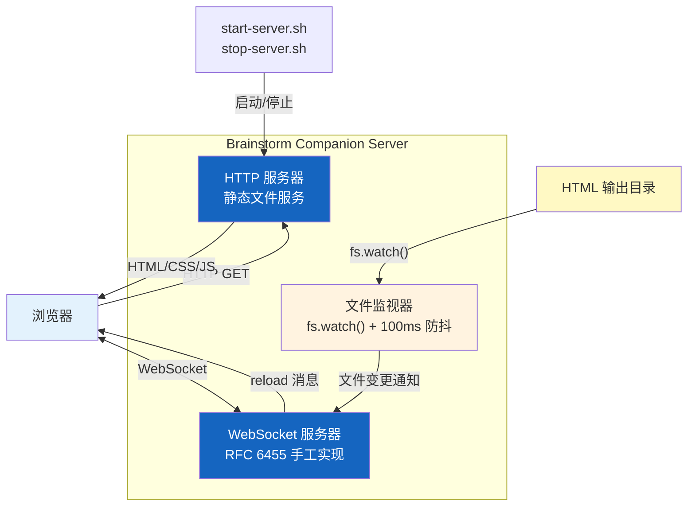
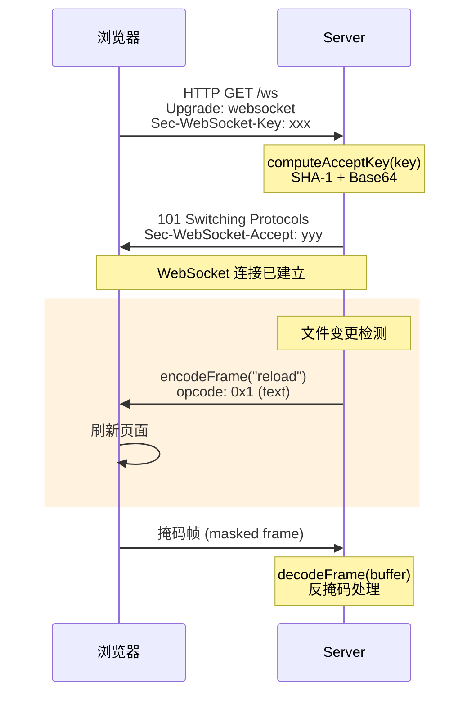
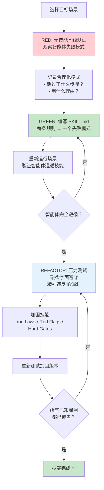
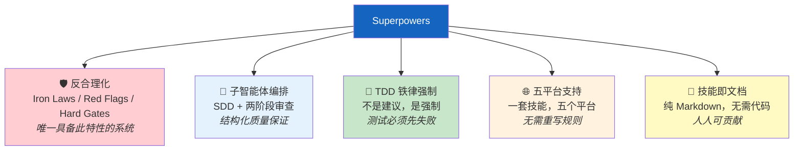

# Phase 5: 服务器、技能开发与对比 — Executable Plan

**Goal:** 完成 brainstorm 服务器、技能开发指南和对比分析三个章节
**Deliverables:** `docs/zh/08-brainstorm-server.md`, `docs/zh/09-writing-skills.md`, `docs/zh/10-comparison.md`
**Requirements:** FR-9 (9.1–9.5), FR-10 (10.1–10.5), FR-11 (11.1–11.4)

---

## Task 1: Write `docs/zh/08-brainstorm-server.md` — Brainstorm Companion Server

**File:** `docs/zh/08-brainstorm-server.md`
**Requirements:** FR-9.1, FR-9.2, FR-9.3, FR-9.4, FR-9.5

### What to write

Write a comprehensive Chinese technical document covering the Brainstorm Companion Server — the only "real code" in the entire Superpowers system. Follow this exact structure:

---

#### Header

```markdown
# Brainstorm Companion Server

> 整个 Superpowers 系统中唯一的"真正代码"——一个零依赖的 HTTP+WebSocket 服务器，
> 用 ~338 行 CommonJS 实现了完整的 RFC 6455 WebSocket 协议，为头脑风暴工作流提供浏览器实时预览。
```

---

#### Section 1: 零依赖服务器概述（FR-9.1）

Write 2–3 paragraphs covering:

1. **Why this exists:** Superpowers 的绝大部分内容是 Markdown 文件——技能、工作流、指南都是纯文本。但头脑风暴（Brainstorm）工作流需要在浏览器中实时预览 HTML 输出。这就是 Brainstorm Companion Server 存在的原因：它是系统中唯一需要运行的代码。

2. **Design philosophy:** 服务器位于 `skills/brainstorming/scripts/server.cjs`，约 338 行代码，零外部依赖。不使用 Express、不使用 ws 库、不使用任何 npm 包——只依赖 Node.js 内置模块（`http`、`fs`、`path`、`crypto`）。选择 `.cjs` 扩展名是因为项目根 `package.json` 设置了 `"type": "module"`（ESM），而服务器使用 CommonJS 的 `require()` 语法。

3. **Supporting files:** 服务器不是孤立的——它有一整套辅助文件：
   - `start-server.sh` / `stop-server.sh` — 生命周期管理脚本
   - `helper.js` — 浏览器端 JavaScript 客户端
   - `frame-template.html` — HTML 模板框架
   - 运行时输出文件：`.server-info`（JSON）、`.server-stopped`（JSON）、`.events`（JSONL）、`.server.pid`、`.server.log`

**Include a Mermaid diagram** showing the server architecture overview:



---

#### Section 2: RFC 6455 WebSocket 手工实现（FR-9.2）

Write 3–4 paragraphs covering the WebSocket implementation details:

1. **Why hand-roll WebSocket:** 不使用 `ws` 库是零依赖设计哲学的直接结果。RFC 6455 的核心协议并不复杂——只需要三个函数就可以实现完整的 WebSocket 通信。

2. **The three core functions:** 服务器手工实现了 WebSocket 协议的三个核心函数：
   - `computeAcceptKey(key)` — 使用 Node.js `crypto` 模块计算 `Sec-WebSocket-Accept` 响应头，这是 WebSocket 握手（Handshake）的关键步骤
   - `encodeFrame(data)` — 将数据编码为 WebSocket 帧（Frame），处理不同长度的 payload 编码（≤125 字节、≤65535 字节、更大的帧）
   - `decodeFrame(buffer)` — 解码接收到的 WebSocket 帧，包含掩码（Masking）处理——客户端发送的帧必须被掩码，服务器需要反掩码才能读取内容

3. **Handshake upgrade:** HTTP 升级（Upgrade）过程：客户端发送 `Upgrade: websocket` 头，服务器验证 `Sec-WebSocket-Key`，计算 accept key，返回 `101 Switching Protocols` 响应。之后连接从 HTTP 切换到 WebSocket 双向通信。

4. **Frame encoding details:** WebSocket 帧格式遵循 RFC 6455 Section 5.2——FIN bit + opcode + mask bit + payload length + masking key（仅客户端→服务器）+ payload data。服务器实现覆盖了文本帧（opcode 0x1）和连接关闭帧（opcode 0x8）。

**Include a Mermaid diagram** showing the WebSocket handshake and communication flow:



---

#### Section 3: 生命周期管理（FR-9.3）

Write 3–4 paragraphs covering server lifecycle:

1. **Startup:** 服务器通过 `start-server.sh` 脚本启动。端口选择策略：优先使用环境变量 `BRAINSTORM_PORT`，否则随机选择 49152–65534 范围内的端口（动态端口范围）。绑定地址默认为 `127.0.0.1`（仅本地访问），可通过 `BRAINSTORM_HOST` 配置。

2. **Server info files:** 启动成功后，服务器写入 `.server-info` 文件（JSON 格式），包含 PID、端口、启动时间等信息。这个文件是其他脚本和智能体发现运行中服务器的主要方式。同时写入 `.server.pid` 文件供进程管理使用。

3. **Idle auto-shutdown:** 服务器实现了 30 分钟空闲自动关闭（Idle Auto-Shutdown）。每次 WebSocket 消息或 HTTP 请求都会重置空闲计时器。如果 30 分钟内没有任何活动，服务器自动退出并写入 `.server-stopped` 文件（JSON 格式，包含停止原因）。

4. **Owner PID monitoring:** 服务器通过 `BRAINSTORM_OWNER_PID` 环境变量接收启动它的进程 PID。服务器定期检查 owner 进程是否仍在运行——如果 owner 进程已退出，服务器也自动关闭。这防止了孤儿服务器进程（Orphan Process）。

5. **Event logging:** 所有生命周期事件记录到 `.events` 文件（JSONL 格式——每行一个 JSON 对象）：启动、连接、断开、文件变更、关闭等。这为调试提供了完整的审计轨迹。

---

#### Section 4: 文件监视与浏览器实时通信（FR-9.4）

Write 2–3 paragraphs covering:

1. **File watching mechanism:** 服务器使用 Node.js 的 `fs.watch()` 监视 HTML 输出目录。当 AI 智能体生成或更新 HTML 文件时，`fs.watch()` 触发变更事件。服务器实现了 100ms 防抖（Debounce）——在 100ms 内的多次变更只触发一次通知，避免文件保存过程中的中间状态触发不必要的刷新。

2. **Browser notification:** 文件变更触发后，服务器通过 WebSocket 向所有连接的浏览器客户端发送 `reload` 消息。浏览器端的 `helper.js` 接收到消息后自动刷新页面，实现热重载（Hot Reload）效果。整个流程从文件保存到浏览器刷新通常在 200ms 以内。

3. **HTTP static file serving:** HTTP 部分负责从监视目录提供静态文件服务。支持 HTML、CSS、JavaScript 等常见 MIME 类型。`frame-template.html` 提供基础页面框架，自动注入 `helper.js` 以建立 WebSocket 连接。

---

#### Section 5: Windows 平台适配（FR-9.5）

Write 2–3 paragraphs covering:

1. **MSYS2 PID namespace issue:** 在 Windows 的 MSYS2 环境中，进程 ID（PID）命名空间与原生 Windows 不同。MSYS2 报告的 PID 是其内部命名空间的 PID，与 Windows 任务管理器中的 PID 不一致。这导致 owner PID 监控功能无法正常工作。

2. **Windows workaround:** 服务器检测到 Windows 平台时，自动禁用 owner PID 监控功能。空闲自动关闭（30 分钟超时）仍然有效，作为 Windows 上防止孤儿进程的替代方案。`stop-server.sh` 脚本也可以手动关闭服务器。

3. **Cross-platform compatibility:** 服务器本身使用 Node.js 编写，天然跨平台。主要的平台差异在于辅助 shell 脚本——它们依赖 bash，在 Windows 上通过 Git for Windows 提供的 bash 或 MSYS2 bash 执行。

---

#### Section 6: 下一步

A brief 2–3 sentence paragraph pointing the reader to the next chapter (09 — 技能开发指南) to learn how to create new skills for the Superpowers system, including the brainstorming skill that uses this server.

---

#### Footer navigation

```markdown
---

[⬅️ 上一篇：平台适配层](./07-platform-adapters.md) | [返回目录](./README.md) | [下一篇：技能开发指南 ➡️](./09-writing-skills.md)
```

---

### Key writing guidelines

1. **Tone:** Technical deep-dive with implementation focus. The reader should understand the actual code architecture and protocol details of the server.
2. **Terms:** Every technical term gets English in parentheses ON FIRST USE ONLY. Key terms: 防抖（Debounce）, 握手（Handshake）, 帧（Frame）, 掩码（Masking）, 空闲自动关闭（Idle Auto-Shutdown）, 孤儿进程（Orphan Process）, 热重载（Hot Reload）, PID 命名空间（PID Namespace）.
3. **No translation-ese:** Write naturally as Chinese technical documentation. Use clear, direct technical language.
4. **Mermaid diagrams:** This document requires at least 2 diagrams: server architecture overview and WebSocket handshake flow.
5. **Code references:** Reference actual file names and paths (`server.cjs`, `start-server.sh`, etc.) throughout. No code blocks of the actual source needed — this is documentation, not a code walkthrough.
6. **Length target:** ~1500–2200 Chinese characters + English terms. Comprehensive server coverage.
7. **Accuracy:** All file names, port ranges, timeout values, environment variables, and protocol details must match the project context provided exactly. Do not invent.

### Acceptance criteria

- [ ] File exists at `docs/zh/08-brainstorm-server.md`
- [ ] Section 1 explains zero-dependency philosophy and lists supporting files (FR-9.1)
- [ ] Section 1 includes Mermaid diagram of server architecture
- [ ] Section 2 explains all 3 WebSocket functions: computeAcceptKey, encodeFrame, decodeFrame (FR-9.2)
- [ ] Section 2 covers RFC 6455 handshake upgrade process
- [ ] Section 2 includes Mermaid sequence diagram of WebSocket flow
- [ ] Section 3 covers startup (random port 49152-65534, BRAINSTORM_PORT, BRAINSTORM_HOST) (FR-9.3)
- [ ] Section 3 explains 30-min idle auto-shutdown (FR-9.3)
- [ ] Section 3 explains owner PID monitoring via BRAINSTORM_OWNER_PID (FR-9.3)
- [ ] Section 3 mentions all runtime files (.server-info, .server-stopped, .events, .server.pid, .server.log)
- [ ] Section 4 explains fs.watch() with 100ms debounce (FR-9.4)
- [ ] Section 4 describes browser hot-reload via WebSocket (FR-9.4)
- [ ] Section 5 explains MSYS2 PID namespace issue (FR-9.5)
- [ ] Section 5 explains Windows workaround (PID monitoring disabled) (FR-9.5)
- [ ] Contains at least 2 Mermaid diagrams
- [ ] All technical terms have English annotations on first use
- [ ] Footer has navigation links: prev (07-platform-adapters) + index (README) + next (09-writing-skills)
- [ ] Written in natural Chinese, technically accurate

### Verification

```bash
# File exists
test -f docs/zh/08-brainstorm-server.md && echo "PASS" || echo "FAIL"

# Contains all required sections
for section in "零依赖" "RFC 6455" "WebSocket" "生命周期" "文件监视" "Windows"; do
  grep -q "$section" docs/zh/08-brainstorm-server.md && echo "PASS: $section" || echo "FAIL: $section missing"
done

# Contains all 3 WebSocket functions
for func in "computeAcceptKey" "encodeFrame" "decodeFrame"; do
  grep -q "$func" docs/zh/08-brainstorm-server.md && echo "PASS: function $func" || echo "FAIL: function $func missing"
done

# Contains environment variables
for env in "BRAINSTORM_PORT" "BRAINSTORM_HOST" "BRAINSTORM_OWNER_PID"; do
  grep -q "$env" docs/zh/08-brainstorm-server.md && echo "PASS: env $env" || echo "FAIL: env $env missing"
done

# Contains runtime files
for file in ".server-info" ".server-stopped" ".events" ".server.pid" ".server.log"; do
  grep -q "$file" docs/zh/08-brainstorm-server.md && echo "PASS: file $file" || echo "FAIL: file $file missing"
done

# Contains supporting scripts
for script in "start-server.sh" "stop-server.sh" "helper.js" "frame-template.html"; do
  grep -q "$script" docs/zh/08-brainstorm-server.md && echo "PASS: script $script" || echo "FAIL: script $script missing"
done

# Contains key values
grep -q "49152" docs/zh/08-brainstorm-server.md && echo "PASS: port range start" || echo "FAIL: port range start missing"
grep -q "30" docs/zh/08-brainstorm-server.md && echo "PASS: 30-min timeout" || echo "FAIL: 30-min timeout missing"
grep -q "100ms\|100 ms" docs/zh/08-brainstorm-server.md && echo "PASS: 100ms debounce" || echo "FAIL: 100ms debounce missing"
grep -q "338" docs/zh/08-brainstorm-server.md && echo "PASS: ~338 lines" || echo "FAIL: ~338 lines missing"
grep -q "server.cjs" docs/zh/08-brainstorm-server.md && echo "PASS: server.cjs" || echo "FAIL: server.cjs missing"

# Contains MSYS2 PID issue
grep -q "MSYS2" docs/zh/08-brainstorm-server.md && echo "PASS: MSYS2" || echo "FAIL: MSYS2 missing"

# Contains Mermaid diagrams (at least 2)
MERMAID_COUNT=$(grep -c '```mermaid' docs/zh/08-brainstorm-server.md)
test "$MERMAID_COUNT" -ge 2 && echo "PASS: $MERMAID_COUNT mermaid diagrams" || echo "FAIL: only $MERMAID_COUNT mermaid diagrams (need >= 2)"

# Contains navigation footer
grep -q "07-platform-adapters.md" docs/zh/08-brainstorm-server.md && echo "PASS: prev link" || echo "FAIL: prev link missing"
grep -q "09-writing-skills.md" docs/zh/08-brainstorm-server.md && echo "PASS: next link" || echo "FAIL: next link missing"
grep -q "README.md" docs/zh/08-brainstorm-server.md && echo "PASS: index link" || echo "FAIL: index link missing"

# Bilingual term annotations present
grep -q "Debounce\|Handshake\|Frame\|Masking\|Hot Reload\|Orphan Process" docs/zh/08-brainstorm-server.md && echo "PASS: bilingual terms" || echo "FAIL: bilingual terms missing"
```

---

## Task 2: Write `docs/zh/09-writing-skills.md` — 技能开发指南

**File:** `docs/zh/09-writing-skills.md`
**Requirements:** FR-10.1, FR-10.2, FR-10.3, FR-10.4, FR-10.5

### What to write

Write a comprehensive Chinese technical document covering how to create new skills for the Superpowers system. This is a meta-skill — a guide about writing the Markdown documents that control AI agent behavior. Follow this exact structure:

---

#### Header

```markdown
# 技能开发指南

> 技能（Skill）是 Superpowers 的核心单元——每个技能是一份 Markdown 文件，
> 定义了 AI 智能体在特定场景下应该如何行为。本章讲述如何用 TDD 的思维方式创建高质量技能。
```

---

#### Section 1: TDD 应用于技能开发（FR-10.1）

Write 3–4 paragraphs covering the TDD mapping for skill development:

1. **Core insight:** 技能开发借用了测试驱动开发（Test-Driven Development, TDD）的核心方法论，但应用对象不是代码——而是流程文档。技能文件（SKILL.md）的质量通过"压力场景"来验证，就像生产代码的质量通过测试用例来验证一样。

2. **The TDD mapping:**

   | TDD 概念 | 技能开发对应物 |
   |----------|--------------|
   | 测试用例（Test Case） | 压力场景（Pressure Scenario）——智能体可能偏离预期行为的具体情境 |
   | 生产代码（Production Code） | SKILL.md 文件——定义智能体行为规范的 Markdown 文档 |
   | RED 阶段 | 运行基线场景，智能体在没有技能指导下失败（合理化、跳过步骤等） |
   | GREEN 阶段 | 编写技能文件后，智能体遵循技能要求正确执行 |
   | REFACTOR 阶段 | 找到并堵住漏洞——智能体可能"字面遵守但精神违反"的情况 |

3. **Why this works:** 传统方法是凭直觉编写指南，然后希望智能体遵守。TDD 方法颠倒了这个流程——先发现智能体在哪里失败，再编写针对性的技能。这确保了每条规则都有存在的理由，不会出现"写了但没人用"的冗余规则。

4. **Iterative refinement:** 就像 TDD 中通过新测试发现新 bug 一样，技能开发通过新压力场景发现新漏洞。技能不是一次性产物——它需要持续迭代，直到覆盖所有已知的失败模式。

---

#### Section 2: 压力测试方法论（FR-10.2）

Write 3–4 paragraphs covering the RED-GREEN-REFACTOR cycle applied to documentation:

1. **Step 1: RED — 建立基线:** 在没有技能的情况下，让智能体执行目标场景。观察并记录智能体的失败模式——它在哪里合理化了跳过步骤？它在哪里选择了更简单但不正确的路径？它如何"解释"为什么不需要遵循最佳实践？

2. **Step 2: GREEN — 编写技能:** 根据观察到的失败模式编写 SKILL.md 文件。技能的每条规则都应该直接对应至少一个观察到的失败模式。重新运行相同的场景，验证智能体现在遵循了技能要求。

3. **Step 3: REFACTOR — 堵住漏洞:** 这是最关键的步骤。智能体可能"字面遵守但精神违反"（Letter Compliance Without Spirit）——例如，技能要求"先写测试"，智能体写了一个永远通过的空测试，然后声称满足了要求。REFACTOR 阶段要找出这些漏洞，加入铁律（Iron Laws）、红旗信号（Red Flags）、硬门槛（Hard Gates）等加固机制。

4. **Documentation of rationalizations:** 在 RED 阶段记录的智能体合理化模式是宝贵的设计输入。它们揭示了智能体最可能偏离的方向——这些方向就是技能文件需要重点防御的地方。

**Include a Mermaid diagram** showing the pressure testing cycle:



---

#### Section 3: 目录结构和命名规范（FR-10.3）

Write 2–3 paragraphs covering:

1. **Directory structure:** 技能使用扁平命名空间（Flat Namespace）——所有技能位于 `skills/<name>/` 目录下，不允许嵌套。每个技能目录至少包含一个 `SKILL.md` 文件，可以包含可选的辅助文件（模板、脚本、参考资料等）。

2. **Skill types:** 技能分为三类：
   - **Technique（技术技能）：** 定义具体的开发技术，如 TDD、代码审查方法
   - **Pattern（模式技能）：** 定义架构模式或设计模式的应用方式
   - **Reference（参考技能）：** 提供工具映射、平台差异等参考信息

3. **Frontmatter requirements:** SKILL.md 的 YAML frontmatter 只需要两个字段：
   - `name` — 技能名称
   - `description` — 技能描述，最大 1024 字符，必须以 "Use when..." 开头

   这是 CSO（Compact Skill Ontology）设计——description 是触发条件描述，不是工作流摘要。

---

#### Section 4: 编写最佳实践（FR-10.4）

Write 3–4 paragraphs covering:

1. **SKILL.md structure:** 标准技能文件遵循固定的章节结构：
   - Overview — 技能概述
   - When to Use — 使用场景（触发条件）
   - Core Pattern — 核心模式（关键行为定义）
   - Quick Reference — 快速参考（速查卡片）
   - Implementation — 实现细节
   - Common Mistakes — 常见错误

2. **Token efficiency:** 技能文件会被注入到智能体的上下文中，因此 token 效率至关重要：
   - 入门级技能（getting-started）：<150 词
   - 高频使用技能（frequent）：<200 词
   - 其他技能：<500 词

3. **CSO — Compact Skill Ontology:** 技能的 description 字段只描述触发条件（"Use when..."），而不是工作流摘要。这是因为智能体根据 description 决定是否加载技能——如果 description 是工作流摘要，智能体会在不需要时也加载它，浪费上下文空间。

4. **Anti-rationalization hardening:** 对于关键技能，需要加入加固机制防止智能体合理化：
   - **Iron Laws（铁律）：** 绝对不可违反的规则，用 "NEVER" / "ALWAYS" 措辞
   - **Red Flags（红旗信号）：** 智能体即将违规的信号模式
   - **Hard Gates（硬门槛）：** 必须通过的检查点，无法跳过

---

#### Section 5: 创建新技能的步骤指南（FR-10.5）

Present a step-by-step numbered guide:

1. **步骤 1: 识别需求** — 观察到智能体在某个场景中反复失败或偏离预期。记录具体的失败模式和合理化理由。

2. **步骤 2: 创建目录** — 在 `skills/` 下创建新目录，使用小写连字符命名（如 `skills/my-new-skill/`）。

3. **步骤 3: RED 阶段** — 设计压力场景，确认没有技能指导时智能体确实失败。

4. **步骤 4: 编写 SKILL.md** — 按照标准结构编写技能文件。frontmatter 只需 name + description。description 以 "Use when..." 开头。

5. **步骤 5: GREEN 阶段** — 重新运行压力场景，验证智能体遵循技能要求。

6. **步骤 6: REFACTOR 阶段** — 寻找漏洞，加入 Iron Laws / Red Flags / Hard Gates。

7. **步骤 7: Token 审计** — 检查技能文件的字数，确保符合 token 效率要求。

**Include a Mermaid diagram** showing the skill creation workflow:


---

#### Section 6: 下一步

A brief 2–3 sentence paragraph pointing the reader to the next chapter (10 — 对比分析) to see how Superpowers compares with other AI coding enhancement tools.

---

#### Footer navigation

```markdown
---

[⬅️ 上一篇：Brainstorm Companion Server](./08-brainstorm-server.md) | [返回目录](./README.md) | [下一篇：对比分析 ➡️](./10-comparison.md)
```

---

### Key writing guidelines

1. **Tone:** Practical and instructional. This is a "how-to" guide — the reader should be able to follow the steps to create a new skill.
2. **Terms:** Every technical term gets English in parentheses ON FIRST USE ONLY. Key terms: 测试驱动开发（Test-Driven Development, TDD）, 压力场景（Pressure Scenario）, 扁平命名空间（Flat Namespace）, 铁律（Iron Laws）, 红旗信号（Red Flags）, 硬门槛（Hard Gates）, CSO（Compact Skill Ontology）.
3. **No translation-ese:** Write naturally as Chinese technical documentation. Use clear, direct technical language.
4. **Mermaid diagrams:** This document requires at least 2 diagrams: pressure testing cycle and skill creation workflow.
5. **Tables:** Use tables for TDD mapping and skill type classification.
6. **Length target:** ~1500–2200 Chinese characters + English terms. Comprehensive skill development guide.
7. **Accuracy:** All directory paths, frontmatter fields, token limits, and methodology steps must match the project context provided exactly. Do not invent.

### Acceptance criteria

- [ ] File exists at `docs/zh/09-writing-skills.md`
- [ ] Section 1 explains TDD mapping with table: test case→pressure scenario, production code→SKILL.md, RED/GREEN/REFACTOR (FR-10.1)
- [ ] Section 2 covers pressure testing methodology with RED-GREEN-REFACTOR cycle (FR-10.2)
- [ ] Section 2 mentions documenting rationalizations as design input
- [ ] Section 2 includes Mermaid diagram of pressure testing cycle
- [ ] Section 3 explains flat namespace directory structure: `skills/<name>/SKILL.md` (FR-10.3)
- [ ] Section 3 lists all 3 skill types: Technique, Pattern, Reference
- [ ] Section 3 explains frontmatter: only name + description, max 1024 chars, "Use when..." prefix
- [ ] Section 4 lists SKILL.md standard sections: Overview, When to Use, Core Pattern, Quick Reference, Implementation, Common Mistakes (FR-10.4)
- [ ] Section 4 includes token efficiency limits: <150, <200, <500 words (FR-10.4)
- [ ] Section 4 explains CSO — description is triggering conditions, not workflow summary (FR-10.4)
- [ ] Section 4 covers anti-rationalization hardening: Iron Laws, Red Flags, Hard Gates (FR-10.4)
- [ ] Section 5 presents step-by-step guide with at least 7 steps (FR-10.5)
- [ ] Section 5 includes Mermaid diagram of skill creation workflow
- [ ] Contains at least 2 Mermaid diagrams
- [ ] All technical terms have English annotations on first use
- [ ] Footer has navigation links: prev (08-brainstorm-server) + index (README) + next (10-comparison)
- [ ] Written in natural Chinese, technically accurate

### Verification

```bash
# File exists
test -f docs/zh/09-writing-skills.md && echo "PASS" || echo "FAIL"

# Contains all required sections
for section in "TDD" "压力测试" "目录结构" "命名规范" "最佳实践" "步骤"; do
  grep -q "$section" docs/zh/09-writing-skills.md && echo "PASS: $section" || echo "FAIL: $section missing"
done

# Contains TDD mapping elements
for term in "RED" "GREEN" "REFACTOR" "Pressure Scenario\|压力场景" "SKILL.md"; do
  grep -q "$term" docs/zh/09-writing-skills.md && echo "PASS: TDD term $term" || echo "FAIL: TDD term $term missing"
done

# Contains skill types
for type in "Technique" "Pattern" "Reference"; do
  grep -q "$type" docs/zh/09-writing-skills.md && echo "PASS: skill type $type" || echo "FAIL: skill type $type missing"
done

# Contains frontmatter details
grep -q "1024" docs/zh/09-writing-skills.md && echo "PASS: max 1024 chars" || echo "FAIL: max 1024 chars missing"
grep -q "Use when" docs/zh/09-writing-skills.md && echo "PASS: Use when prefix" || echo "FAIL: Use when prefix missing"

# Contains SKILL.md standard sections
for section in "Overview" "When to Use" "Core Pattern" "Quick Reference" "Implementation" "Common Mistakes"; do
  grep -q "$section" docs/zh/09-writing-skills.md && echo "PASS: SKILL.md section $section" || echo "FAIL: SKILL.md section $section missing"
done

# Contains token efficiency limits
grep -q "150" docs/zh/09-writing-skills.md && echo "PASS: 150 words limit" || echo "FAIL: 150 words limit missing"
grep -q "200" docs/zh/09-writing-skills.md && echo "PASS: 200 words limit" || echo "FAIL: 200 words limit missing"
grep -q "500" docs/zh/09-writing-skills.md && echo "PASS: 500 words limit" || echo "FAIL: 500 words limit missing"

# Contains CSO
grep -q "CSO\|Compact Skill Ontology" docs/zh/09-writing-skills.md && echo "PASS: CSO" || echo "FAIL: CSO missing"

# Contains anti-rationalization elements
for term in "Iron Law" "Red Flag" "Hard Gate"; do
  grep -qi "$term" docs/zh/09-writing-skills.md && echo "PASS: $term" || echo "FAIL: $term missing"
done

# Contains Mermaid diagrams (at least 2)
MERMAID_COUNT=$(grep -c '```mermaid' docs/zh/09-writing-skills.md)
test "$MERMAID_COUNT" -ge 2 && echo "PASS: $MERMAID_COUNT mermaid diagrams" || echo "FAIL: only $MERMAID_COUNT mermaid diagrams (need >= 2)"

# Contains navigation footer
grep -q "08-brainstorm-server.md" docs/zh/09-writing-skills.md && echo "PASS: prev link" || echo "FAIL: prev link missing"
grep -q "10-comparison.md" docs/zh/09-writing-skills.md && echo "PASS: next link" || echo "FAIL: next link missing"
grep -q "README.md" docs/zh/09-writing-skills.md && echo "PASS: index link" || echo "FAIL: index link missing"

# Contains flat namespace
grep -q "扁平\|Flat Namespace\|flat namespace" docs/zh/09-writing-skills.md && echo "PASS: flat namespace" || echo "FAIL: flat namespace missing"

# Bilingual term annotations present
grep -q "Test-Driven Development\|Pressure Scenario\|Iron Laws\|Compact Skill Ontology" docs/zh/09-writing-skills.md && echo "PASS: bilingual terms" || echo "FAIL: bilingual terms missing"
```

---

## Task 3: Write `docs/zh/10-comparison.md` — 对比分析

**File:** `docs/zh/10-comparison.md`
**Requirements:** FR-11.1, FR-11.2, FR-11.3, FR-11.4

### What to write

Write a comprehensive Chinese technical document comparing Superpowers with other AI coding enhancement approaches. This chapter must be objective — highlighting unique advantages while honestly acknowledging limitations. Follow this exact structure:

---

#### Header

```markdown
# 对比分析

> Superpowers 不是唯一的 AI 编程增强方案——但它是唯一将反合理化作为核心架构关注点的系统。
> 本章客观对比 Superpowers 与其他主流方案的异同。
```

---

#### Section 1: 对比对象概览（FR-11.1）

Write 2–3 paragraphs introducing the comparison landscape:

1. **Landscape overview:** AI 编程工具的增强方案可以分为几类：平台专属配置文件（Cursor Rules、CLAUDE.md）、通用 AI 编程助手（Aider）、IDE 扩展（Continue.dev）、AI 编程工具（Cline/Roo）、以及自定义系统提示（Custom System Prompts）。Superpowers 在这个生态中定位为跨平台技能系统（Cross-Platform Skill System）。

2. **Brief introduction of each competitor:**
   - **Cursor Rules** (`.cursorrules`) — Cursor IDE 专属的静态规则文件，定义编码风格和项目约定
   - **CLAUDE.md / AGENTS.md** — Claude Code 的项目级指令文件，提供上下文和行为指导
   - **Aider** — 开源 AI 编程助手，有自己的约定和工作流，专注于单一平台
   - **Continue.dev** — 开源 AI 编码 IDE 扩展，配置驱动，无技能概念
   - **Cline/Roo** — AI 编程工具，各自有独特的方法论
   - **Custom System Prompts** — 临时性自定义系统提示，无结构化、无反合理化

---

#### Section 2: 多维度对比表（FR-11.2）

Present a comprehensive comparison table covering multiple dimensions:

| 维度 | Superpowers | Cursor Rules | CLAUDE.md | Aider | Continue.dev | Cline/Roo |
|------|-----------|------------|----------|-------|-------------|-----------|
| **架构** | 技能系统 + 工作流引擎 | 静态规则文件 | 项目级指令 | CLI 工具 + 约定 | IDE 扩展 + 配置 | AI 工具 |
| **跨平台** | 5 个平台 | 仅 Cursor | 仅 Claude Code | 仅 Aider | 多 IDE（VSCode 等） | 各自平台 |
| **技能系统** | ✅ 结构化 SKILL.md | ❌ 无 | ❌ 无 | ❌ 无 | ❌ 无 | ❌ 无 |
| **工作流管线** | ✅ brainstorm→plan→implement→finish | ❌ 无 | ❌ 无 | 部分（编辑循环） | ❌ 无 | 部分 |
| **反合理化** | ✅ 核心架构 | ❌ 无 | ❌ 无 | ❌ 无 | ❌ 无 | ❌ 无 |
| **子智能体编排** | ✅ SDD + 两阶段审查 | ❌ 无 | ❌ 无 | ❌ 无 | ❌ 无 | 部分 |
| **TDD 强制** | ✅ 铁律级别 | ❌ 无 | 可手动指定 | ❌ 无 | ❌ 无 | ❌ 无 |
| **可扩展性** | Markdown 技能文件 | 单一规则文件 | 单一 Markdown | 配置文件 | JSON 配置 | 各自机制 |
| **社区/生态** | 开源，技能可复用 | 社区分享规则 | 项目级，不可复用 | 开源社区 | 开源社区 | 各自社区 |

---

#### Section 3: Superpowers 独特优势（FR-11.3）

Write 4–5 paragraphs, each covering one unique differentiator:

1. **反合理化作为核心架构关注点（Anti-Rationalization as Core Concern）：** 这是 Superpowers 与所有其他方案最根本的区别。其他工具假设 AI 会忠实遵循指令——Superpowers 假设 AI 会寻找借口不遵循指令，并在架构层面防御这种行为。Iron Laws、Red Flags、Hard Gates 不是可选的最佳实践建议——它们是系统的结构性组成部分。

2. **子智能体编排与两阶段审查（Subagent Orchestration with Two-Stage Review）：** Superpowers 的 SDD 模式不只是"派遣子智能体"——它包含了结构化的两阶段审查（规格合规 + 代码质量）。每个子智能体获得新鲜上下文，审查由独立的子智能体执行，确保"做了"和"做好了"两个维度都被覆盖。

3. **TDD 铁律级强制（TDD Enforcement with Iron Laws）：** 其他工具最多是"建议使用 TDD"。Superpowers 通过铁律将 TDD 从建议提升为强制——测试必须先失败、每次只修一个测试、禁止在 GREEN 阶段重构。这种强制级别在其他系统中不存在。

4. **真正的跨平台支持（True Multi-Platform Support）：** 一套技能文件在 Claude Code、Cursor、Gemini CLI、Codex 和 OpenCode 五个平台上运行。其他方案要么只支持单一平台，要么跨平台时需要重写规则。

5. **技能即文档（Skills-as-Documents）：** 技能是纯 Markdown 文件——不需要写代码、不需要学习 DSL、不需要特定的运行时。任何人都可以阅读、修改和创建新技能。这也意味着技能文件可以在团队间分享、在项目间复用。

**Include a Mermaid diagram or visual** highlighting the unique differentiators:



---

#### Section 4: 局限性与诚实评估（FR-11.4）

Write 3–4 paragraphs honestly acknowledging Superpowers' limitations:

1. **无 CI/CD 集成管线：** Superpowers 目前不提供持续集成/持续部署（CI/CD）管线。技能的验证依赖手动压力测试，没有自动化的回归测试系统。对于需要在 CI 中验证 AI 行为一致性的团队，这是一个明显的缺口。

2. **平台 API 依赖：** Superpowers 依赖各平台的实验性 API（如 Claude Code 的钩子系统、Cursor 的插件系统）。这些 API 可能在平台更新时发生破坏性变更，导致 Superpowers 需要紧急适配。五个平台意味着五个潜在的破坏性变更来源。

3. **版本同步挑战：** 五个平台各有自己的清单文件（manifest），版本号需要同步维护。当前没有自动化工具确保所有清单的一致性——这是已知的维护负担。

4. **Brainstorm 服务器无认证：** Brainstorm Companion Server 绑定到 `127.0.0.1`，只接受本地连接，但不提供任何认证机制。在共享开发环境中，这可能是一个安全考量。

5. **非服务器代码的测试覆盖有限：** 虽然 brainstorm 服务器有测试覆盖，但技能文件本身的"测试"依赖手动压力测试流程，缺乏自动化验证。

Present limitations in a table format as well:

| 局限性 | 影响范围 | 缓解措施 |
|--------|---------|---------|
| 无 CI/CD 管线 | 回归测试 | 手动压力测试流程 |
| 平台 API 依赖 | 平台升级时 | 关注平台变更日志，快速适配 |
| 版本同步 | 维护负担 | 手动检查五个清单一致性 |
| 服务器无认证 | 安全性 | 绑定 127.0.0.1，仅本地访问 |
| 有限测试覆盖 | 质量保证 | TDD 压力测试方法论 |

---

#### Section 5: 总结

A brief 2–3 paragraph summary:

1. Superpowers 在反合理化、子智能体编排、TDD 强制和跨平台支持方面具有独特优势——这些特性的组合在当前 AI 编程工具生态中是唯一的。

2. 同时，它在 CI/CD 集成、平台 API 稳定性和自动化测试方面存在已知局限性。选择使用 Superpowers 的团队应该评估这些权衡是否适合自己的场景。

3. Superpowers 与其他工具不是完全互斥的——可以在使用 CLAUDE.md 的项目中同时使用 Superpowers 的技能系统，或者在 Cursor 项目中同时保留 `.cursorrules` 和 Superpowers 技能。

---

#### Footer navigation

```markdown
---

[⬅️ 上一篇：技能开发指南](./09-writing-skills.md) | [返回目录](./README.md)
```

---

### Key writing guidelines

1. **Tone:** Objective and balanced. This is a comparison — not marketing material. Strengths should be specific and verifiable; limitations should be honest and practical.
2. **Terms:** Every technical term gets English in parentheses ON FIRST USE ONLY. Key terms: 跨平台技能系统（Cross-Platform Skill System）, 持续集成/持续部署（CI/CD）, 破坏性变更（Breaking Change）.
3. **No translation-ese:** Write naturally as Chinese technical documentation. Use clear, direct technical language.
4. **Mermaid diagrams:** This document requires at least 1 Mermaid diagram showing Superpowers' unique differentiators.
5. **Tables:** The multi-dimensional comparison table is the centerpiece. The limitations table adds transparency. Both must be accurate.
6. **Balance:** For every advantage claimed, ensure it's specific (not "Superpowers is better" but "Superpowers has X, which others lack because Y"). For every limitation, provide the mitigation approach.
7. **Length target:** ~1500–2200 Chinese characters + English terms. Comprehensive comparison coverage.
8. **Accuracy:** All competitor descriptions must be fair and accurate. Do not misrepresent other tools' capabilities. Do not overstate Superpowers' advantages.

### Acceptance criteria

- [ ] File exists at `docs/zh/10-comparison.md`
- [ ] Section 1 introduces all 6 comparison targets: Cursor Rules, CLAUDE.md, Aider, Continue.dev, Cline/Roo, Custom System Prompts (FR-11.1)
- [ ] Section 2 presents multi-dimensional comparison table with all 6+ targets (FR-11.2)
- [ ] Section 2 covers architecture, workflow, platform support, extensibility, community dimensions
- [ ] Section 3 explains 5 unique differentiators: anti-rationalization, subagent orchestration, TDD enforcement, multi-platform, skills-as-documents (FR-11.3)
- [ ] Section 3 includes Mermaid diagram of differentiators
- [ ] Section 4 honestly lists all 5 limitations: no CI/CD, platform API dependency, version sync, no auth, limited test coverage (FR-11.4)
- [ ] Section 4 includes limitations table with mitigation approaches
- [ ] Contains at least 1 Mermaid diagram
- [ ] Contains at least 1 comprehensive comparison table
- [ ] All technical terms have English annotations on first use
- [ ] Footer has navigation links: prev (09-writing-skills) + index (README)
- [ ] Written in natural Chinese, technically accurate
- [ ] Tone is objective — advantages are specific, limitations are honest

### Verification

```bash
# File exists
test -f docs/zh/10-comparison.md && echo "PASS" || echo "FAIL"

# Contains all comparison targets
for target in "Cursor Rules" "CLAUDE.md" "Aider" "Continue.dev" "Cline" "Roo" "Custom System Prompt\|自定义系统提示"; do
  grep -qE "$target" docs/zh/10-comparison.md && echo "PASS: target $target" || echo "FAIL: target $target missing"
done

# Contains comparison dimensions
for dim in "架构" "跨平台\|平台支持" "技能系统" "工作流" "反合理化" "可扩展性" "社区"; do
  grep -qE "$dim" docs/zh/10-comparison.md && echo "PASS: dimension $dim" || echo "FAIL: dimension $dim missing"
done

# Contains unique differentiators
for diff in "反合理化" "子智能体编排\|SDD" "TDD" "五平台\|五个平台\|跨平台" "技能即文档\|Skills-as-Documents"; do
  grep -qE "$diff" docs/zh/10-comparison.md && echo "PASS: differentiator $diff" || echo "FAIL: differentiator $diff missing"
done

# Contains limitations
for limit in "CI/CD" "平台 API\|API 依赖" "版本同步\|版本漂移" "认证\|无认证" "测试覆盖"; do
  grep -qE "$limit" docs/zh/10-comparison.md && echo "PASS: limitation $limit" || echo "FAIL: limitation $limit missing"
done

# Contains Mermaid diagrams (at least 1)
MERMAID_COUNT=$(grep -c '```mermaid' docs/zh/10-comparison.md)
test "$MERMAID_COUNT" -ge 1 && echo "PASS: $MERMAID_COUNT mermaid diagrams" || echo "FAIL: only $MERMAID_COUNT mermaid diagrams (need >= 1)"

# Contains comparison table (check for table with multiple tools)
grep -q "|.*Superpowers.*|" docs/zh/10-comparison.md && echo "PASS: comparison table" || echo "FAIL: comparison table missing"

# Contains limitations table
grep -q "|.*缓解措施\|缓解.*|" docs/zh/10-comparison.md && echo "PASS: limitations table" || echo "FAIL: limitations table missing"

# Contains navigation footer
grep -q "09-writing-skills.md" docs/zh/10-comparison.md && echo "PASS: prev link" || echo "FAIL: prev link missing"
grep -q "README.md" docs/zh/10-comparison.md && echo "PASS: index link" || echo "FAIL: index link missing"

# Bilingual term annotations present
grep -q "Cross-Platform\|Breaking Change\|CI/CD" docs/zh/10-comparison.md && echo "PASS: bilingual terms" || echo "FAIL: bilingual terms missing"

# Contains .cursorrules mention
grep -q "\.cursorrules\|cursorrules" docs/zh/10-comparison.md && echo "PASS: .cursorrules" || echo "FAIL: .cursorrules missing"

# Contains AGENTS.md mention
grep -q "AGENTS.md" docs/zh/10-comparison.md && echo "PASS: AGENTS.md" || echo "FAIL: AGENTS.md missing"
```

---

## Execution Order

```
Task 1 (08-brainstorm-server.md)  ←→  Task 2 (09-writing-skills.md)  ←→  Task 3 (10-comparison.md)   [all parallel, no dependencies]
```

All 3 tasks are fully independent and can be executed in parallel. Task 1 covers the brainstorm server implementation; Task 2 covers skill development methodology; Task 3 covers competitive comparison. None depend on each other's content.

---

## Phase 5 Completion Checklist

- [ ] `docs/zh/08-brainstorm-server.md` — complete brainstorm server doc covering FR-9.1 through FR-9.5
- [ ] `docs/zh/09-writing-skills.md` — complete skill development guide covering FR-10.1 through FR-10.5
- [ ] `docs/zh/10-comparison.md` — complete comparison analysis covering FR-11.1 through FR-11.4
- [ ] At least 2 Mermaid diagrams in brainstorm server doc
- [ ] At least 2 Mermaid diagrams in writing skills doc
- [ ] At least 1 Mermaid diagram in comparison doc
- [ ] Zero-dependency server philosophy explained with supporting file list
- [ ] All 3 WebSocket functions documented (computeAcceptKey, encodeFrame, decodeFrame)
- [ ] Server lifecycle: startup, idle timeout (30 min), owner PID monitoring, shutdown
- [ ] File watching with 100ms debounce and browser hot-reload via WebSocket
- [ ] MSYS2 PID namespace issue explained with Windows workaround
- [ ] TDD mapping for skill development with RED-GREEN-REFACTOR cycle
- [ ] Pressure testing methodology with rationalization documentation
- [ ] Directory structure: flat namespace, skill types, frontmatter requirements
- [ ] Best practices: token efficiency limits, CSO, anti-rationalization hardening
- [ ] Step-by-step skill creation guide (7 steps)
- [ ] Multi-dimensional comparison table with 6+ competitor tools
- [ ] 5 unique differentiators explained with specifics
- [ ] 5 limitations honestly acknowledged with mitigation approaches
- [ ] All technical terms have bilingual annotations on first use
- [ ] Navigation links correct (07 ← 08 → 09, 08 ← 09 → 10, 09 ← 10 → README)
- [ ] Natural Chinese writing quality, no translation-ese
- [ ] All verification scripts pass
