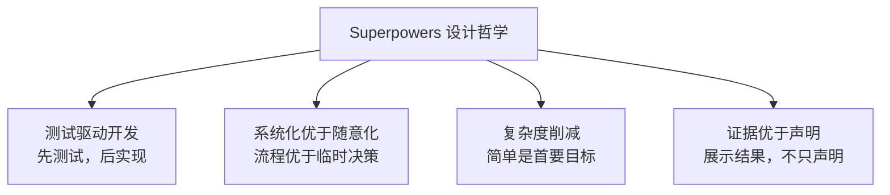
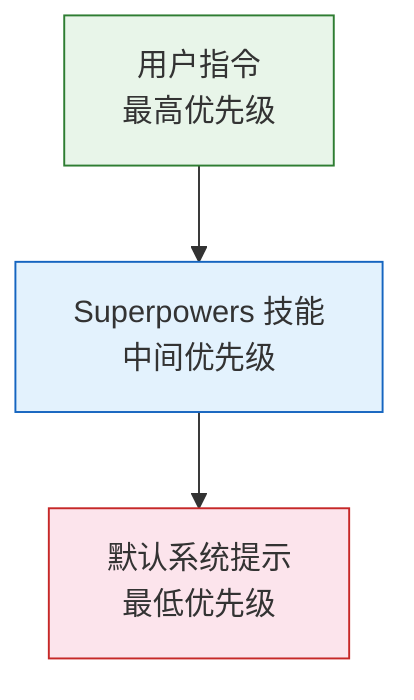

# 概述与设计哲学

> Superpowers 不是一个传统意义上的软件框架——它的主体是一组 Markdown 文档，
> 但这些文档能从根本上改变 AI 编程助手的工作方式。

## 什么是 Superpowers

Superpowers 是一个技能库（Skills Library），由 15 个技能（Skill）组成，共约 70 个 Markdown 文件（含参考文档与子智能体提示模板），专门为 AI 编程助手（AI Coding Assistant）提供结构化的开发工作流（Development Workflow）。截至 7.0.1，它支持 15 个平台：Claude Code、Antigravity、Codex（App 与 CLI）、Cursor、Devin CLI、Factory Droid、Gemini CLI、GitHub Copilot CLI、Grok Build CLI、Kimi Code、OpenCode、Pi、Qwen Code、Hermes Agent 和 Muse。Superpowers 由 Prime Radiant 的 Jesse Vincent 创建。

与传统的代码库不同，Superpowers 没有需要编译的应用，没有运行时依赖。它的"逻辑"主要是 Markdown 文档，只有少量辅助脚本：子智能体开发用的 `sdd-workspace`、`task-brief`、`review-package`，执行计划用的 `task-start`、`task-done`，以及头脑风暴的可视化伴随服务器。这些文档被 AI 智能体直接消费后，会产生实实在在的行为改变——智能体不再随意响应，而是按照经过验证的工作流有条不紊地推进任务。

这套机制的核心是引导注入（Bootstrap Injection）。当 AI 编程助手启动一个新会话（Session）时，各平台会通过各自的方式（会话启动钩子、插件代码、技能描述发现等，详见[第 2 章](./02-architecture.md)）让智能体读到 `using-superpowers/SKILL.md`。从这一刻起，这些文档就成为智能体的"操作手册"——它不再依靠默认行为猜测你想要什么，而是遵循明确定义的流程来完成工作。

整个流程可以用下图概括：


## 核心洞察——为什么需要结构化流程

一个关键的经验观察是：AI 智能体在有结构化流程指导时，表现远优于接收随意指令。这不是理论推测，而是大量实践中反复验证的结论。没有结构化指导时，AI 倾向于一系列有害行为：跳过测试、在未验证的情况下做出假设、过度工程化或工程化不足、在多步骤任务中丢失进度，甚至合理化（Rationalize）自己的错误行为。

问题的根源不在于 AI 的能力不足，而在于缺少纪律。一个聪明但没有流程约束的开发者和一个聪明且遵循严格工作流的开发者，产出质量天差地别。Superpowers 的思路不是让 AI "更聪明"，而是让它更有纪律——提供明确的工作流、检查清单（Checklist）和防护栏（Guardrails）。

打个比方：你不会给一个新来的高级工程师一句"把这个功能做了"就不管了。你会给他一份写得很好的操作手册——包括代码规范、测试要求、代码审查流程和发布清单。Superpowers 对 AI 做的就是这件事。

## 四大设计哲学

Superpowers 的所有技能文档都围绕四个核心哲学构建（它们也是仓库 `README.md` 中的 Philosophy 一节）。它们不是抽象的口号，而是贯穿每一个技能的具体约束。



### 测试驱动开发（Test-Driven Development, TDD）

**原则：** 先写测试，再写实现。测试是规范，不仅仅是验证手段。

AI 有一种特殊的倾向——写出"看起来对"但包含细微 bug 的代码。人类审查这类代码时容易被表面的合理性误导。TDD 通过强制在写任何实现代码之前先编写失败测试，从根本上阻断这种模式。测试先行意味着你在写代码之前就定义了"正确"是什么样子的。

Superpowers 的 TDD 技能强制执行严格的红-绿-重构（Red-Green-Refactor）循环，铁律是 `NO PRODUCTION CODE WITHOUT A FAILING TEST FIRST`。7.0 的 TDD 还有两点值得注意：一是"绿"以**项目完整测试套件**为准，不只是你写的那个测试文件，别处的失败也要点名报告；二是配套的参考文档 `writing-good-tests.md`（取代了旧的 `testing-anti-patterns.md`）要求每个测试都能说清"哪个生产代码改动会让它失败"，并用变异检查（Mutation Check）自证。

### 系统化优于随意化（Systematic over Ad-hoc）

**原则：** 可重复的流程优于临时决策。

AI 在不同会话间的表现可能差异很大。同一个任务，这次做得完美，下次可能遗漏关键步骤。系统化工作流消除了这种随机性，确保不论哪次会话、不论什么时间，质量输出是一致的。

Superpowers 定义了一条显式的工作流水线（Pipeline）：头脑风暴（Brainstorming）→ 使用 Git 工作树（Git Worktrees）→ 编写计划（Writing Plans）→ 子智能体驱动开发（Subagent-driven Development）或执行计划（Executing Plans）→ 完成开发分支（Finishing a Development Branch）。每个阶段有明确的输入、输出和质量门控（Quality Gate）。智能体不需要"决定下一步做什么"——流程已经告诉它了。

### 复杂度削减（Complexity Reduction）

**原则：** 简单是首要目标；最好的代码是不存在的代码。

AI 特别容易过度工程化——添加不必要的抽象层、引入多余的依赖、为未来可能永远不会出现的需求预留扩展点。这些行为表面上"专业"，实际上增加了维护负担和出错概率。

Superpowers 的技能中包含明确的反过度工程警告（YAGNI、DRY）。项目本身也践行这一哲学：运行时零外部依赖，WebSocket 服务器是手写的，仓库的贡献指南明确"不接受第三方依赖"。7.0 对技能本身也做了一轮"瘦身"：删除复述性的总结段落，把超长技能拆到 `references/`，并用 `tests/skill-size` 把单个 `SKILL.md` 限制在 20,000 字节以内（原因见[第 4 章](./04-skills-system.md)）。

### 证据优于声明（Evidence over Claims）

**原则：** 不要说"测试通过了"——展示测试输出。不要说"我检查过了"——展示检查结果。

AI 有一种危险的倾向，可以称之为"幻觉式完成"——声称任务已完成，但实际上并未运行验证。它可能告诉你"所有测试通过"，但它根本没执行测试命令。这种行为如果不被约束，会严重侵蚀信任。

Superpowers 通过铁律（Iron Laws）和红旗表（Red Flags Table）使这类违规行为可见。技能要求智能体展示实际的命令输出和验证步骤。不是"我确认了"，而是"这是我运行的命令，这是输出结果"。精神高于字面（Spirit-over-letter）条款进一步确保智能体不会通过技术性合规来绕过这些要求的本意。7.0 的子智能体审查也沿用这一原则：审查者必须为每个结论给出文件和行号，看不到证据时要明说"无法验证"，而不是默认通过。

## 技能即文档（Skills-as-Documents）

在 Superpowers 中，Markdown 文档就是代码。每个技能是一个独立目录，核心是 `SKILL.md`：包含 YAML 前言（Frontmatter）和 Markdown 正文。没有编译步骤，没有运行时——文档本身直接被 AI 消费并转化为行为。

一个技能的结构如下：

```yaml
---
name: test-driven-development
description: Use when implementing any feature or bugfix, before writing implementation code
---

# 测试驱动开发

## 铁律
NO PRODUCTION CODE WITHOUT A FAILING TEST FIRST

## 红-绿-重构
1. 写失败的测试（红）
2. 写最少的代码让测试通过（绿）
3. 重构（保持测试通过）
```

YAML 前言包含元数据（必填 `name` 与 `description`），供平台识别和加载。Markdown 正文包含具体的指令、指南、清单和硬门。每个技能可独立加载，也可以与其他技能组合使用——它们是可组合的（Composable），同时也是平台无关的（Platform-agnostic）：技能正文用"派发子智能体""你的指令文件"这类中性说法，各平台再通过 `skills/using-superpowers/references/` 里的工具映射文件对应到自己的工具。

这种设计的好处显而易见：任何能写 Markdown 的人都能理解和修改技能。技能文档可以用 Git 做版本控制，可以 diff，可以在代码审查中逐行讨论。需要注意的是，项目对**向上游贡献新技能**非常克制：贡献指南明确"通常不接受新技能"，对已有技能的修改必须在所有支持的平台上都成立，并有评测证据。

## 指令优先级系统

Superpowers 采用三级优先级系统来解决指令冲突，规则写在 `using-superpowers` 的 "User Instructions" 一节：

- **用户指令** — 最高优先级。包括 `CLAUDE.md`、`AGENTS.md`、`GEMINI.md` 等指令文件和你的直接请求。
- **Superpowers 技能** — 中间优先级。在用户没有明确指示时生效。
- **默认系统提示** — 最低优先级。平台自带的默认行为。



冲突解决规则很简单：高优先级覆盖低优先级。原文强调"只有你的人类伙伴（human partner）明确表态，才可以跳过技能流程"。如果用户说"这次跳过测试"，那么 TDD 技能的要求被覆盖——用户说了算；如果用户没有特别指示，技能的要求覆盖平台默认行为。

这意味着 Superpowers 永远不会"锁定"用户。你始终掌握最终控制权。但在你没有明确表态的时候，智能体会自动遵循经过验证的最佳实践，而不是退回到不可预测的默认行为。

## 下一步

本章介绍了 Superpowers 是什么以及它为什么这样设计。下一章将深入系统架构——引导注入如何工作、技能文档如何被加载和组合、以及不同平台的适配机制。

---

[⬅️ 返回目录](./README.md) | [下一篇：系统架构 ➡️](./02-architecture.md)
