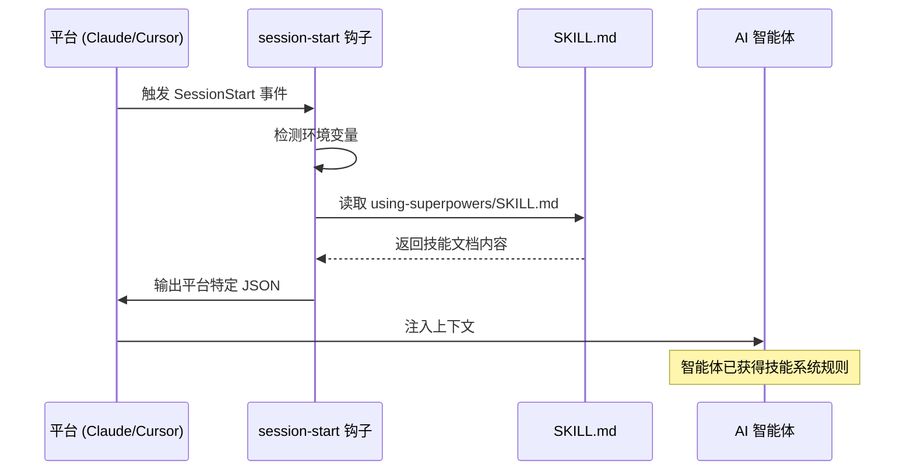
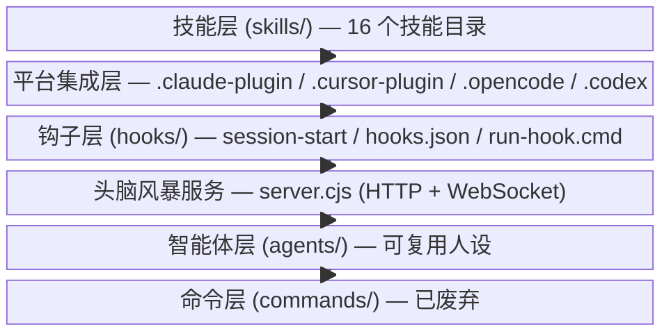
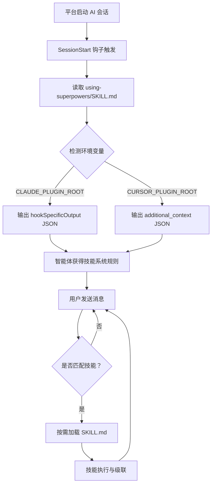
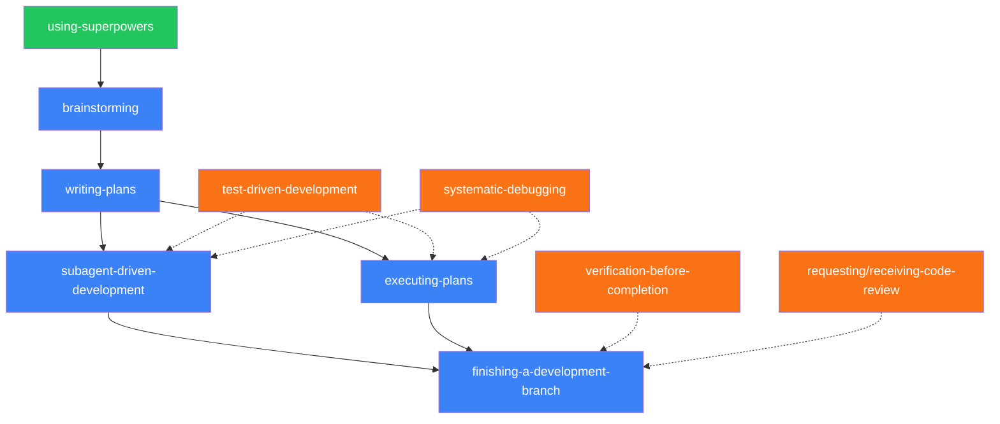
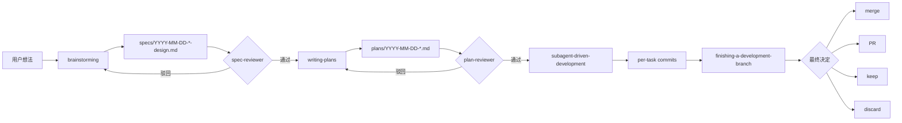

# 系统架构

> Superpowers 的核心创新在于：它不修改 AI 的能力，而是通过上下文注入（Context Injection）
> 改变 AI 的行为方式——用 Markdown 文档"编程"智能体。

## 1. 架构模式——提示注入插件

Superpowers 采用**提示注入插件（Prompt Injection Plugin）**模式。该模式的核心思路：在 AI 会话启动时，通过会话钩子（Session Hook）将技能文档注入智能体上下文，从而改变其后续行为。

整个过程无需运行时依赖——系统的"代码"就是 Markdown 文档本身，在正确的时机被注入到正确的位置。

### 技术实现

1. 平台启动 AI 会话，触发 `session-start` 钩子
2. 钩子脚本读取 `skills/using-superpowers/SKILL.md`
3. 通过环境变量（Environment Variable）检测当前平台：`CLAUDE_PLUGIN_ROOT` 或 `CURSOR_PLUGIN_ROOT`
4. 以平台特定的 JSON 格式输出注入内容

**Claude Code 输出格式：**

```json
{
  "hookSpecificOutput": {
    "hookEventName": "SessionStart",
    "additionalContext": "..."
  }
}
```

**Cursor 输出格式：**

```json
{
  "additional_context": "..."
}
```

### 注入流程



这种"零运行时"设计意味着：没有常驻进程、没有编译步骤、没有依赖安装——整个系统由约 70 个 Markdown 文档构成。

## 2. 系统层次结构

Superpowers 由六个层次组成，各层职责清晰：

| 层次 | 目录 | 职责 |
|------|------|------|
| 技能层 | `skills/` | 16 个技能目录，每个包含 `SKILL.md` 及支撑文件 |
| 平台集成层 | `.claude-plugin/`、`.cursor-plugin/`、`.opencode/`、`.codex/`、`GEMINI.md` | 各平台配置与适配 |
| 钩子层 | `hooks/` | `session-start` 钩子、`hooks.json`、`hooks-cursor.json`、跨平台 `run-hook.cmd` |
| 头脑风暴服务 | `skills/brainstorming/scripts/server.cjs` | 零依赖 HTTP + WebSocket 服务器 |
| 智能体层 | `agents/` | 可复用智能体人设（如 `code-reviewer.md`） |
| 命令层 | `commands/` | 已废弃的斜杠命令 |



## 3. 会话启动生命周期

从平台启动到技能执行，完整生命周期包含 10 个步骤：

1. **平台启动** — AI 编程助手创建新会话
2. **钩子触发** — `SessionStart` 事件触发 `session-start` 钩子
3. **文档读取** — 钩子脚本读取 `skills/using-superpowers/SKILL.md`
4. **平台检测** — 通过 `CLAUDE_PLUGIN_ROOT` / `CURSOR_PLUGIN_ROOT` 判断平台
5. **JSON 输出** — 按平台格式封装技能文档为 JSON
6. **上下文注入** — 智能体上下文中包含技能系统规则
7. **用户交互** — 用户发送消息
8. **技能匹配** — 智能体判断："当前任务是否适用某个技能？"（1% 规则：仅在确信时加载）
9. **按需加载** — 通过平台的 Skill 工具读取对应 `SKILL.md`
10. **执行与级联** — 技能执行，可能触发后续技能链



关键设计：技能**不是**在会话启动时全部预加载的。根技能 `using-superpowers` 仅提供技能索引和加载规则，具体技能在需要时才通过平台的 Skill 工具读取。

## 4. 技能依赖图

### 依赖结构

- **根技能**：`using-superpowers` — 会话启动时唯一加载的技能，提供技能索引
- **工作流链**：`brainstorming` → `writing-plans` → [`subagent-driven-development` | `executing-plans`] → `finishing-a-development-branch`
- **横切技能**：`test-driven-development`、`systematic-debugging`、`verification-before-completion`、`requesting-code-review` / `receiving-code-review`
- **独立技能**：`using-git-worktrees`、`dispatching-parallel-agents`、`writing-skills`

所有技能均为按需加载——智能体在上下文中持有技能索引，仅在判断当前任务匹配时才读取完整的 `SKILL.md`。



图例：🟢 根技能 🔵 工作流技能 🟠 横切技能（虚线表示可选依赖）

## 5. 数据与工件流向

从用户想法到最终合并，工件沿以下路径流转：

| 阶段 | 输出工件 | 质量门 |
|------|----------|--------|
| 头脑风暴 | `specs/YYYY-MM-DD-*-design.md` | spec-reviewer 审查 |
| 计划编写 | `plans/YYYY-MM-DD-*.md` | plan-reviewer 审查 |
| 子智能体开发 | 每任务提交（per-task commits） | 测试、验证技能 |
| 收尾 | 合并 / PR / 保留 / 丢弃 | `verification-before-completion` |



每个质量门由专门的 reviewer 智能体把关。审查不通过时，工件回退到上一阶段修改，确保缺陷不会向下游传播。

## 6. 系统边界

理解 Superpowers 的边界，对正确使用至关重要：

| Superpowers 控制 | Superpowers 不控制 |
|---|---|
| 智能体行为（通过上下文注入引导） | AI 核心能力（模型本身的推理/生成） |
| 工作流进展（技能链的顺序与条件） | 平台工具实现（文件读写、终端执行等） |
| 质量门（reviewer 审查、验证检查） | 用户项目代码（仅提供开发流程，不干预实现） |
| 子智能体编排（任务分派与协调） | Git 操作（依赖平台提供的 Git 工具） |

简言之：Superpowers 是"行为层"——它告诉 AI **怎样工作**，而非赋予 AI **工作的能力**。

## 7. 下一步

架构理解完毕后，下一章将深入核心工作流的具体运作——从头脑风暴到分支收尾的完整开发循环。

👉 [03 — 核心工作流](./03-workflow.md)

---

[⬅️ 上一篇：概述与设计哲学](./01-overview.md) | [返回目录](./README.md) | [下一篇：核心工作流 ➡️](./03-workflow.md)
