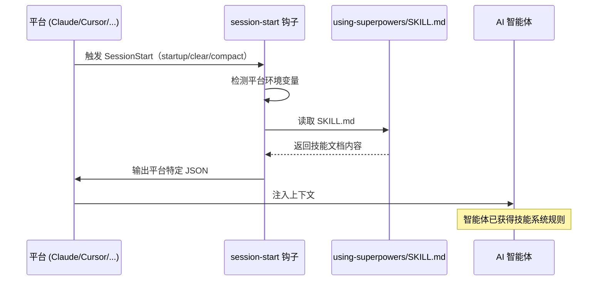
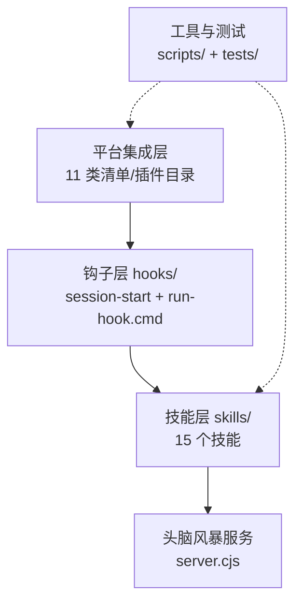
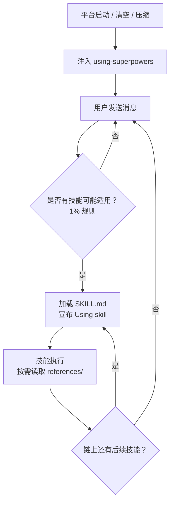
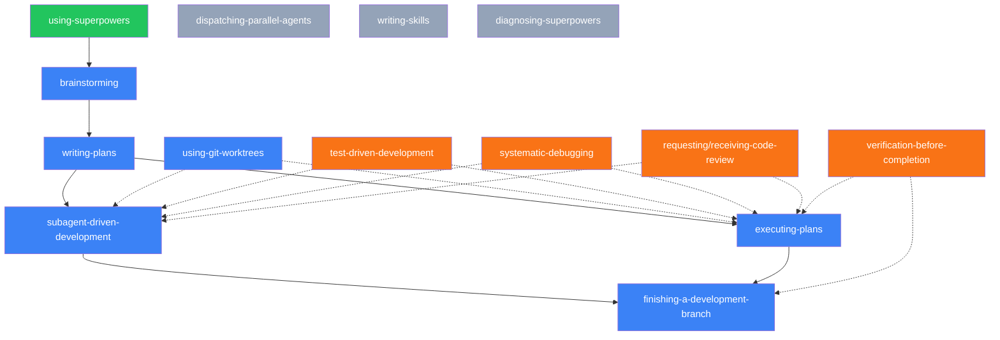
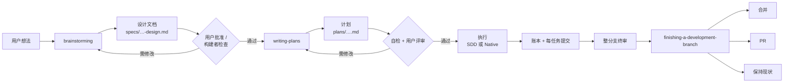

# 系统架构

> Superpowers 的核心创新在于：它不修改 AI 的能力，而是通过上下文注入（Context Injection）
> 改变 AI 的行为方式——用 Markdown 文档"编程"智能体。

## 1. 架构模式——提示注入插件

Superpowers 采用**提示注入插件（Prompt Injection Plugin）**模式。该模式的核心思路：在 AI 会话启动时，让智能体读到根技能 `using-superpowers`，从而改变其后续行为。

整个过程无需常驻进程，系统的"逻辑"就是 Markdown 文档本身，在正确的时机被送到智能体面前。关键约束只有一条（来自 `docs/porting-to-a-new-harness.md`）：**必须在会话开始时加载 bootstrap**，只把技能文件拷过去而不加载 bootstrap 的集成不被接受。

### 四种注入机制

不同平台能力不同，7.0.1 中共有四种让 bootstrap 生效的方式：

| 机制 | 工作方式 | 使用的平台 |
|------|---------|-----------|
| Shell 钩子 | `SessionStart` 事件触发 `hooks/session-start`，脚本把 `using-superpowers/SKILL.md` 包成平台要求的 JSON 输出 | Claude Code、Cursor、GitHub Copilot CLI、Muse（Factory Droid、Qwen Code、Grok Build CLI 没有专属集成目录，走 Claude 兼容的插件市场安装，具体机制以各平台文档为准） |
| 进程内插件 | 平台加载一段 JS/TS/Python 代码，由它注册技能并在合适时机注入 bootstrap | OpenCode（`.opencode/plugins/superpowers.js`）、Pi（`.pi/extensions/superpowers.ts`）、Hermes Agent（`.hermes-plugin/__init__.py`） |
| 指令文件引用 | 平台启动时读取指令文件，文件里用 `@` 引入技能 | Gemini CLI（`GEMINI.md`） |
| 技能发现 / 清单声明 | 没有钩子；平台把技能的 `description` 展示给模型，或在清单里声明启动技能 | Codex、Antigravity、Devin CLI、Kimi Code |

第四类不依赖注入脚本，靠的是 `using-superpowers` 的 `description`（"Use when starting any conversation..."）诱导模型在会话开头自己去加载它。Antigravity 就是这样验证的：对"Let's make a react todo list"这类请求，在写任何代码之前触发了 `brainstorming`。

### Shell 钩子的实现

以 Claude Code 为例（`hooks/hooks.json`）：

```json
{
  "hooks": {
    "SessionStart": [{
      "matcher": "startup|clear|compact",
      "hooks": [{
        "type": "command",
        "command": "\"${CLAUDE_PLUGIN_ROOT}/hooks/run-hook.cmd\" session-start",
        "shell": "bash",
        "async": false
      }]
    }]
  }
}
```

要点：

1. `matcher` 包含 `compact`——上下文被压缩后会重新注入 bootstrap。
2. `shell: "bash"` 要求 Claude Code 2.1.81+，它会直接解析到 Git for Windows 的 Bash；旧版本忽略该字段。
3. 命令经由跨平台包装器 `run-hook.cmd`（详见[第 7 章](./07-platform-adapters.md)）。

`hooks/session-start` 的行为：

1. 用 `$0` 定位插件根目录（不调用 `dirname`），用 Bash 内建语法读取 `skills/using-superpowers/SKILL.md`（不调用 `cat`）。7.0.0 起这样做是为了应对宿主启动时 `PATH` 损坏的情况（anthropics/claude-code#43127），否则 bootstrap 会悄悄丢失。
2. 把内容手工转义为 JSON，包进 `<EXTREMELY_IMPORTANT>` 模板。
3. 按环境变量判断当前平台，输出平台要求的格式。

**平台检测顺序与输出格式：**

| 条件（按顺序判断） | 平台 | 输出 |
|------------------|------|------|
| `CURSOR_PLUGIN_ROOT` 非空 | Cursor | `{"additional_context": "..."}` |
| `CLAUDE_PLUGIN_ROOT` 非空，且 `COPILOT_CLI`、`MUSE_PLUGIN_ROOT` 均为空 | Claude Code | `{"hookSpecificOutput":{"hookEventName":"SessionStart","additionalContext":"..."}}` |
| `MUSE_PLUGIN_ROOT` 非空 | Muse | 与 Claude Code 相同的嵌套格式 |
| 其他（含 Copilot CLI，`COPILOT_CLI=1`） | Copilot CLI / 未知 | 顶层 `{"additionalContext": "..."}`（SDK 标准格式） |

### 注入流程



这种设计意味着：没有常驻进程、没有编译步骤、没有依赖安装。

## 2. 系统层次结构

| 层次 | 目录 / 文件 | 职责 |
|------|------------|------|
| 技能层 | `skills/` | 15 个技能目录，每个包含 `SKILL.md`，部分带 `references/`、提示模板和脚本 |
| 平台集成层 | `.claude-plugin/`、`.cursor-plugin/`、`.codex-plugin/`、`.antigravity-plugin/`、`.devin-plugin/`、`.hermes-plugin/`、`.kimi-plugin/`、`.muse-plugin/`、`.opencode/`、`.pi/`、`.agents/`，以及根目录的 `gemini-extension.json`、`GEMINI.md`、`index.js` | 各平台清单与适配代码 |
| 钩子层 | `hooks/` | `session-start`、`hooks.json`、`hooks-cursor.json`、跨平台包装器 `run-hook.cmd` |
| 头脑风暴服务 | `skills/brainstorming/scripts/server.cjs` | 零依赖 HTTP + WebSocket 服务器（可视化伴随） |
| 工具层 | `scripts/` | `bump-version.sh`（版本同步）、`lint-shell.sh`、`package-codex-plugin.sh`、`sync-to-codex-plugin.sh`、`render-antigravity-logo.sh` |
| 测试层 | `tests/` | 插件代码测试（非 LLM）；技能行为评测在独立的 evals 仓库 |

与 5.0 时期相比，**`agents/`（可复用智能体人设）与 `commands/`（斜杠命令）两层已被移除**。代码审查者不再是具名 agent，而是 `requesting-code-review/code-reviewer.md` 这个自包含模板，由 `general-purpose` 子智能体填充使用；`/brainstorm`、`/write-plan`、`/execute-plan` 三个已废弃的斜杠命令在 5.1.0 删除，直接调用对应技能即可。



## 3. 会话启动生命周期

从平台启动到技能执行：

1. **平台启动** — AI 编程助手创建新会话（或清空 / 压缩上下文）
2. **bootstrap 注入** — 通过上节四种机制之一，`using-superpowers` 进入智能体上下文
3. **用户交互** — 用户发送消息
4. **技能匹配** — 智能体判断："是否有技能可能适用？"（**1% 规则**：哪怕只有 1% 的可能性适用，也必须调用）
5. **按需加载** — 通过平台的技能工具读取对应 `SKILL.md`，并宣布"Using [skill] to [purpose]"
6. **执行与级联** — 技能执行，可能触发后续技能链；技能内部再按需读取 `references/` 下的文件



关键设计：技能**不是**在会话启动时全部预加载的。根技能 `using-superpowers` 仅提供规则，具体技能在需要时才加载；大技能内部又把细节放进 `references/`，到对应步骤才读（例如 `subagent-driven-development` 在修复循环时才读 `references/fix-loop.md`）。这是 7.0.1 为应对 Claude Code 压缩后对每个技能截断 20,000 字符的限制而做的结构调整。

另一个细节：被派发为子智能体去执行具体任务时，`using-superpowers` 顶部的 `<SUBAGENT-STOP>` 块会让它忽略本技能，避免子智能体再去走一遍技能发现流程。OpenCode 的插件也会在代码层面跳过带 `parentID` 的子会话，不给它们注入 bootstrap。

## 4. 技能依赖图

### 依赖结构

- **根技能**：`using-superpowers` — 会话启动时唯一注入的技能
- **工作流链**：`brainstorming` → `writing-plans` → [`subagent-driven-development` | `executing-plans`] → `finishing-a-development-branch`
- **工作环境技能**：`using-git-worktrees`（头脑风暴批准后、执行计划前）
- **横切技能**：`test-driven-development`、`systematic-debugging`、`verification-before-completion`、`requesting-code-review` / `receiving-code-review`
- **独立技能**：`dispatching-parallel-agents`、`writing-skills`、`diagnosing-superpowers`



图例：绿色为根技能，蓝色为工作流技能，橙色为横切技能，灰色为独立技能（虚线表示可选依赖）。

## 5. 数据与工件流向

从用户想法到最终合并，工件沿以下路径流转：

| 阶段 | 输出工件 | 质量门 |
|------|----------|--------|
| 头脑风暴 | `docs/superpowers/specs/YYYY-MM-DD-<topic>-design.md`（小改动写短文档；快速任务不写） | 用户批准；项目级设计另有"构建者检查"（Builder Check） |
| 计划编写 | `docs/superpowers/plans/YYYY-MM-DD-<feature>.md` | 作者自检清单（非子智能体）+ 用户评审已保存的计划 |
| 执行 | `.superpowers/sdd/<plan-basename>/` 工作区（账本 `progress.md`、任务简报、报告、评审包），以及每任务的提交 | 每任务测试 + SDD 的任务审查者；Native 模式则靠测试日志与完成契约 |
| 终审 | 整分支评审（最强模型） | Critical / Important 一波修复，一次聚焦复审 |
| 收尾 | 本地合并 / 推送并建 PR / 保持现状 | `verification-before-completion`（先跑测试） |



两点与旧版不同：一是 `.superpowers/sdd/` 工作区位于工作树内（git 忽略），而不是 `.git/` 里——因为 Claude Code 把 `.git/` 视为受保护路径、拒绝智能体写入（6.0.3 修复）；二是工作区按计划隔离（`.superpowers/sdd/<plan-basename>/`），最终评审干净后整个目录被删除，git 历史才是持久记录（6.2.0）。

## 6. 系统边界

理解 Superpowers 的边界，对正确使用至关重要：

| Superpowers 控制 | Superpowers 不控制 |
|---|---|
| 智能体行为（通过上下文注入引导） | AI 核心能力（模型本身的推理/生成） |
| 工作流进展（技能链的顺序与条件） | 平台工具实现（文件读写、终端执行等） |
| 质量门（审查、验证检查） | 用户项目代码（仅提供开发流程，不干预实现） |
| 子智能体编排（任务分派与协调） | 平台自身的技能与钩子 API 的稳定性 |

简言之：Superpowers 是"行为层"——它告诉 AI **怎样工作**，而非赋予 AI **工作的能力**。

## 7. 下一步

架构理解完毕后，下一章将深入核心工作流的具体运作——从头脑风暴到分支收尾的完整开发循环。

👉 [03 — 核心工作流](./03-workflow.md)

---

[⬅️ 上一篇：概述与设计哲学](./01-overview.md) | [返回目录](./README.md) | [下一篇：核心工作流 ➡️](./03-workflow.md)
