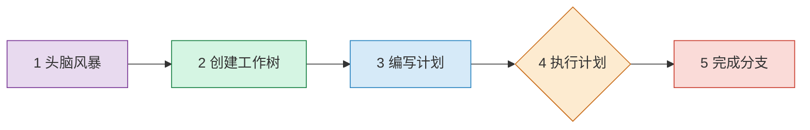
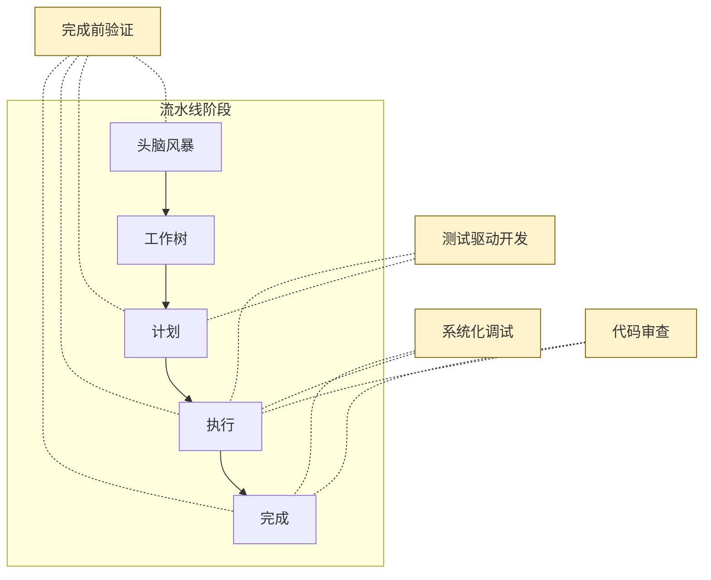
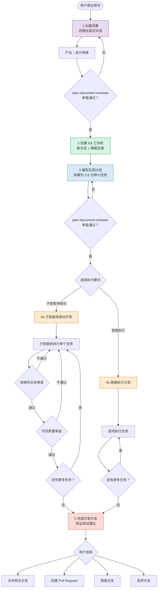

# 核心工作流

> 从一个模糊的想法到一个经过测试、审查、可合并的代码分支——
> Superpowers 将整个过程编排为一条结构化的流水线（Pipeline）。

## 1. 工作流概览

大多数 AI 编程助手拿到需求后会立刻开始写代码。Superpowers 的做法恰恰相反：它定义了一条**完整的开发工作流流水线**，强制要求在动手编码之前完成设计与规划，从而避免方向偏离和返工。

整条流水线由 **5 个顺序阶段**组成：

1. **头脑风暴（Brainstorming）** — 苏格拉底式对话，提炼设计
2. **创建 Git 工作树** — 隔离的工作空间
3. **编写实现计划** — 将工作拆解为可执行的小任务
4. **执行计划** — 子智能体驱动开发 或 直接执行
5. **完成开发分支** — 验证、合并或提交 PR

每个阶段都有明确的**输入、输出和门控条件**——只有满足门控条件后，才能进入下一阶段。

---

## 2. 流水线各阶段详解

### 阶段 1：头脑风暴

- **描述** — 通过苏格拉底式提问与用户反复澄清需求，将模糊的想法逐步打磨为结构清晰的设计规格。此阶段侧重于"做什么"和"为什么做"，而非"怎么做"。
- **输入** — 用户的初始想法或需求描述
- **输出** — 结构化的设计规格文档
- **门控条件** — 设计规格通过 `spec-document-reviewer` 审查
- **产出物** — `docs/superpowers/specs/YYYY-MM-DD-<topic>-design.md`

### 阶段 2：创建 Git 工作树

- **描述** — 基于主分支创建一个独立的 Git 工作树（Worktree），并切换到新分支。这保证了开发过程与主干完全隔离，不会影响其他工作。
- **输入** — 通过门控的设计规格、主分支的当前状态
- **输出** — 新分支上的独立工作目录
- **门控条件** — 工作树创建成功，新分支已签出
- **产出物** — 一个与主分支隔离的 Git 工作树及对应分支

### 阶段 3：编写实现计划

- **描述** — 将设计规格拆解为一系列小任务，每个任务的预估工作量控制在 2–5 分钟。计划以可勾选清单的形式呈现，便于逐项执行和追踪进度。
- **输入** — 设计规格文档、项目现有代码结构
- **输出** — 分步实现计划文档
- **门控条件（Gate Condition）** — 计划通过 `plan-document-reviewer` 审查
- **产出物** — `docs/superpowers/plans/YYYY-MM-DD-<feature>.md`

### 阶段 4a：子智能体驱动开发

- **描述** — 为计划中的每个任务启动一个全新的子智能体来执行。每个子智能体完成任务后，需经过两阶段审查：先检查是否符合设计规格，再检查代码质量。子智能体通过状态协议汇报结果。
- **输入** — 实现计划、设计规格、当前代码库
- **输出** — 通过审查的代码变更
- **门控条件** — 子智能体返回 `DONE` 状态，且两阶段审查均通过
- **产出物** — 符合规格且通过质量审查的已提交代码

> **子智能体状态协议：** `DONE` | `DONE_WITH_CONCERNS` | `BLOCKED` | `NEEDS_CONTEXT`

### 阶段 4b：直接执行计划

- **描述** — 不使用子智能体，由当前智能体直接按照计划逐项执行任务。适用于较简单或上下文依赖性强的场景，减少子智能体切换的开销。
- **输入** — 实现计划、设计规格、当前代码库
- **输出** — 完成的代码变更
- **门控条件** — 所有计划任务执行完毕，测试通过
- **产出物** — 已提交的代码变更

### 阶段 5：完成开发分支

- **描述** — 验证所有测试通过后，向用户提供四个选项：合并到主分支、创建 Pull Request、保留分支待后续处理、或丢弃分支。确保只有经过充分验证的代码才会进入主干。
- **输入** — 完成所有任务的开发分支
- **输出** — 根据用户选择完成的操作
- **门控条件** — 全部测试通过、代码审查完成
- **产出物** — 合并的代码 / PR / 保留的分支（取决于用户选择）

---

## 3. 横切关注点技能

横切关注点（Cross-Cutting Concerns）是贯穿流水线所有阶段的通用技能。它们不属于某个特定阶段，而是在任何需要的时刻自动介入。

### 3.1 测试驱动开发

采用严格的红-绿-重构（Red-Green-Refactor）循环：先写一个会失败的测试（红），再写最少量的代码让测试通过（绿），最后重构代码。**铁律：没有先写失败的测试，就不能编写生产代码。** 这条规则在阶段 4 的每一个任务中都必须遵守。

### 3.2 系统化调试

当任何阶段出现故障或非预期行为时，触发四阶段根因分析流程：

1. **观察** — 收集错误信息和上下文
2. **假设** — 提出可能的原因
3. **实验** — 设计并执行验证实验
4. **验证** — 确认根因已消除

### 3.3 完成前验证

在每个阶段结束时，必须提供**实际的证据**而非口头声明。例如展示测试运行的真实输出，而非仅仅说"测试通过了"。这一原则确保每个门控条件的通过都有据可查。

### 3.4 代码审查

分为两个时机：**任务间审查**——每个任务完成后进行，确保问题尽早暴露；**完成时审查**——整个开发分支完成后进行全面审查。审查包括如何发起请求和如何处理反馈两个维度。

---

## 4. 工作流完整流程图

下图将流水线阶段、门控条件、决策点和横切技能整合在一起，呈现完整的工作流全貌：

---

## 5. 下一步

本章介绍了 Superpowers 的核心工作流流水线及其运作机制。下一章将深入讲解每个技能的具体行为和配置方式。

> 继续阅读：[04 — 技能系统详解](./04-skills-system.md)

---

[⬅️ 上一篇：系统架构](./02-architecture.md) | [返回目录](./README.md) | [下一篇：技能系统详解 ➡️](./04-skills-system.md)
