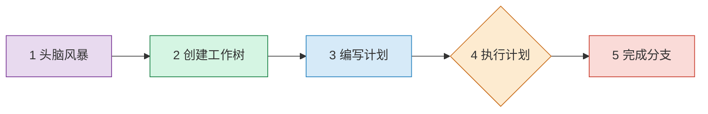
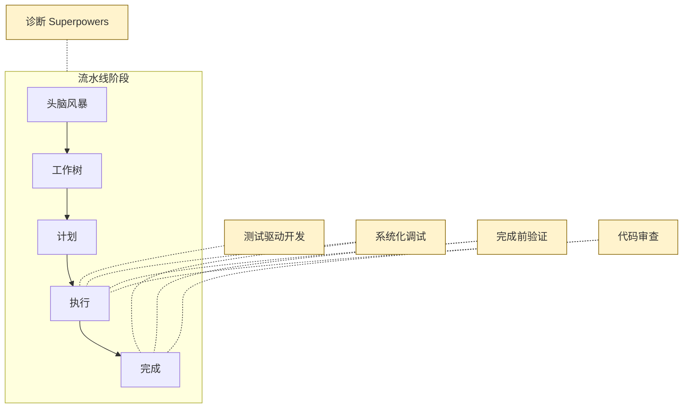
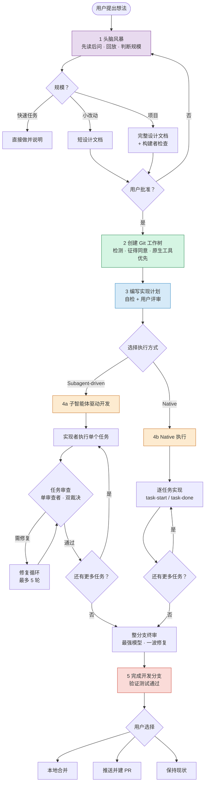

# 核心工作流

> 从一个模糊的想法到一个经过测试、审查、可合并的代码分支——
> Superpowers 将整个过程编排为一条结构化的流水线（Pipeline）。

## 1. 工作流概览

大多数 AI 编程助手拿到需求后会立刻开始写代码。Superpowers 的做法恰恰相反：它定义了一条**完整的开发工作流流水线**，强制要求在动手编码之前先弄清需求、获得批准，从而避免方向偏离和返工。

整条流水线由 **5 个顺序阶段**组成：

1. **头脑风暴（Brainstorming）** — 弄清你想要什么，形成设计，获得批准
2. **创建 Git 工作树** — 隔离的工作空间
3. **编写实现计划** — 把设计转成可执行的任务
4. **执行计划** — 子智能体驱动开发（SDD）或 Native（当前会话内）执行
5. **完成开发分支** — 验证、合并或提交 PR

每个阶段都有明确的**输入、输出和门控条件**——只有满足门控条件后，才能进入下一阶段。

> **与旧版的主要区别：** 5.0 时期的每个质量门都由专门的"文档审查子智能体"把关（`spec-document-reviewer`、`plan-document-reviewer`）。实测发现这些审查循环使耗时翻倍却没有可测量的质量提升（5.0.6），后来被内联自检、用户评审和更小范围的"构建者检查"取代。

---

## 2. 流水线各阶段详解

### 阶段 1：头脑风暴

7.0.0 重写了这个技能，7.0.1 又根据反馈调优。它不再是一套固定的问答脚本，而是围绕"先弄懂、再动手"的几条原则。

- **先读后问（Look Before You Ask）** — 在已有项目中，或用户指向了 spec、计划、文件时，智能体在第一条消息之前就先读完，并且"项目或上下文已经能回答的事，绝不再问"。
- **第一条消息** — 如果用户已经说明了想要什么，整条消息约 200 词：用自己的话回放请求（要什么、给谁、为什么），加上查到的影响面和用户可能没想到的约束，最后问**一个**最能改变"要建什么"的问题。如果用户没说清，则只问一个开放式问题，并说明答案会改变什么。只有当用户**没有**点名要头脑风暴时，才会附带"想让我直接动手也可以说"；用户点名或用 `/brainstorming` 触发时不再提供跳过。
- **提问方式** — 每条消息只以一个问题结尾，单句，不挂示例清单，用平实的语言；先让你描述，卡住了才给短菜单；每个问题建立在你上一个回答或它查到的内容上。
- **边理解边回放** — 每理解一部分，就用 200–300 词回放一次，把自己的猜测标成猜测，只有你说过的才算"你的"；每段结尾问"哪里错了、缺了什么"。
- **"怎么做"的归属** — 平台、语言、库、媒介这类选择，早早问清你想自己定还是交给它。交给它的，设计里要标为"我的决定"，而不是"你同意的"。7.0.0 加入这点，是因为有一次会话设计了 iOS 应用却从没问平台，最后做出了网页应用。
- **按规模匹配流程** — 弄清需求后判断规模：**快速任务**直接做并说明；**小改动**在聊天里达成一致后写一份短设计文档；**项目**写完整设计文档。用户可以推翻它的判断；工作变大时它会升一档。
- **列方案** — 给出两三种做法，推荐一种，让你选。
- **可视化伴随（Visual Companion）** — 当"看到"比"读到"更容易理解时（界面、布局、流程、外观不同的选项、图表），在第一次出现这种时刻单独发一条消息询问是否打开浏览器页面；被拒绝就保持文本。详见[第 8 章](./08-brainstorm-server.md)。
- **构建者检查（Builder Check）** — 仅对**项目级**设计：派一个全新的子智能体，以"拿着这份文档就要动手建、又联系不上作者的称职构建者"的身份阅读，列出仍需回答的问题。智能体能答的补进文档，次要的自己拍板并标注，剩下影响构建结果的问题一次性带给你。小改动的短文档不做这一步。

**硬门（HARD-GATE）：** 设计文档（小的用短文档，项目用完整文档）获批之前，不得写产品代码、搭脚手架、安装依赖、创建项目或调用实现类技能；阅读和探索是允许的。例外只有两种：用户明确放弃提问；用户同意的一次性 spike（保留 spike 的产物视为新请求，要重新过门）。文档获批后，下一步**只**调用 `writing-plans`。

- **输入** — 用户的初始想法或需求描述
- **输出** — 设计文档（快速任务则没有）
- **门控条件** — 用户批准设计文档；项目级另需通过构建者检查
- **产出物** — `docs/superpowers/specs/YYYY-MM-DD-<topic>-design.md`（软件仓库内，并提交；非软件项目会先询问存放位置；用户偏好优先）

### 阶段 2：创建 Git 工作树

`using-git-worktrees` 技能在 6.x–7.x 间大幅重写，行为如下：

- **先检测环境** — 比较 `git rev-parse --git-dir` 与 `--git-common-dir`：两者不同说明已经在某个链接工作树里，**直接跳过创建**。有子模块护栏，避免误判。
- **先征得同意** — 不再隐式创建工作树。先看你的指令里有没有偏好，没有就问"要不要建一个隔离工作树来保护当前分支？"，拒绝就原地工作。
- **优先使用平台原生工具** — 平台提供自己的工作树工具（如 `EnterWorktree`）时用它，因为原生工具负责放置、建分支和清理，绕过它会产生平台看不见的幽灵状态。只有完全没有原生工具时才回退到 `git worktree add`。
- **目录选择** — 优先级为：你的明确偏好 > 已有 `.worktrees/` > 已有 `worktrees/` > 默认在项目根新建 `.worktrees/`。6.0.0 起不再使用全局的 `~/.config/superpowers/worktrees/`。项目内目录必须先被 `.gitignore` 忽略。
- **基线** — 自动安装依赖并跑一遍测试，基线不干净就报告并询问是否继续。

### 阶段 3：编写实现计划

`writing-plans` 在 6.4.x 之后更强调"记录决定，而不是转录代码"：

- **读者设定** — 计划的读者是"没见过代码库和 spec 的工程师，但一旦知道确切接口和确切测试，就能写出地道的代码"。计划要写的是只有作者能决定的东西：哪些文件、什么名字和签名、spec 里的哪些值、哪些测试能证明任务完成。
- **文件结构与任务粒度** — 先定文件及其职责，再拆任务。任务是"自带一个测试循环、值得一位全新审查者把关"的最小单位；配置、脚手架、文档折进需要它们的任务。每一步是"一个动作、一个可检查的结果"（旧版的"2–5 分钟"说法已废弃）。
- **计划头部** — 目标、架构、技术栈、`Spec:`（指向设计文档，执行者会同时读两份）、`Global Constraints`（spec 中逐条照抄的项目级约束：版本下限、依赖限制、命名与文案、平台要求）、`Review Focus`（至多五条 spec 暗示但没有任何任务测试覆盖的输入或失败模式，各由拥有该代码的任务用测试钉住）。
- **任务结构** — 每个任务含 `Files`、`Interfaces`（Consumes 与 Produces，确切签名；因为实现者只看得到自己的任务）和若干步骤。
- **一个步骤包含什么** — 测试步给出测试名和断言（含 spec 的原值）；代码步给出确切签名、文件和 spec 钉死的值，函数体只在签名与测试无法决定的算法处才写；验证步给出命令和表示通过的输出。"TBD""处理边界情况""为上述内容写测试"这类占位是反面典型。
- **自检（自己做，不派子智能体）** — 五项：spec 覆盖、步骤扫描、类型一致性、Review Focus、**比例**（计划比 spec 长数倍就是在转录代码，要把函数体换成签名和测试断言）。起因是 6.4.2 发现部分前沿模型在写计划时会"顺手把整个项目实现了"。
- **用户评审** — 保存并自检后，让你阅读计划再执行；批准某个想法或范围，不等于批准一份你没看过的计划。
- **执行方式交接** — 提供两种并说明代价，基于这份计划给出推荐及理由：**Subagent-driven**（每任务一个新实现者 + 新审查者，最彻底）或 **Native**（本会话自己实现，最后一次整分支评审，最便宜）。

- **输入** — 获批的设计文档
- **输出** — 分步实现计划
- **门控条件** — 自检通过且用户评审
- **产出物** — `docs/superpowers/plans/YYYY-MM-DD-<feature-name>.md`

### 阶段 4a：子智能体驱动开发（SDD）

- **描述** — 主智能体（Controller）为每个任务派一个全新的实现者子智能体；每个任务由**一个**审查者读一次 diff，同时给出规格合规和代码质量两个裁决；有问题进入修复循环（最多 5 轮）；全部任务完成后，用最强模型做一次整分支评审。
- **输入** — 实现计划、设计文档、当前代码库
- **门控条件** — 每个任务审查通过（或按断路器规则裁决）、整分支评审干净
- **产出物** — 已提交的代码变更

> **子智能体状态协议：** `DONE` | `DONE_WITH_CONCERNS` | `BLOCKED` | `NEEDS_CONTEXT`

细节见[第 6 章](./06-subagent-orchestration.md)。

### 阶段 4b：Native 执行（`executing-plans`）

6.4.1 之前，这个技能是个 64 行的占位，与不装插件没有区别（旧文档里"独立并行会话 + 人工检查点"的描述也早已过时）。现在它是一种真正的执行模式：

- **当前会话自己做实现者**，不派实现者也不派每任务审查者；与 SDD 共用同一个工作区、账本和停止规则，因此可以中途换执行者续跑。
- **任务之间不停下来问你** — 你选 Native 是为了省钱，不是为了回答"要不要继续"。
- **只有四件事才会停**：不可逆或破坏性操作、安全敏感操作、worktree 之外按惯例要先问的副作用（合并、推送共享分支、发布）、计划坏到每条路都是猜。其他冲突、歧义和计划缺陷，自己裁决并在账本里记一条 `Ruling:`。
- **两个辅助脚本**：`task-start` 取出任务简报并记录 BASE；`task-done` 跑任务的测试命令，**仅当通过**才往账本追加完成行。
- **完成契约** — 写账本前必须有证据：简报点名的每个测试都在本任务运行并读过输出，每条 `Expected:` 都与真实输出比对过。
- **末尾一次整分支评审**（最强模型）— 重新定级后，Critical / Important 走**一次**修复，Minor 进账本；最终消息里汇总"我做过的裁决"和"延后的小问题"。
- **适用性** — 想要每任务审查门，或计划长到后段会跑在已被压缩的上下文上时，优先 SDD。

### 阶段 5：完成开发分支

- **描述** — 先验证测试全部通过，检测环境，再向你呈现选项并执行。
- **选项（7.0.1）：** 在普通仓库和具名分支工作树里**恰好三项**：① 本地合并回基准分支；② 推送并创建 Pull Request；③ 保持现状（你自己处理）。detached HEAD 时缩减为两项：作为新分支推送并建 PR，或保持现状。
- **"丢弃"不再出现在菜单里** — 6.2.0 起，它只在你明确要求时才出现，并且需要逐字输入 `discard` 确认。
- **PR 创建与代码托管平台无关** — 有该平台的命令行工具就用，没有就使用推送时打印的创建 URL。选 PR 后保留工作树以便迭代反馈。
- **清理有来源判断** — 只清理位于 `.worktrees/` 或 `worktrees/` 下的工作树；移除被拒绝（含未提交文件）时**绝不自行 `--force`**，而是列出文件让你在提交、移动、删除中选择（6.3.0 修复了会销毁未跟踪文件的问题）。
- **门控条件** — 全部测试通过
- **产出物** — 合并的代码 / PR / 保留的分支

---

## 3. 横切关注点技能

横切关注点（Cross-Cutting Concerns）是贯穿流水线所有阶段的通用技能。它们不属于某个特定阶段，而是在需要时自动介入。

### 3.1 测试驱动开发

采用严格的红-绿-重构循环：先写一个会失败的测试（红），再写最少量的代码让测试通过（绿），最后重构。**铁律：没有先写失败的测试，就不能编写生产代码。** 这条规则在阶段 4 的每个任务中都必须遵守。"通过"以项目完整测试套件为准，失败要逐条点名，包括不是你造成的。

### 3.2 系统化调试

当任何阶段出现故障或非预期行为时，触发四阶段根因分析流程（旧文档中的"观察/假设/实验/验证"不准确，真实名称如下）：

1. **Root Cause Investigation（根因调查）** — 读错误信息、稳定复现、查看近期改动、收集证据
2. **Pattern Analysis（模式分析）** — 找到能正常工作的相似代码并比较差异
3. **Hypothesis and Testing（假设与验证）** — 提出单一假设，做最小改动来验证
4. **Implementation（实施）** — 先写失败的测试再修复；**连续三次以上修复失败就应质疑架构**，而不是继续试

铁律：`NO FIXES WITHOUT ROOT CAUSE INVESTIGATION FIRST`。配套文件有根因追踪、纵深防御、条件等待等技法，辅助文件与 `SKILL.md` 同级存放。

### 3.3 完成前验证

在声称"完成""已修复""已通过"之前，必须提供**实际的证据**而非口头声明。例如展示测试运行的真实输出，而非仅仅说"测试通过了"。

### 3.4 代码审查

`requesting-code-review` 由主智能体派一个 `general-purpose` 子智能体，使用自包含的 `code-reviewer.md` 模板。7.0 的模板有几处值得注意：

- **"The spec is a vision document"** — 对 spec 没提到的输入，按"一个合理的使用者会预期什么"来判，而不是按 spec 是否提到；对未命名输入崩溃这类问题，按对使用者的影响定级，不会因为"spec 没写"就滑成 Minor。
- **"Declined to judge"** — 给出裁决前，逐行列出审查者考虑过但因"超出计划或 spec"而搁置的行为，由执行者逐条裁决，防止它们被静默丢掉。
- **只读、不再派子智能体** — 审查者不得改动工作树、索引或 HEAD；也不得再派自己的审查者（会重复计费，裁决也无效）。
- **严重度** — Critical（必须修）/ Important（应该修）/ Minor（锦上添花），并给出 `Ready to merge? Yes | No | With fixes`。

`receiving-code-review` 约束的是收到反馈后的反应：不做表演式同意，先核实再实施，有理由时有依据地回推。

### 3.5 诊断 Superpowers 自身（`diagnosing-superpowers`）

6.4.1 新增。当会话出问题（重复劳动、无视计划、技能没触发、费用异常），对智能体说"figure out what went wrong with superpowers in this session"。它会先和你把问题说清楚，读取磁盘上的会话记录，并行派分析子智能体，**每条发现都必须带 `path:line` 证据**。你要求时，它还能打包脱敏过的会话材料，或起草一份 GitHub issue（经你批准才提交，且要求包含人类撰写的摘要，占位文字不允许提交）。它只报告发生了什么，**不诊断 Superpowers 本身该怎么改**。

---

## 4. 工作流完整流程图

---

## 5. 下一步

本章介绍了 Superpowers 的核心工作流流水线及其运作机制。下一章将深入讲解每个技能的结构、加载与分类。

> 继续阅读：[04 — 技能系统详解](./04-skills-system.md)

---

[⬅️ 上一篇：系统架构](./02-architecture.md) | [返回目录](./README.md) | [下一篇：技能系统详解 ➡️](./04-skills-system.md)
