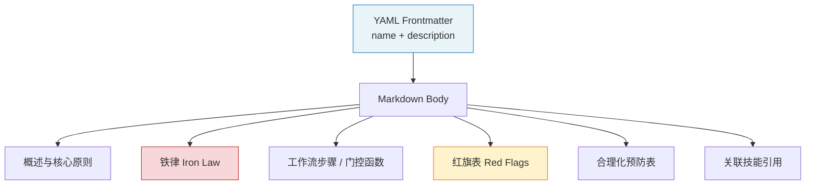
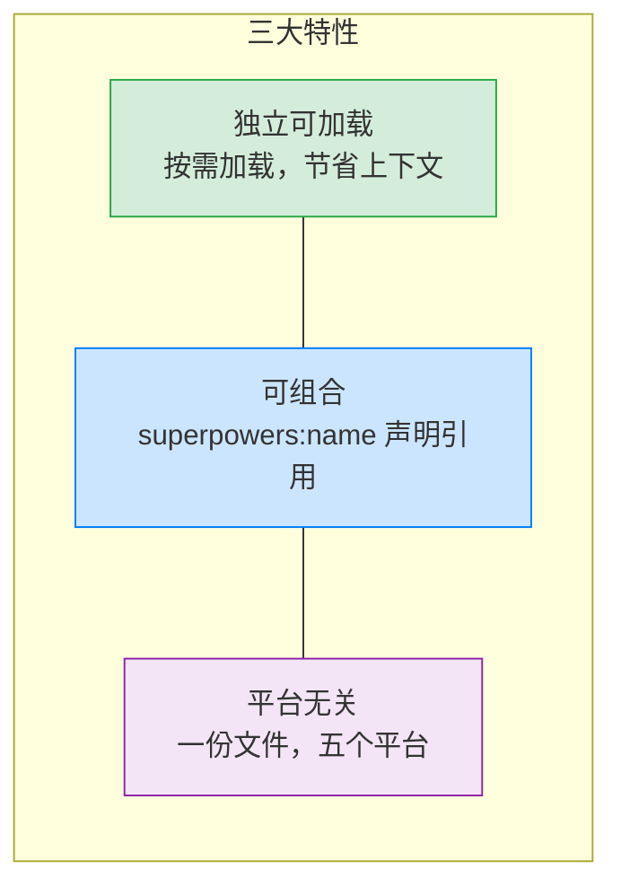
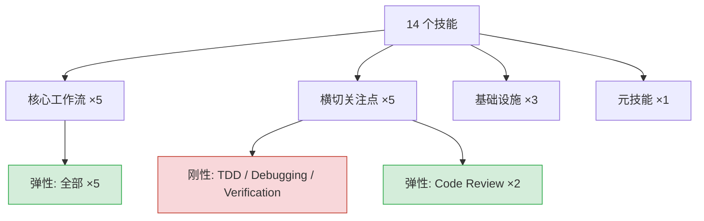

# 技能系统详解

> 技能（Skill）是 Superpowers 的原子单元——一个自包含的 Markdown 文档，
> 既是人类可读的规范，也是 AI 智能体直接执行的指令。

## 1. 技能定义与解剖

每个技能是一个存储在 `skills/<name>/SKILL.md` 的 Markdown 文件，由两部分组成：

- **YAML Frontmatter** — 仅包含 `name` 和 `description` 两个字段，总长度不超过 1024 字符。`description` 必须以 "Use when..." 开头，只描述触发条件，不描述工作流内容（工作流属于反合理化设计模式，详见[第五章](./05-anti-rationalization.md)）。
- **Markdown Body** — 工作流步骤、检查清单、硬门控（Hard Gate）、铁律（Iron Law）、红旗（Red Flag）等执行指令。

以 `verification-before-completion` 技能为例：

```yaml
---
name: verification-before-completion
description: Use when about to claim work is complete, fixed, or passing,
  before committing or creating PRs - requires running verification commands
  and confirming output before making any success claims
---

# Verification Before Completion

## The Iron Law

NO COMPLETION CLAIMS WITHOUT FRESH VERIFICATION EVIDENCE

## The Gate Function

BEFORE claiming any status or expressing satisfaction:
1. IDENTIFY: What command proves this claim?
2. RUN: Execute the FULL command (fresh, complete)
3. READ: Full output, check exit code, count failures
4. VERIFY: Does output confirm the claim?
5. ONLY THEN: Make the claim

## Red Flags - STOP
- Using "should", "probably", "seems to"
- Expressing satisfaction before verification
- About to commit/push/PR without verification
...
```



Frontmatter 是元数据，Body 是执行逻辑。智能体加载技能后，按 Body 中的步骤逐项执行。

## 2. 三大特性

### 2.1 独立可加载

技能不会预加载到上下文窗口中。根技能 `using-superpowers` 告诉智能体"有哪些技能可用"，但实际内容只在需要时按需加载。这意味着 14 个技能不会同时占用上下文空间——智能体只为当前任务付出认知成本。

### 2.2 可组合

技能通过 `superpowers:<name>` 声明式地引用其他技能。例如 `subagent-driven-development` 在集成部分写道：

```
Required workflow skills:
- superpowers:using-git-worktrees
- superpowers:writing-plans
- superpowers:finishing-a-development-branch

Subagents should use:
- superpowers:test-driven-development
```

这不是函数调用，而是声明式组合——技能说明"何时需要什么"，由智能体决定加载时机。

### 2.3 平台无关

所有技能使用 Claude Code 的工具名称编写，其他平台通过映射文件适配。同一份 `SKILL.md` 在 Claude Code、Gemini CLI、Codex CLI、Cursor、Windsurf 五个平台上共享，无需维护多份副本。



## 3. 触发机制

### 3.1 1% 可能性规则

根技能 `using-superpowers` 用一条极端规则消灭所有犹豫：

> **If you think there is even a 1% chance a skill might apply to what you are doing, you ABSOLUTELY MUST invoke the skill.**

这个超低阈值的设计意图是——漏用一个技能的代价远高于多加载一个技能的代价。加载后发现不适用？丢弃即可。但跳过一个本该使用的技能，可能导致整个任务失败。

### 3.2 红旗表

当智能体产生以下念头时，必须立刻停下并检查技能：

| 你的想法 | 正确反应 |
|---------|---------|
| "这只是一个简单问题" | "问题也是任务。检查是否有适用技能。" |
| "我需要先了解更多上下文" | "技能检查在澄清问题之前。" |
| "这个技能用在这里太重了" | "简单的事情会变复杂。用它。" |
| "我已经知道该怎么做了" | "知道怎么做 ≠ 不需要流程。" |
| "就这一次跳过吧" | "这正是合理化的表现。" |
| "用户没有要求用这个技能" | "用户不需要明确要求。1% 规则。" |
| "让我先探索一下代码库" | "技能告诉你如何探索。先检查。" |
| "这不算一个任务" | "有动作 = 有任务。检查技能。" |

这张表本身就是反合理化机制的一部分——它预判了智能体会产生的每一种逃避理由，并提前封堵。

### 3.3 优先级顺序

当多个技能同时适用时：

1. **流程技能优先** — `brainstorming`、`writing-plans`、`systematic-debugging` 决定"怎么做"
2. **实现技能其次** — `test-driven-development`、`subagent-driven-development` 指导执行

例如："帮我构建 X" → 先加载 `brainstorming`，再加载实现类技能。"修复这个 bug" → 先加载 `systematic-debugging`，再加载领域技能。

## 4. 分类体系

### 4.1 按功能分类

| 类别 | 数量 | 包含技能 |
|------|------|---------|
| 核心工作流 | 5 | brainstorming, writing-plans, subagent-driven-development, executing-plans, finishing-a-development-branch |
| 横切关注点 | 5 | test-driven-development, systematic-debugging, verification-before-completion, requesting-code-review, receiving-code-review |
| 基础设施 | 3 | using-superpowers, using-git-worktrees, dispatching-parallel-agents |
| 元技能 | 1 | writing-skills |

核心工作流覆盖从构思到合并的完整生命周期；横切关注点在任何阶段都可能介入；基础设施提供运行时支撑；元技能用于扩展系统本身。

### 4.2 按刚性分类

- **刚性技能** — 包含铁律，必须严格遵守，不可根据上下文调整：`test-driven-development`、`systematic-debugging`、`verification-before-completion`
- **弹性技能** — 遵循原则但可适应上下文：`brainstorming`、`writing-plans` 等其余技能

技能自身会声明属于哪一类。刚性技能的铁律是不可违反的硬约束，弹性技能的原则是可以灵活适配的软约束。



## 5. 完整技能目录

| # | 技能名 | 中文名 | 类别 | 刚性 | 简述 |
|---|--------|-------|------|------|------|
| 1 | brainstorming | 头脑风暴 | 核心工作流 | 弹性 | 创意工作前探索用户意图与需求 |
| 2 | writing-plans | 编写计划 | 核心工作流 | 弹性 | 将规格转化为可执行的实现计划 |
| 3 | subagent-driven-development | 子智能体驱动开发 | 核心工作流 | 弹性 | 在当前会话中分派子智能体逐任务执行 |
| 4 | executing-plans | 执行计划 | 核心工作流 | 弹性 | 在独立会话中执行计划并设审查检查点 |
| 5 | finishing-a-development-branch | 完成开发分支 | 核心工作流 | 弹性 | 实现完成后引导合并、PR 或清理 |
| 6 | test-driven-development | 测试驱动开发 | 横切关注点 | **刚性** | 先写失败测试，再写最小实现 |
| 7 | systematic-debugging | 系统化调试 | 横切关注点 | **刚性** | 先查根因，再提修复方案 |
| 8 | verification-before-completion | 完成前验证 | 横切关注点 | **刚性** | 声明完成前必须有新鲜验证证据 |
| 9 | requesting-code-review | 发起代码审查 | 横切关注点 | 弹性 | 完成任务后发起结构化审查 |
| 10 | receiving-code-review | 接收代码审查 | 横切关注点 | 弹性 | 收到审查反馈后严谨验证再实施 |
| 11 | using-superpowers | 使用技能系统 | 基础设施 | 弹性 | 建立技能发现与加载机制 |
| 12 | using-git-worktrees | 使用 Git Worktree | 基础设施 | 弹性 | 创建隔离工作区以避免冲突 |
| 13 | dispatching-parallel-agents | 分派并行智能体 | 基础设施 | 弹性 | 将独立任务分派给并行智能体执行 |
| 14 | writing-skills | 编写技能 | 元技能 | 弹性 | 创建、编辑、验证新技能 |

三条铁律全文：

| 刚性技能 | 铁律 |
|---------|------|
| test-driven-development | `NO PRODUCTION CODE WITHOUT A FAILING TEST FIRST` |
| systematic-debugging | `NO FIXES WITHOUT ROOT CAUSE INVESTIGATION FIRST` |
| verification-before-completion | `NO COMPLETION CLAIMS WITHOUT FRESH VERIFICATION EVIDENCE` |

## 6. 下一步

技能系统的触发机制和红旗表只是 Superpowers 反合理化体系的冰山一角。下一章将深入探讨这一设计模式的完整理论框架。

→ [第五章：反合理化设计模式](./05-anti-rationalization.md)

---

[⬅️ 上一篇：核心工作流](./03-workflow.md) | [返回目录](./README.md) | [下一篇：反合理化设计模式 ➡️](./05-anti-rationalization.md)
