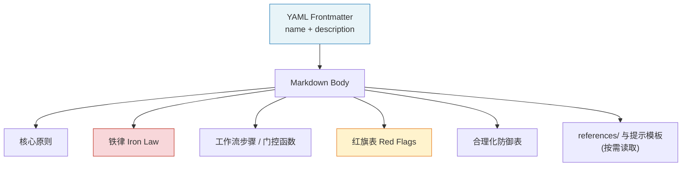
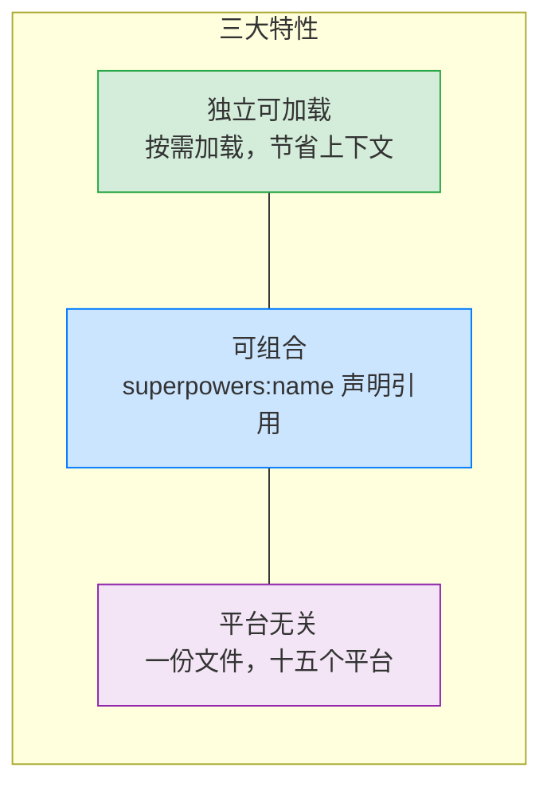

# 技能系统详解

> 技能（Skill）是 Superpowers 的原子单元——一个自包含的 Markdown 文档，
> 既是人类可读的规范，也是 AI 智能体直接执行的指令。

## 1. 技能定义与解剖

每个技能是 `skills/<name>/` 目录，核心文件是 `SKILL.md`，由两部分组成：

- **YAML Frontmatter** — 必填 `name`（仅限字母、数字、连字符）和 `description`；其他可选字段遵循 [agentskills.io](https://agentskills.io) 规范（5.0.6 修正了"只支持两个字段"的错误说法）。整个 frontmatter 的长度上限 1024 字符同样来自该规范；`writing-skills` 另建议 `description` 尽量控制在 500 字符内。
- **Markdown Body** — 工作流步骤、检查清单、硬门（Hard Gate）、铁律（Iron Law）、红旗（Red Flag）等执行指令。

`description` 的写作约定：第三人称，**只描述触发条件，不描述工作流**，通常以 "Use when..." 开头。这是 `writing-skills` 里的写作规范与检查项，不是机制强制的——例如 `brainstorming` 的 description 就以 "You MUST use this before any creative work..." 开头，而且 7.0 起明确把范围扩展到软件之外（一场演讲、一门生意、一次装修）。为什么不能写工作流，详见[第 5 章](./05-anti-rationalization.md)的 SDO 一节。

以 `verification-before-completion` 为例：

```yaml
---
name: verification-before-completion
description: Use when about to claim work is complete, fixed, or passing,
  before committing or creating PRs - requires running verification commands
  and confirming output before making any success claims; evidence before assertions always
---

# Verification Before Completion

## The Iron Law

NO COMPLETION CLAIMS WITHOUT FRESH VERIFICATION EVIDENCE

## The Gate Function

BEFORE claiming any status or expressing satisfaction:
1. IDENTIFY: What command proves this claim?
2. RUN: Execute the FULL command (fresh, complete)
3. READ: Full output, check exit code, count failures
4. VERIFY: Does output confirm the claim?
5. ONLY THEN: Make the claim

## Red Flags - STOP
- Using "should", "probably", "seems to"
...
```



Frontmatter 是元数据，Body 是执行逻辑。智能体加载技能后，按 Body 中的步骤逐项执行；Body 里点名的 `references/` 文件，在走到对应步骤时才读取。

## 2. 三大特性

### 2.1 独立可加载

技能不会预加载到上下文窗口中。根技能 `using-superpowers` 告诉智能体加载规则，实际内容只在需要时按需加载。这意味着 15 个技能不会同时占用上下文空间——智能体只为当前任务付出认知成本。

7.0.1 把这个思路推进到技能**内部**：Claude Code 在上下文压缩后会把每个技能重新附加，但**截断在 20,000 字符处**，之后的内容在会话剩余时间里就丢了。有一次真实会话中，`subagent-driven-development` 因此丢掉了"五轮上限"规则，对同一个任务跑了 18 轮修复（#2481）。对策：

- `subagent-driven-development` 把修复循环、终审、报告处理、续跑、预检、批处理、无法验证等内容移入 `references/`，走到对应步骤再读。
- `writing-skills` 把 SKILL.md 模板、发现优化、加固、流程图规范移入 `references/`。
- `executing-plans` 删掉复述上文规则的示例工作流。
- `tests/skill-size/test-skill-size.sh` 在任何 `SKILL.md` 达到 20,000 **字节**时失败（字节比字符更严格）。

### 2.2 可组合

技能通过 `superpowers:<name>` 声明式地引用其他技能。例如 `writing-plans` 生成的计划头部会写明：

```
> **For agentic workers:** REQUIRED SUB-SKILL: Use superpowers:subagent-driven-development
> (recommended) or superpowers:executing-plans to implement this plan task-by-task.
> Steps use checkbox (`- [ ]`) syntax for tracking.
```

这不是函数调用，而是声明式组合——技能说明"何时需要什么"，由智能体决定加载时机。5.1.0 删除了各技能里残留的"Integration"章节，它们是智能体还没有原生技能系统时的遗留物，对引导行为没有帮助。

### 2.3 平台无关

6.0.0 之前，技能用 Claude Code 的方言书写（"用 Task 工具""写进 CLAUDE.md"）。现在技能正文改用动作描述（"派发一个子智能体""你的指令文件"），并在 `skills/using-superpowers/references/` 里为各平台提供工具映射文件：

| 文件 | 平台 |
|------|------|
| `claude-code-tools.md` | Claude Code |
| `codex-tools.md` | Codex |
| `gemini-tools.md` | Gemini CLI |
| `pi-tools.md` | Pi |
| `antigravity-tools.md` | Antigravity |
| `hermes-tools.md` | Hermes Agent |
| `muse-tools.md` | Muse |

其余平台的映射或者不需要（Cursor），或者内嵌在各自的插件代码/清单里（OpenCode、Kimi Code）。6.1.0 又把这些参考文件裁剪到只剩平台特有的内容（子智能体派发、任务跟踪、指令文件路径），因为动作到工具的对应表是现代智能体本来就会的。



## 3. 触发机制

### 3.1 1% 可能性规则

根技能 `using-superpowers` 用一条极端规则消灭所有犹豫：

> **If you think there is even a 1% chance a skill might apply to what you are doing, you ABSOLUTELY MUST invoke the skill.**

这个超低阈值的设计意图是——漏用一个技能的代价远高于多加载一个技能的代价。加载后发现不适用？不必使用即可。但跳过一个本该使用的技能，可能导致整个任务失败。相关要求还有：在响应或动作**之前**调用（包括澄清问题、探索代码库）；调用后宣布 "Using [skill] to [purpose]"；技能有清单就为每项建一个待办；进入计划模式之前，如果还没做过头脑风暴，先调用 `brainstorming`。

### 3.2 红旗表

`using-superpowers` 的红旗表共 12 条，当智能体产生以下念头时必须立刻停下并检查技能：

| 你的想法 | 现实 |
|---------|------|
| "这只是一个简单问题" | 问题也是任务。检查是否有适用技能。 |
| "我需要先了解更多上下文" | 技能检查在澄清问题**之前**。 |
| "让我先探索一下代码库" | 技能告诉你怎么探索。先检查。 |
| "我可以快速看一下 git/文件" | 文件里没有对话上下文。检查技能。 |
| "让我先收集信息" | 技能告诉你怎么收集信息。 |
| "这不需要正式的技能" | 只要技能存在，就用它。 |
| "我记得这个技能" | 技能会演进，读当前版本。 |
| "这不算一个任务" | 有动作 = 有任务。检查技能。 |
| "这个技能太重了" | 简单的事情会变复杂。用它。 |
| "我先做一件事" | 在做任何事之前先检查。 |
| "这样感觉很有效率" | 无纪律的行动浪费时间。技能能防止这点。 |
| "我知道那是什么意思" | 知道概念 ≠ 使用技能。调用它。 |

这张表本身就是反合理化机制的一部分——它预判了智能体会产生的每一种逃避理由，并提前封堵。

### 3.3 优先级顺序

当多个技能同时适用时，**流程技能优先**——它们决定"怎么做"；实现类技能其次。例如："帮我构建 X" → 先 `brainstorming`，再实现类技能；"修复这个 bug" → 先 `systematic-debugging`，再领域技能。

### 3.4 子智能体豁免

`using-superpowers` 开头有 `<SUBAGENT-STOP>` 块：如果你是被派发去执行具体任务的子智能体，忽略本技能。这避免了每个子智能体再走一遍技能发现流程。

## 4. 分类体系

### 4.1 按功能分类

| 类别 | 数量 | 包含技能 |
|------|------|---------|
| 核心工作流 | 5 | brainstorming, writing-plans, subagent-driven-development, executing-plans, finishing-a-development-branch |
| 横切关注点 | 5 | test-driven-development, systematic-debugging, verification-before-completion, requesting-code-review, receiving-code-review |
| 基础设施 | 3 | using-superpowers, using-git-worktrees, dispatching-parallel-agents |
| 元技能 | 2 | writing-skills, diagnosing-superpowers |

核心工作流覆盖从构思到合并的完整生命周期；横切关注点在任何阶段都可能介入；基础设施提供运行时支撑；元技能用于扩展和诊断系统本身。

### 4.2 按刚性分类

- **刚性技能** — 包含铁律，必须严格遵守，不可根据上下文调整：`test-driven-development`、`systematic-debugging`、`verification-before-completion`
- **弹性技能** — 遵循原则但可适应上下文：其余技能


## 5. 完整技能目录

| # | 技能名 | 中文名 | 类别 | 刚性 | 简述 |
|---|--------|-------|------|------|------|
| 1 | brainstorming | 头脑风暴 | 核心工作流 | 弹性 | 动手前弄清你想要什么；先读后问，回放理解，按规模匹配设计文档 |
| 2 | writing-plans | 编写计划 | 核心工作流 | 弹性 | 把设计转成记录决定（签名、断言、spec 取值）的计划 |
| 3 | subagent-driven-development | 子智能体驱动开发 | 核心工作流 | 弹性 | 每任务一个新实现者 + 一个审查者，最后整分支评审 |
| 4 | executing-plans | 执行计划 | 核心工作流 | 弹性 | Native 模式：当前会话自己实现，末尾一次整分支评审 |
| 5 | finishing-a-development-branch | 完成开发分支 | 核心工作流 | 弹性 | 验证后合并 / 建 PR / 保持现状，并安全清理工作树 |
| 6 | test-driven-development | 测试驱动开发 | 横切关注点 | **刚性** | 先写失败测试，再写最小实现；以完整测试套件为准 |
| 7 | systematic-debugging | 系统化调试 | 横切关注点 | **刚性** | 先查根因，再提修复方案 |
| 8 | verification-before-completion | 完成前验证 | 横切关注点 | **刚性** | 声明完成前必须有新鲜验证证据 |
| 9 | requesting-code-review | 发起代码审查 | 横切关注点 | 弹性 | 用 `code-reviewer.md` 模板发起结构化、只读的审查 |
| 10 | receiving-code-review | 接收代码审查 | 横切关注点 | 弹性 | 收到反馈后先核实再实施，拒绝表演式同意 |
| 11 | using-superpowers | 使用技能系统 | 基础设施 | 弹性 | 建立技能发现与加载机制，1% 规则 |
| 12 | using-git-worktrees | 使用 Git 工作树 | 基础设施 | 弹性 | 检测、征得同意、优先原生工具地创建隔离工作区 |
| 13 | dispatching-parallel-agents | 分派并行智能体 | 基础设施 | 弹性 | 把互不相干的任务同时派给多个智能体 |
| 14 | writing-skills | 编写技能 | 元技能 | 弹性 | 创建、编辑、验证新技能（含测试方法论） |
| 15 | diagnosing-superpowers | 诊断 Superpowers | 元技能 | 弹性 | 查清一次会话哪里出了问题，必要时导出脱敏材料或起草 issue |

三条铁律全文（7.0.1 核对，未变）：

| 刚性技能 | 铁律 |
|---------|------|
| test-driven-development | `NO PRODUCTION CODE WITHOUT A FAILING TEST FIRST` |
| systematic-debugging | `NO FIXES WITHOUT ROOT CAUSE INVESTIGATION FIRST` |
| verification-before-completion | `NO COMPLETION CLAIMS WITHOUT FRESH VERIFICATION EVIDENCE` |

## 6. 下一步

技能系统的触发机制和红旗表只是 Superpowers 反合理化体系的冰山一角。下一章将深入探讨这一设计模式的完整理论框架。

→ [第五章：反合理化设计模式](./05-anti-rationalization.md)

---

[⬅️ 上一篇：核心工作流](./03-workflow.md) | [返回目录](./README.md) | [下一篇：反合理化设计模式 ➡️](./05-anti-rationalization.md)
