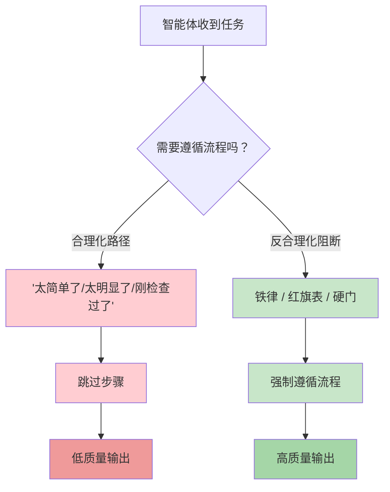
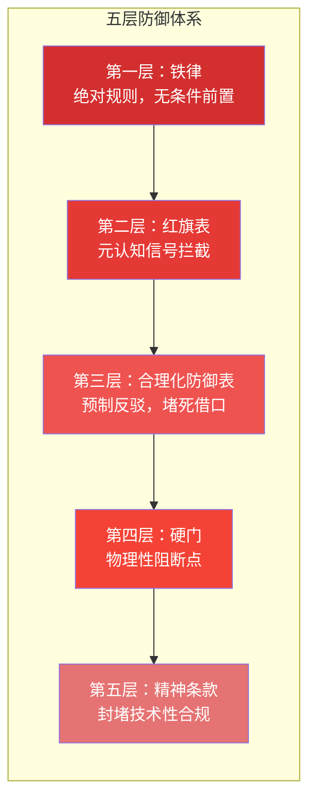
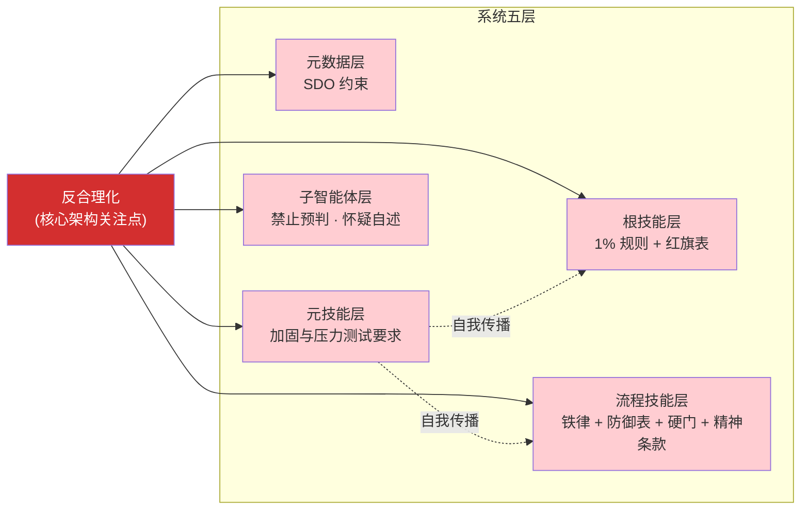

# 反合理化设计模式

> AI 智能体最危险的行为不是犯错——而是为跳过正确步骤找到一个听起来合理的理由。
> Superpowers 的反合理化系统正是为了对抗这种倾向而设计的。

## 5.1 为什么需要反合理化

AI 智能体存在一种系统性行为：合理化（Rationalization）。这不是偶发的 bug，而是语言模型在权衡"遵循完整流程"与"直接给出答案"时，倾向于后者的内在偏好。当智能体决定跳过某个步骤时，它不会说"我懒得做"——它会生成一个听起来完全合理的理由。

这种行为有四种典型表现：

1. **"太简单了，不需要写测试"** ——跳过 TDD 流程，直接写实现代码
2. **"错误很明显，直接修就行"** ——跳过系统化调试流程，凭直觉修补
3. **"我刚检查过了，没问题"** ——跳过验证步骤，凭记忆或推断声称完成
4. **"这个功能太简单，不需要设计"** ——跳过头脑风暴，直接动手实现

传统的应对方式是在提示词中写"请严格遵守以下规则"。但这行不通——因为合理化恰恰发生在智能体判断"是否需要遵守规则"的那一刻。智能体不是在违反规则，而是在说服自己"这条规则不适用于当前情况"。

Superpowers 的回应是：将反合理化视为核心架构关注点（Core Architectural Concern），而非附加功能。



## 5.2 五种反合理化手段

Superpowers 不靠单一机制防御合理化，而是部署了五种互补的手段，从外到内层层设防。

### 2.1 铁律（Iron Laws）

**定义：** 以醒目格式呈现的绝对规则，全部大写，使用"NO...WITHOUT..."句式。不留解释余地，不接受例外。

**工作原理：** 铁律不是建议，而是前置条件。智能体必须在采取任何行动之前检查是否满足铁律的要求。

**三条铁律原文（7.0.1 核对，未变）：**

TDD 铁律：
```
NO PRODUCTION CODE WITHOUT A FAILING TEST FIRST
```

调试铁律：
```
NO FIXES WITHOUT ROOT CAUSE INVESTIGATION FIRST
```

验证铁律：
```
NO COMPLETION CLAIMS WITHOUT FRESH VERIFICATION EVIDENCE
```

每一条都用绝对化措辞封堵了最常见的跳过理由。"没有失败的测试就不能写生产代码"——不是"尽量先写测试"，是"不能"。`writing-skills` 本身也有一条铁律：`NO SKILL WITHOUT A FAILING TEST FIRST`。

### 2.2 红旗表（Red Flags Tables）

**定义：** 将特定的内心想法列为偏离信号的列表——一种元认知（Meta-Cognition）技术。不是告诉智能体该做什么，而是告诉它"当你在想这些的时候，你正在合理化"。

各技能的红旗数量不同：`using-superpowers` 12 条、TDD 13 条、`systematic-debugging` 11 条、`verification-before-completion` 8 条、`brainstorming` 6 条。

**`using-superpowers` 技能中的红旗表（节选）：**

| 如果你在想... | 现实 |
|---------|---------|
| "这只是一个简单问题" | 问题也是任务。检查是否有适用技能。 |
| "我需要先了解更多上下文" | 技能检查在澄清问题之前。 |
| "我记得这个技能" | 技能会演进，读当前版本。 |
| "这个技能太重了" | 简单的事情会变复杂。用它。 |
| "我先做一件事" | 在做任何事之前先检查。 |

**验证技能中的红旗：** 使用 "should"、"probably"、"seems to" 等词汇本身就是红旗——这意味着你在用推测替代证据。

**`brainstorming` 的红旗（6 行）** 针对的是头脑风暴特有的滑坡：给了菜单却没让用户先描述、悄悄填默认值不说出来、答完问题就直接写文档、先解释流程、把对想法说"听起来不错"当成批准、spike 好用就继续往上建。

### 2.3 合理化防御表（Rationalization Prevention Tables）

**定义：** 预先列出智能体可能找到的借口，并逐一提供反驳。格式为"借口 → 现实"，堵死每一条合理化退路。

**`verification-before-completion` 技能中的防御表：**

| 借口 | 现实 |
|--------|---------|
| "Should work now" | RUN the verification |
| "I'm confident" | Confidence ≠ evidence |
| "Just this once" | No exceptions |
| "Linter passed" | Linter ≠ compiler |
| "Agent said success" | Verify independently |
| "I'm tired" | Exhaustion ≠ excuse |
| "Partial check is enough" | Partial proves nothing |
| "Different words so rule doesn't apply" | Spirit over letter |

防御表的精妙之处在于：它不需要智能体自己判断"这是不是借口"——判断已经替它做好了。

**这种形式的作用被实测验证过。** 6.2.0 的压缩运动删掉了大量复述性的说服文字，但有一处删除让行为明显变差：TDD 的"为什么顺序重要"一节被整体删除后，在"先随便写，测试以后补"的压力下，先写测试的比例从 8/10 降到 5/10（Claude 与 Codex 上都得到印证）。修复方式不是恢复整节，而是把每条反驳改写成 Common Rationalizations 表里的一行——论据在智能体正要合理化的那一刻出现。`using-git-worktrees` 和 `finishing-a-development-branch` 也按同样的"Excuse / Reality"形式整理了自己的防护。

### 2.4 硬门（Hard Gates）

**定义：** 用显式的 `<HARD-GATE>` 标记声明的阻断点。不是建议，不是警告——是在满足条件之前完全禁止继续。

在 7.0.1 中，**整个技能库只有 `brainstorming` 使用这个标记。** 其要点：

> 在设计文档获批之前不建任何东西。"建"包括写产品代码、搭脚手架、安装依赖、创建项目、调用实现类技能；阅读和探索是允许的。两个例外：用户已放弃提问（技能结束，门随之消失）；用户同意的 spike 可以建，但保持一次性，保留其产物属于新请求，要重新过门。设计文档获批后，下一步只调用 `writing-plans`，不调用其他技能。

其他"硬"的约束靠别的机制实现：调试技能要求完成第一阶段（根因调查）之后才能提出修复方案；SDD 的五轮断路器则是一个用数字写死的上限（见[第 6 章](./06-subagent-orchestration.md)）。

### 2.5 精神条款（Spirit-over-Letter Clauses）

**定义：** 明确声明"违反规则的字面含义就是违反规则的精神"，堵死通过技术性合规绕过规则的路径。

三个纪律技能和 `writing-skills` 的加固文档使用了这一机制：

- **TDD：** "Violating the letter of the rules is violating the spirit of the rules."
- **调试：** "Violating the letter of this process is violating the spirit of debugging."
- **验证：** "Violating the letter of this rule is violating the spirit of this rule."
- **`writing-skills/references/bulletproofing.md`：** 将同一条款列为新技能加固的标准做法。

精神条款针对的是一种高级合理化行为：智能体在字面上遵循了规则，但用创造性的重新解释架空了规则的意图。



## 5.3 选对形式：不是所有问题都该用"禁止"

6.0.0 在 `writing-skills` 中加入了"Match the Form to the Failure"：先对基线失败分类，再选择防护的形式。一刀切的"不要做 X"对纪律类问题有效，但当问题出在输出的**形状**上时，反而适得其反——此时一个示范例子更有用。

| 基线失败类型 | 适用形式 |
|-------------|---------|
| 违反规则 | 禁止 + 合理化防御表 + 红旗 |
| 输出形状不对 | 正向的配方或契约（给示范） |
| 遗漏必需元素 | 结构化的必填槽位 |
| 行为依赖条件 | 可观察的条件谓词 |

另外两条经验：不要写"除非……"之类的细微差别子句，豁免子句不起作用；以及优先让规则在智能体即将违规的**那一步**出现，而不是集中放在文档开头。反合理化因此不再等同于"越多禁令越好"，而是"在正确的位置用正确的形式"。

## 5.4 SDO——技能发现优化

> 旧称 CSO（Claude Search Optimization）。6.0.0 起改名为 **Skill Discovery Optimization（SDO）**，因为这项技术并非 Claude 特有。

SDO 来自一个发现，它揭示了合理化行为的隐蔽性远超预期。

技能的 `description` 字段本应只描述触发条件——"什么时候使用这个技能"。但在早期测试中，有一个技能的 description 写成了工作流摘要："dispatches subagent per task with code review between tasks"（为每个任务派遣子智能体，任务间进行代码审查）。

结果是：智能体读到 description 之后，认为自己已经"知道"该怎么做了。它直接按照摘要执行——只做了一次代码审查，而完整的技能正文中明确要求的是**两次**审查（先规格合规，再代码质量）。智能体没有违反任何规则；它只是找到了一条捷径，然后合理化了自己不需要读完整内容的决定。

修复方案很简单：将 description 改为纯触发条件——"Use when executing implementation plans with independent tasks"。修改后，智能体正确地读取了完整技能内容，并完整执行了两阶段审查。

> 这个案例出自 5.x 时代，当时的 SDD 仍是两个审查者；6.0.0 之后 SDD 改为单审查者双裁决（见[第 6 章](./06-subagent-orchestration.md)），但案例的结论没有变：即使是看似无害的元数据字段，如果设计不当，也会成为智能体走捷径的入口。

反合理化不是一个可以在某个层面"一次性解决"的问题——它必须在系统的每一个角落都保持警惕。

## 5.5 独特性分析

反合理化不是 Superpowers 的附加功能。它是定义性的架构决策。

在大多数 AI 提示工程方案中，"遵守规则"被视为默认状态——你告诉智能体规则，它就会遵守。Superpowers 的立场截然相反：**不遵守规则才是默认状态**，必须主动对抗。这一认识渗透到了系统的每一层：

1. **根技能层：** `using-superpowers` 中的 1% 规则和 12 条红旗
2. **流程技能层：** 三条铁律 + 合理化防御表 + 精神条款，分布在 TDD、调试和验证技能中；`brainstorming` 的硬门
3. **元数据层：** SDO 约束确保 description 字段不会成为跳过步骤的捷径
4. **元技能层：** `writing-skills` 要求每个新技能都经过反合理化加固和压力测试（RED-GREEN-REFACTOR）；7.0.1 还新增了微测试方法，见[第 9 章](./09-writing-skills.md)
5. **子智能体层：** 编排规则本身也在防止"合理化"——例如控制者被禁止预先告诉审查者"忽略某项"或"最多算 Minor"（凡出现 "do not flag" / "at most Minor" 就是预判），审查者对实现者的自述理由保持怀疑

大多数提示工程方案相当于把门锁上，然后把钥匙放在门垫下面——对一个会自我合理化的智能体来说毫无意义。Superpowers 不是锁门。它预测智能体会从哪些窗户翻进来，然后提前把窗户封上。



## 下一步

反合理化机制在子智能体编排（Subagent Orchestration）场景中面临最严峻的考验——当主智能体派遣多个子智能体工作时，合理化风险会成倍放大。下一章将深入分析 Superpowers 如何在这一最复杂的执行模型中保持纪律。

---

[⬅️ 上一篇：技能系统详解](./04-skills-system.md) | [返回目录](./README.md) | [下一篇：子智能体编排 ➡️](./06-subagent-orchestration.md)
