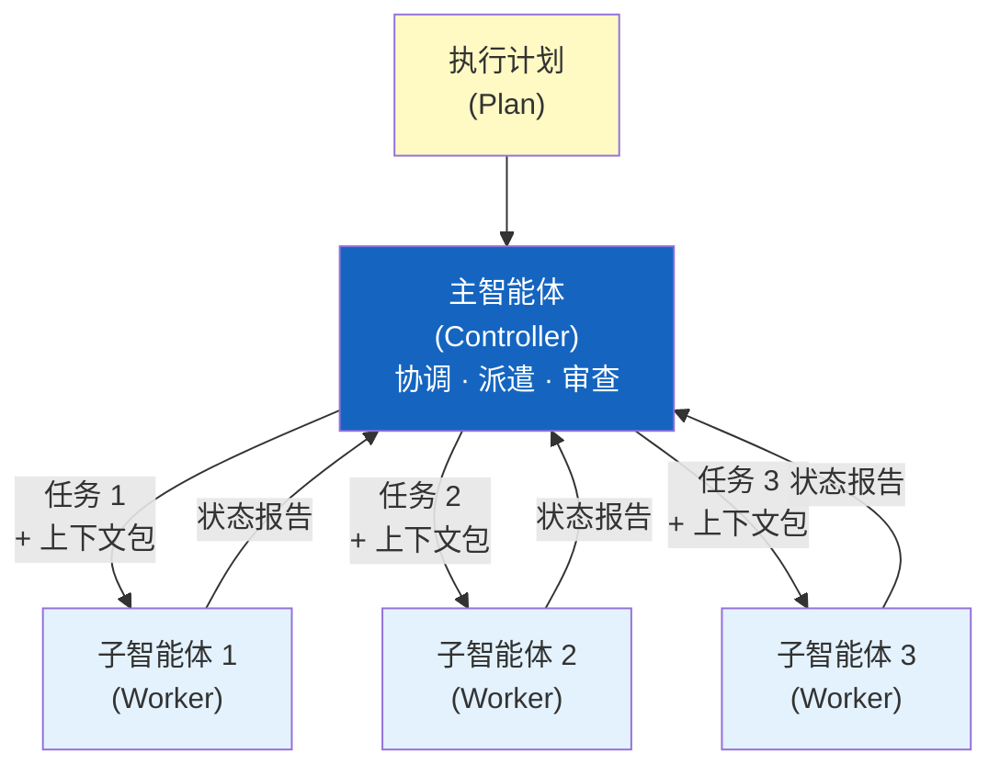
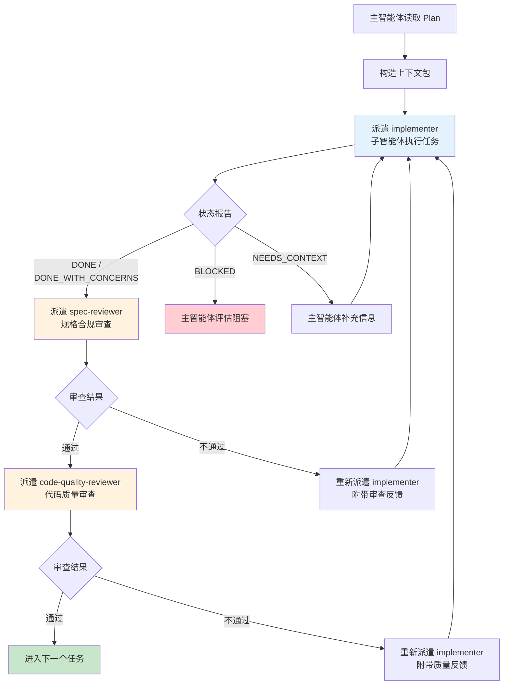
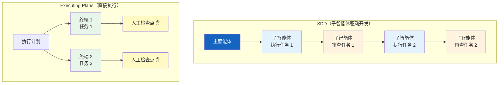

# 子智能体编排

> 子智能体驱动开发（Subagent-Driven Development, SDD）是 Superpowers 的主执行引擎——
> 主智能体负责协调，子智能体负责执行，每个子智能体拥有独立的、精心构造的上下文。

## 7.1 Controller-Worker 模式

Controller-Worker 模式是 SDD 的核心架构。主智能体（Controller）充当项目经理角色——它不直接编写代码，而是协调多个子智能体（Worker）来完成具体任务。每个子智能体是一个独立的执行单元，只负责一个明确定义的任务。

为什么不让单个智能体一口气做完？因为单个智能体处理复杂项目时，上下文窗口会逐渐被历史信息填满，导致注意力分散、指令遵从度下降。Controller-Worker 模式通过任务隔离（Task Isolation）解决这个问题——每个子智能体只看到自己需要的信息，注意力始终保持集中。

主智能体的职责是：读取执行计划、为每个任务构造完整的上下文包、派遣子智能体、收集结果、处理审查反馈、决定是否需要返工。子智能体的职责则简单得多：接收上下文包、执行单个任务（通常结合 TDD 流程）、使用标准状态协议报告结果。子智能体不知道也不关心其他任务的存在。

## 7.2 "新鲜上下文"原则

"新鲜上下文"原则（Fresh Context Principle）是 SDD 最重要的设计决策——每个子智能体**绝不继承**主智能体的会话历史。子智能体的上下文由主智能体精心构造，只包含该任务真正需要的信息。

主智能体为每个子智能体构造的上下文包（Context Package）包含四类内容：

- **任务规格：** 从执行计划中提取的当前任务的具体要求
- **相关代码：** 主智能体预先读取并传入的代码文件内容
- **技能引用：** 适用的技能文件（如 TDD 技能、验证技能）
- **项目约束：** 编码规范、命名约定等项目级约定

不继承历史意味着每个子智能体都以最大的注意力和指令遵从度开始工作。它不会受到前面任务的干扰，不会因为上下文过长而"遗忘"关键指令。这也是为什么 SDD 在大型任务上比单智能体执行更可靠——每个子智能体都像第一次接手任务一样专注。

## 7.3 两阶段审查

每个子智能体完成任务后，不是直接进入下一个任务——而是经过两阶段审查（Two-Stage Review）。这是 SDD 质量保证的核心机制。

**第一阶段——规格合规审查：** 主智能体派遣一个专用的审查子智能体（spec-reviewer），检查实现是否匹配任务规格。它关注的是：是否遗漏了计划中定义的要求？是否引入了计划未要求的内容？这个阶段只关心一个问题——"做对了没有"。

**第二阶段——代码质量审查：** 规格合规通过后，主智能体派遣第二个审查子智能体（code-quality-reviewer），检查代码质量。它关注的是：是否有重复代码、命名不当、潜在 bug？测试覆盖是否充分？这个阶段关心的是——"做好了没有"。

两个关注点故意分开，因为规格合规和代码质量是完全不同的评估维度。合并为一个审查会导致两方面都被稀释。每个审查者有自己的专用 Prompt 模板，确保审查始终聚焦。

## 7.4 Prompt 模板系统

SDD 使用三个专用的 Prompt 模板，存放在 `skills/subagent-driven-development/` 目录下。每个模板定义了一个角色的完整行为规范，确保子智能体从启动的那一刻起就清楚自己的职责边界。

| 模板文件 | 角色 | 职责 | 模型选择 |
|---------|------|------|---------|
| `implementer-prompt.md` | 实现者 | 执行具体编码任务，遵循 TDD 流程 | 根据任务复杂度——机械任务用低成本模型，集成任务用标准模型 |
| `spec-reviewer-prompt.md` | 规格审查者 | 审查实现是否匹配规格要求 | 高能力模型——需要理解规格和代码的对应关系 |
| `code-quality-reviewer-prompt.md` | 代码质量审查者 | 审查代码质量、测试覆盖、最佳实践 | 高能力模型——需要架构和代码质量判断 |

模型选择遵循"最低能力匹配"（Least Powerful Model）原则——用能完成任务的最便宜的模型。机械性任务（如按模板生成代码）交给低成本模型；集成任务（如多组件协调）交给标准模型；架构决策和审查交给最强模型。这在保证质量的同时优化了成本。

## 7.5 状态报告协议

子智能体完成任务后，必须使用标准化的状态报告协议（Status Protocol）向主智能体报告结果。这四种状态构成了主智能体决策树的全部输入——主智能体不需要解析自由文本来判断任务状态。

| 状态码 | 含义 | 主智能体响应 |
|--------|------|-------------|
| `DONE` | 任务完成，可以审查 | 派遣 spec-reviewer 进行规格合规审查 |
| `DONE_WITH_CONCERNS` | 任务完成但有顾虑 | 先阅读顾虑内容，再决定是否进入审查 |
| `NEEDS_CONTEXT` | 缺少必要信息，无法继续 | 主智能体提供所需信息，重新派遣 |
| `BLOCKED` | 遇到阻塞，无法完成 | 主智能体评估阻塞原因——可能需要修改计划或调整任务 |

状态协议的价值在于通信的结构化和可预测性。主智能体收到状态码后，可以直接进入对应的处理分支，无需额外的判断和解析。这让整个编排流程变成了一个确定性的状态机。

## 7.6 SDD 与直接执行对比

Superpowers 提供两种执行模式——子智能体驱动开发（SDD）和直接执行计划（Executing Plans）。选择取决于任务性质和团队偏好。

| 维度 | SDD（子智能体驱动开发） | Executing Plans（直接执行） |
|------|----------------------|--------------------------|
| 会话模式 | 同一会话内派遣子智能体 | 并行独立会话（如多个终端） |
| 子智能体 | 使用子智能体 | 不使用子智能体 |
| 审查方式 | 自动两阶段审查（spec + quality） | 人工检查点 |
| 上下文 | 每个子智能体新鲜上下文 | 每个并行会话独立上下文 |
| 适用场景 | 任务间有依赖、需要自动质量控制 | 任务完全独立、人工可以高效审查 |
| 成本 | 较高（多个子智能体 + 审查） | 较低（无审查子智能体开销） |

SDD 适合复杂项目、任务间有依赖关系、希望自动化质量控制的场景。Executing Plans 适合任务完全独立、开发者愿意在每个检查点亲自审查的场景。两者不是互斥的——同一个项目的不同阶段可以混合使用。

## 下一步

子智能体编排系统和所有其他技能都需要在不同的 AI 编码平台上运行。下一章将深入解析 Superpowers 的平台适配层——如何让同一套技能文件在 Claude Code、Cursor、Gemini CLI、Codex 和 OpenCode 五个平台上无缝工作。

---

[⬅️ 上一篇：反合理化设计模式](./05-anti-rationalization.md) | [返回目录](./README.md) | [下一篇：平台适配层 ➡️](./07-platform-adapters.md)
