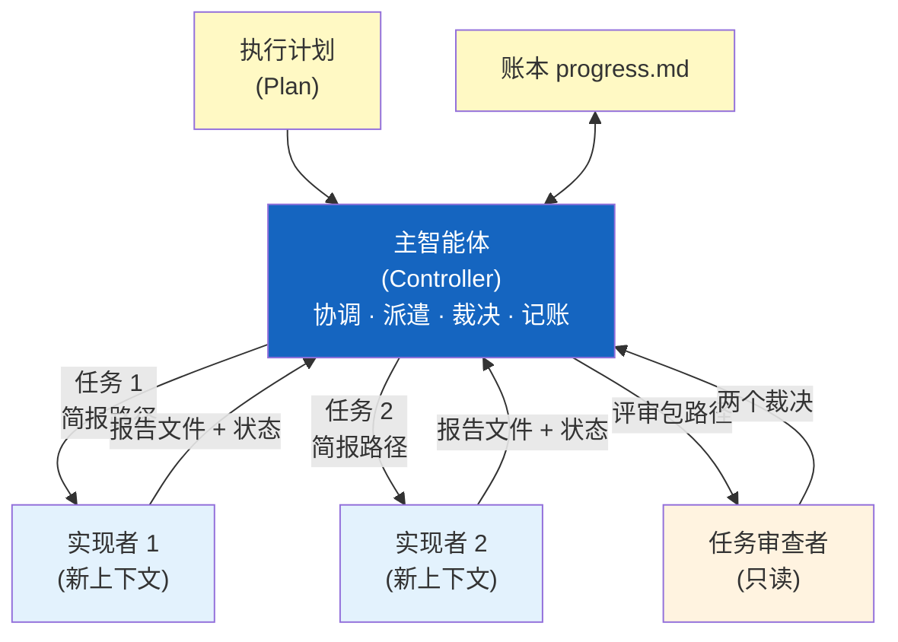

# 子智能体编排

> 子智能体驱动开发（Subagent-Driven Development, SDD）是 Superpowers 最彻底的执行引擎——
> 主智能体负责协调，子智能体负责执行与审查，每个子智能体拥有独立的、精心构造的上下文。
> 6.0.0 对它做了彻底重写，在官方评测中得到约一倍的速度提升和接近 50% 的 token 节省（不保证在所有平台和负载上成立）。

## 6.1 Controller-Worker 模式

Controller-Worker 模式是 SDD 的核心架构。主智能体（Controller）充当项目经理角色——它不直接编写实现代码，而是协调多个子智能体（Worker）来完成具体任务。每个子智能体是一个独立的执行单元，只负责一个明确定义的任务。

为什么不让单个智能体一口气做完？因为单个智能体处理复杂项目时，上下文窗口会逐渐被历史信息填满，导致注意力分散、指令遵从度下降。Controller-Worker 模式通过任务隔离（Task Isolation）解决这个问题——每个子智能体只看到自己需要的信息，注意力始终保持集中。

主智能体的职责是：读取执行计划、为每个任务生成简报、派遣子智能体、收集结果、处理审查反馈、决定是否需要返工、维护账本。子智能体的职责则简单得多：读简报、执行单个任务（结合 TDD）、写报告、使用标准状态协议回复。

**控制者永远不自己修实现代码**——这样既保持自己的上下文干净，也避免控制者自己的修复绕过审查。

## 6.2 "新鲜上下文"原则与文件交接

"新鲜上下文"原则（Fresh Context Principle）仍是 SDD 最重要的设计决策——每个子智能体**绝不继承**主智能体的会话历史。上下文由主智能体精心构造，只包含该任务真正需要的信息。

6.0.0 的重大改变是**交接方式**：任务文本和 diff 不再粘贴进派发消息，而是写成文件，由子智能体自己读。原因是粘贴的 diff 会永久留在最昂贵的上下文里，而一个拿不到 diff 的审查者又会手工重建它——后者是审查者最大的成本。有一次真实会话里，42k 字符的派发消息 99% 是粘贴的历史。

每次派发包含五项：一行定位语、简报路径（"先读这个，其中的确切值照用"）、简报里没有的前序接口与决定、控制者对简报歧义的解决、报告文件路径与报告契约。**绝不把整份计划交给子智能体读**。

**三个辅助脚本**（均通过解释器调用，如 `bash scripts/...`，因为有的打包方式会丢失可执行位）：

| 脚本 | 作用 |
|------|------|
| `sdd-workspace PLAN_FILE` | 解析并创建**每个计划一个**的工作区目录，打印其绝对路径；是工作区位置的唯一真源 |
| `task-brief PLAN_FILE N` | 从计划中抽出 `Task N` 全文写成 `task-N-brief.md`，让任务文本不必经过控制者上下文 |
| `review-package PLAN_FILE BASE HEAD [OUTFILE]` | 生成"提交列表 + `--stat` + `git diff -U10`"的单一评审包；范围无效（不可解析、HEAD 不是 BASE 的后代、为空）时退出码 3 |

**工作区**位于 `<repo-root>/.superpowers/sdd/<plan-basename>/`，在工作树内、被 git 忽略（不放 `.git/` 内，因为 Claude Code 把 `.git/` 当受保护路径）。内含账本 `progress.md`、`task-N-brief.md`、`task-N-report.md`、`review-*.diff`、`task-N-tests.log`。同名计划冲突时用父目录名再用计数器消歧；每个工作区写 `plan-path` 标记记录归属；最终评审干净后整个目录被删除，git 历史才是持久记录。注意 `git clean -fdx` 会删掉它，可用 `git log` 恢复。

## 6.3 账本（Ledger）与续跑

账本 `progress.md` 首行写明所属计划：`# SDD ledger — plan: <plan file path>`。常见行型：

- `Task <N>: complete (commits <base7>..<head7>, review clean)`
- `Task <N>: complete (commits <base7>..<head7>, <K> parked)`（断路器触发后）
- `Task <N>: fix round <R>/5 (...)`
- `Task <N>: minor (deferred): <一句话>`
- `Task <N>: parked — <发现> — Ruling: <...>`
- `Task <N>: Ruling: <...>`

**续跑规则：** 首行指向本计划的账本，有 `Task <N>: complete` 的任务视为已完成，不要重派；从第一个没有完成行的任务继续；末行是修复轮的任务从下一轮继续。首行指向别的计划的账本不要动，另起自己的目录。**上下文被压缩后，信账本与 `git log`，不信自己的记忆。**

## 6.4 单审查者、双裁决

这是 6.0.0 对旧版"两阶段审查"的取代。旧文档描述的 `spec-reviewer-prompt.md` 和 `code-quality-reviewer-prompt.md` 已不存在，合并为一个 `task-reviewer-prompt.md`。

**审查者读一次 diff，返回两个裁决：**

- **Part 1 — 规格合规（Spec Compliance）：** Missing（遗漏）/ Extra（多做）/ Misunderstood（误解）
- **Part 2 — 代码质量（Code Quality）：** 代码质量、测试、结构

输出格式含 `### Spec Compliance`（✅ / ❌，外加 `⚠️ Cannot verify from diff`）、`### Strengths`、`### Issues`（Critical / Important / Minor，每条带 `file:line`）、`### Assessment`（**Task quality: Approved | Needs fixes**）。

好处是一次修复就能同时清掉两类问题，而不是两轮审查两轮修复。**一个新增的"无法从 diff 验证"裁决**：当某条需求住在未改动的代码里，审查者不得猜测，而是标出 ⚠️，由控制者自己逐项核实（控制者掌握计划和跨任务上下文）；确认是真缺口就当作规格审查失败处理，进入修复循环。

**审查者的行为约束：**

- **只读**：不得改动工作树、索引或 HEAD（曾有审查者执行 `git checkout` 导致后续提交成了孤儿）
- **不得派子智能体**：重复计费，也让裁决无效
- **不信任自述**：实现者的"我故意没抽象"不能说服审查者放过真问题；不重跑实现者已跑过的测试，只在读代码引发具体疑问时跑聚焦测试
- **看不见 ≠ 不存在**：报告或测试证据疑似被截断时，按路径重读；真缺失就作为缺口报告
- **计划强制的缺陷也要报**：计划明令但按评分标准属于缺陷的内容（如断言为空的测试、逐字重复的逻辑块），以 Important 报出并标注"plan-mandated"，因为"计划作者不能给自己的作品打分，应当由人来决定"
- **批处理任务**：简报中列出的每个文件都必须在 diff 里有对应改动，否则算 Missing

**控制者的反向约束：** 不得告诉审查者要忽略什么，也不得预先给严重度。凡出现 "do not flag" / "at most Minor" / "the plan chose" 就是预判。这条规则来自真实运行：有控制者教审查者把某个发现判为"最多 Minor"，缺陷就这样上线了。

## 6.5 修复循环与五轮断路器

触发条件：规格 ❌、任何 Critical / Important、或控制者确认为真缺口的 ⚠️。Minor **永远不进循环**，记入账本并交给最终评审分诊。

- **一轮** = 一次修复派发 + 一次**聚焦**复审，每个任务**最多 5 轮**
- **第 1–3 轮：恢复原实现者**（上下文完整）；平台不支持再发消息时，带上简报路径、报告路径和发现派新实现者
- **第 4–5 轮：换更强模型的新实现者**，框定为"此前的实现者尝试了此任务 N 次，现在由你接手"
- **复审是聚焦的**：用 `re-review-prompt.md`（SDD 里的第三份提示），只逐条判 ADDRESSED / NOT ADDRESSED，并检查修复 diff 是否引入新破坏；范围外的观察记为 deferred minor，不延长循环
- **断路器**：第 5 轮仍有未结项就停止派发，控制者自己三选一裁决——审查者错或有争议（park + ruling）、真实但下游无人依赖（park 并说明）、真实且承重（裁决最小改动，带入下一个任务）。**只能在上限处裁决**，提前裁决是换了名字的预判；每次裁决必须写入账本，**静默丢弃被禁止**

5 轮上限出现在 6.2.0；7.0.1 把它移到 `references/fix-loop.md`，正是因为技能被截断后这条规则丢过一次。

## 6.6 其他控制者纪律

- **预检冲突扫描（preflight）：** Task 1 之前做一次，检查任务之间、任务与 Global Constraints 之间是否矛盾，以及计划**明令**但评分标准视为缺陷的内容。产出是一张**表**而不是一句"扫描干净"——每对共享文件/接口的任务一行，外加每任务的自洽性检查；写进账本，开始执行前逐条裁决（spec 为约束权威）。
- **批处理小任务：** 多个"同类、小而独立"的改动（同一个一行修复、常量改动、字段新增，跨文件重复）合并成**一个**简报、一次派发、整体评审。
- **永不并行派多个实现者。**
- **等待时不短轮询，也不无限静默等**：忙时继续本地工作，真空闲时有界等待（5–10 分钟）并在两段之间发一行状态。
- **遇到计划冲突不卡住：** 非灾难性的冲突和歧义由控制者裁决并记录，继续工作；只有破坏性或不可逆的操作才停下问人（6.3.0。之前有一次会话为一个控制者本可自己决定的问题卡了近九小时）。
- **BASE 在派发前记录**（`git rev-parse HEAD`），供评审包使用；用记录的 BASE 而不是 `HEAD~1`，避免多提交任务被截断。

## 6.7 模型选择：每次派发都必须显式指定

旧文档提到的"最低能力匹配"原则仍在，但 6.0.0 之后变得更硬：**每次派发必须显式写明模型。** 省略会继承会话模型（往往是最贵最强的），一次运行中 26 个审查者全部落在最高档。

| 角色 | 倾向 |
|------|------|
| 机械实现 | 快而便宜的模型 |
| 集成 / 判断类实现 | 标准模型 |
| 架构 / 设计，以及**最终整分支评审** | 最强模型 |
| 任务审查 | 按 diff 大小、复杂度、风险缩放；小修复 diff 的聚焦复审可用便宜到中端 |
| 第 4–5 轮修复 | 至少比前面的实现者高一级 |

一条反直觉的经验："回合数比 token 单价更重要"——最便宜的模型在多步任务上常需要 2–3 倍回合反而更贵，所以审查者和"按散文描述实现"的实现者以中端模型为下限；如果计划里已经写好完整代码，实现者实质上是转录加测试，才可用最便宜档。

## 6.8 状态报告协议

子智能体完成任务后，使用标准化状态报告协议向主智能体回复（`implementer-prompt.md`）。这四种状态在 7.0.1 中**仍然存在**：

| 状态码 | 含义 | 主智能体响应 |
|--------|------|-------------|
| `DONE` | 任务完成，可以审查 | 生成评审包，派发任务审查者 |
| `DONE_WITH_CONCERNS` | 任务完成但有顾虑 | 先读顾虑：涉及正确性或范围就先处理再审查；只是观察（如"文件变大了"）则记录后继续 |
| `NEEDS_CONTEXT` | 缺少必要信息 | 补上缺失的上下文后重新派发 |
| `BLOCKED` | 遇到阻塞 | 按原因处理：缺上下文（补上，同模型重派）、需要更强推理（换更强模型重派）、任务太大（拆分）、计划本身错（裁决并记账后带裁决重派） |

原则是"永不忽略升级，也永不在没有任何变化的情况下强迫同一个模型重试"。

## 6.9 整分支终审

所有任务完成后（`references/final-review.md`）：

1. `review-package PLAN_FILE MERGE_BASE HEAD` 生成整分支评审包
2. 在**最强可用模型**上派发审查者，使用 `requesting-code-review/code-reviewer.md`，并指向账本中的 deferred minor 与 parked 行
3. 有发现时只派**一个**修复子智能体，带上完整清单（不是一发现一个修复者——真实会话中终审修复波的成本曾超过全部任务之和）
4. 随后**恰好一次**聚焦复审，残余项按断路器方式裁决
5. **没有第二波修复**；残余承重项在 `finishing-a-development-branch` 呈现选项时上呈给你

## 6.10 SDD 与 Native 执行对比

Superpowers 提供两种执行方式，在 `writing-plans` 的交接环节由你选择，智能体会基于计划给出推荐及理由。

| 维度 | SDD（Subagent-driven） | Native（`executing-plans`） |
|------|----------------------|--------------------------|
| 谁实现 | 每个任务一个新子智能体 | 当前会话自己实现 |
| 审查节奏 | 每任务一个审查者 + 最后整分支评审 | 只有最后一次整分支评审 |
| 上下文 | 每个任务都是新鲜上下文 | 同一个会话持续累积 |
| 工作区与账本 | `.superpowers/sdd/<plan>/` | **同一个**目录与格式，可中途换执行者续跑 |
| 停止规则 | 四类才停：破坏性、安全敏感、worktree 外的副作用、计划坏到只剩猜 | 相同 |
| 成本 | 较高，每任务每审查各一份新上下文 | 最低，可用中端会话模型运行 |
| 适用 | 想要每任务审查门；计划很长、后段会跑在被压缩的上下文上 | 任务耦合紧密、想省成本；平台没有子智能体工具 |

选 Native 的前提之一就是平台没有子智能体工具时——此时审查者的那一次整分支评审由当前会话自己按 `code-reviewer.md` 做一遍，并在账本和最终消息里老实写明"作者自审弱于新审查者"，**绝不伪造派发**。

## 6.11 可选：控制者再下沉一层

在 Claude Code 上，控制者可以作为嵌套子智能体运行在中端模型上，测得成本和耗时都约减半（6.4.1）。这是**可选**的：需要你主动提出，或告诉智能体"会话模型太贵，不想用来做协调"。

## 下一步

子智能体编排系统和所有其他技能都需要在不同的 AI 编码平台上运行。下一章将深入解析 Superpowers 的平台适配层——如何让同一套技能文件在 15 个平台上工作。

---

[⬅️ 上一篇：反合理化设计模式](./05-anti-rationalization.md) | [返回目录](./README.md) | [下一篇：平台适配层 ➡️](./07-platform-adapters.md)
