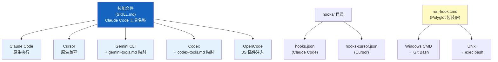
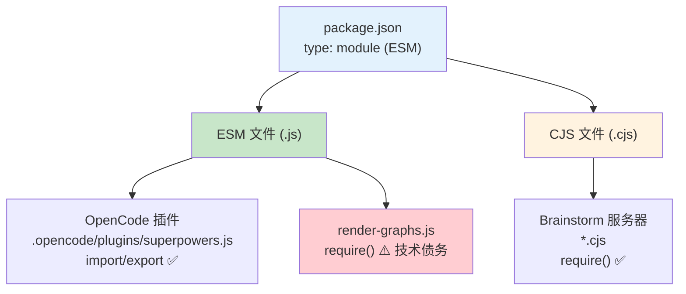

# 平台适配层

> 一套技能，五个平台——Superpowers 通过平台适配层（Platform Adaptation Layer）
> 让同一份 SKILL.md 文件在 Claude Code、Cursor、Gemini CLI、Codex 和 OpenCode 上无缝运行。

## 7.1 五平台集成概览

Superpowers 的技能文件统一使用 Claude Code 的工具名称编写——这是项目的"标准方言"。其他平台通过各自的适配机制将这些名称映射到等价物。技能层完全不感知平台差异，所有适配逻辑封装在插件定义文件和钩子脚本中。



以下是五个平台的具体集成方式：

### Claude Code

- 插件定义：`.claude-plugin/plugin.json`（v5.0.5 格式）
- 市场信息：`.claude-plugin/marketplace.json`
- 钩子配置：`hooks/hooks.json` → `SessionStart` 事件，触发时机为 `startup|clear|compact`
- 钩子执行：`run-hook.cmd session-start` → 调用 `hooks/session-start` 脚本
- JSON 输出格式：

```json
{
  "hookSpecificOutput": {
    "hookEventName": "SessionStart",
    "additionalContext": "..."
  }
}
```

- 安装命令：`/plugin install superpowers@claude-plugins-official`

### Cursor

- 插件定义：`.cursor-plugin/plugin.json`（v5.0.5 格式）——包含 `skills`、`agents`、`commands`、`hooks` 引用
- 钩子配置：`hooks/hooks-cursor.json` → `sessionStart` 事件
- JSON 输出格式：

```json
{ "additional_context": "..." }
```

- 安装命令：`/add-plugin superpowers`

### Gemini CLI

- 扩展定义：`gemini-extension.json`（v5.0.0 格式）——`contextFileName: "GEMINI.md"`
- 上下文文件：`GEMINI.md`，使用 `@` 引用包含技能文件
- 工具映射：`references/gemini-tools.md`
- 安装命令：`gemini extensions install https://github.com/obra/superpowers`

### Codex

- 基于符号链接（Symlink）：克隆仓库，将 `skills/` 目录链接到 `~/.agents/skills/superpowers`
- 安装说明：`.codex/INSTALL.md`
- 工具映射：`references/codex-tools.md`

### OpenCode

- JS 插件：`.opencode/plugins/superpowers.js`（ESM 格式）
- 配置钩子：注入技能路径到 `config.skills.paths`
- 系统提示：通过 `experimental.chat.system.transform` 注入引导提示
- 安装方式：添加到 `opencode.json` 的 plugin 数组

## 7.2 平台对比表

| 维度 | Claude Code | Cursor | Gemini CLI | Codex | OpenCode |
|------|-----------|--------|-----------|-------|----------|
| 集成方式 | Plugin (.claude-plugin/) | Plugin (.cursor-plugin/) | Extension (gemini-extension.json) | Symlink (~/.agents/skills/) | JS Plugin (.opencode/) |
| 钩子格式 | hooks.json → SessionStart | hooks-cursor.json → sessionStart | @-include 引用 | 无钩子（手动加载） | config hook + system transform |
| JSON 输出 | `hookSpecificOutput.additionalContext` | `additional_context` | 无（Markdown 直接注入） | 无 | 无（代码注入） |
| 安装命令 | `/plugin install superpowers@...` | `/add-plugin superpowers` | `gemini extensions install URL` | 手动 symlink | 编辑 opencode.json |
| 工具映射 | 原生（标准方言） | 原生兼容 | references/gemini-tools.md | references/codex-tools.md | 无需映射 |

Claude Code 和 Cursor 最为相似——都是插件系统加钩子机制，区别仅在于钩子配置文件和 JSON 输出结构。Gemini CLI 采用 Markdown 上下文注入的方式，不依赖 JSON 钩子。Codex 最轻量，通过文件系统符号链接直接暴露技能目录。OpenCode 则用 JavaScript 插件以编程方式完成配置注入。

## 7.3 Windows 跨平台支持

Superpowers 的钩子脚本用 Bash 编写，但 Windows 没有原生 Bash 支持。解决方案是多语言脚本（Polyglot Script）——`run-hook.cmd` 同时是合法的 Windows CMD 批处理文件和合法的 Bash 脚本：

```cmd
: ; # Polyglot CMD/Bash script
: ; # On Windows: CMD interprets this as labels and GOTOs
: ; # On Unix: bash ignores ':' (no-op) and runs the bash section
:; exec bash "$0" "$@"
@echo off
REM === Windows CMD section ===
REM Try Git for Windows bash first
if exist "C:\Program Files\Git\bin\bash.exe" (
    "C:\Program Files\Git\bin\bash.exe" hooks/%1 %*
    goto :eof
)
REM Try PATH bash
where bash >nul 2>nul && (
    bash hooks/%1 %*
    goto :eof
)
REM No bash available — exit silently
goto :eof
```

这段脚本的巧妙之处在于：Unix 上 Bash 读到 `:;` 将其视为空操作（no-op），然后 `exec bash` 接管执行；Windows 上 CMD 将 `:` 开头的行视为标签，跳过后执行 `@echo off` 以下的批处理部分，依次尝试 Git for Windows 自带的 Bash 和 PATH 中的 Bash。

除了多语言脚本，跨平台支持还涉及以下细节：

- **LF 行尾强制**：所有文本文件通过 `.gitattributes` 强制使用 LF 行尾。Bash 脚本在 Windows 上如果包含 CRLF 会执行失败，这是最常见的跨平台陷阱。
- **无扩展名钩子文件**：钩子文件使用无扩展名格式（如 `session-start` 而非 `session-start.sh`），防止 Claude Code 在 Windows 上的文件类型自动检测出现问题。
- **MSYS2 PID 命名空间问题**：在 Windows 的 MSYS2 环境中，PID 命名空间（PID Namespace）与原生 Windows 不同，导致 owner PID 监控功能无法正确工作，因此该功能在 Windows 上被禁用。

## 7.4 平台检测机制

平台检测主要通过环境变量（Environment Variables）实现。不同平台在执行钩子时会设置各自的环境变量，钩子脚本通过检测这些变量来确定当前运行平台，并输出对应格式的 JSON：

```bash
# Platform detection and conditional JSON output
if [ -n "$CLAUDE_CODE_HOOK_EVENT" ]; then
    # Claude Code format
    echo '{"hookSpecificOutput":{"hookEventName":"SessionStart","additionalContext":"..."}}'
elif [ -n "$CURSOR_HOOK_EVENT" ]; then
    # Cursor format
    echo '{"additional_context":"..."}'
fi
```

Claude Code 期望 `hookSpecificOutput` 嵌套结构，Cursor 期望 `additional_context` 平铺——两者输出格式不可互换。钩子脚本根据检测结果选择正确的 JSON 结构。

当无法检测到任何平台标识时，钩子脚本默认使用 Claude Code 格式（标准方言），并静默处理失败——不中断用户工作流。这遵循"宁可降级也不崩溃"的设计原则。

## 7.5 模块系统处理

项目根 `package.json` 设置 `"type": "module"`，表示默认使用 ESM（ECMAScript Modules）。所有 `.js` 文件默认被解释为 ESM 模块，使用 `import`/`export` 语法。

部分组件需要 CommonJS（CJS）模块支持。Brainstorm 服务器使用 `.cjs` 扩展名——这是因为在 ESM 包中，Node.js 22+ 会将 `.js` 文件作为 ESM 处理，导致 `require()` 调用失败。将文件重命名为 `.cjs` 是显式声明"这是 CommonJS"的方式。这也是 `.cjs` 扩展名在项目中出现的历史原因。

已知的技术债务（Technical Debt）：`render-graphs.js` 在 ESM 包中使用 CJS 的 `require()` 语法——在当前 Node.js 版本中工作但不规范。OpenCode 插件 `.opencode/plugins/superpowers.js` 则正确使用 ESM `import`/`export`。



## 7.6 下一步

平台适配层和上一章的子智能体编排共同构成了 Superpowers 的实现细节层。适配层确保技能系统在五个平台上一致运行，子智能体编排则定义了这些技能如何被协调执行。下一章将介绍 Brainstorm Companion Server——Superpowers 用于多角色结构化讨论的独立服务组件。

---

[⬅️ 上一篇：子智能体编排](./06-subagent-orchestration.md) | [返回目录](./README.md) | [下一篇：Brainstorm Companion Server ➡️](./08-brainstorm-server.md)
