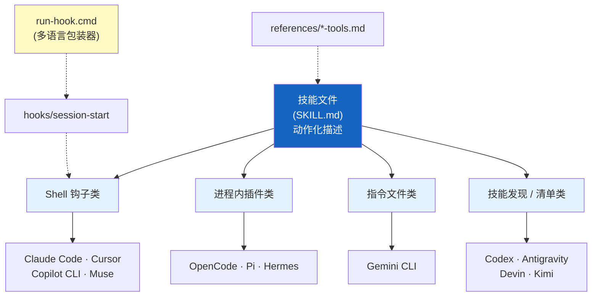
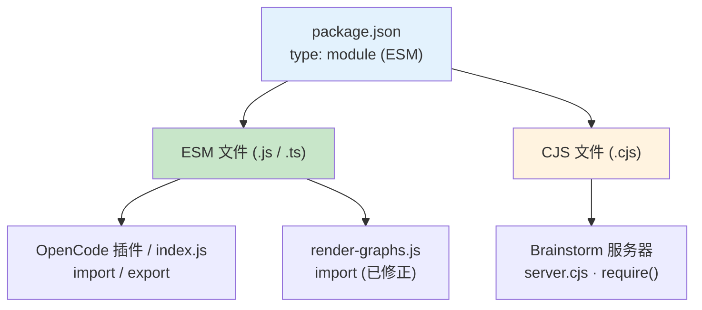

# 平台适配层

> 一套技能，十五个平台——Superpowers 通过平台适配层（Platform Adaptation Layer）
> 让同一份 SKILL.md 文件在不同的 AI 编程助手上运行。

## 7.1 十五个平台概览

截至 7.0.1，`README.md` 的安装小节列出 15 个平台（Codex App 与 Codex CLI 合计一个）。5.0 时期只有 5 个，之后陆续增加：5.0.7 的 Copilot CLI，6.0.0 的 Kimi Code、Pi、Antigravity，6.3.0 的 Devin CLI、Hermes Agent、Grok Build CLI，6.4.1 的 Muse、Qwen Code、OpenCode 2.0，另有 Factory Droid 的安装说明。

适配层的原则是：**技能层完全不感知平台差异**，所有适配逻辑都封装在各平台的清单、插件代码和钩子脚本中；平台之间的工具差异通过 `skills/using-superpowers/references/` 里的映射文件处理（详见[第 4 章](./04-skills-system.md)）。

| 平台 | 集成位置 | 安装方式（摘自 README） |
|------|---------|----------------------|
| Claude Code | `.claude-plugin/` + `hooks/hooks.json` | `/plugin install superpowers@claude-plugins-official` |
| Antigravity | `.antigravity-plugin/plugin.json` | `agy plugin install https://github.com/obra/superpowers` |
| Codex App / CLI | `.codex-plugin/plugin.json`、`.agents/plugins/marketplace.json` | 官方 Codex 插件市场；App 内点 Plugins，CLI 用 `/plugins` 搜索 |
| Cursor | `.cursor-plugin/` + `hooks/hooks-cursor.json` | `/add-plugin superpowers` |
| Devin CLI | `.devin-plugin/plugin.json` | `devin plugins install obra/superpowers` |
| Factory Droid | 走 Claude 兼容的插件市场 | `droid plugin marketplace add https://github.com/obra/superpowers`，再 `droid plugin install superpowers@superpowers` |
| Gemini CLI | `gemini-extension.json` + `GEMINI.md` | `gemini extensions install https://github.com/obra/superpowers` |
| GitHub Copilot CLI | 走 Claude 兼容的插件市场；`hooks/session-start` 检测 `COPILOT_CLI` | `copilot plugin marketplace add obra/superpowers-marketplace`，再 `copilot plugin install superpowers@superpowers-marketplace` |
| Grok Build CLI | 官方 Grok 插件市场 | `grok plugin install superpowers@xai-official --trust` |
| Kimi Code | `.kimi-plugin/plugin.json` | `/plugins install https://github.com/obra/superpowers` |
| OpenCode | `.opencode/plugins/superpowers.js`、根目录 `index.js` | 让 OpenCode 获取并执行 `.opencode/INSTALL.md` |
| Pi | `.pi/extensions/superpowers.ts` | `pi install git:github.com/obra/superpowers` |
| Qwen Code | 直接读取 Claude Code 市场 | `qwen extensions install obra/superpowers` |
| Hermes Agent | `.hermes-plugin/`（`plugin.yaml` + `__init__.py`） | `hermes plugins install obra/superpowers --enable` |
| Muse | `.muse-plugin/` | `muse plugins install ./`，再 `muse plugins approve superpowers` |

其中 Factory Droid、GitHub Copilot CLI、Grok Build CLI、Qwen Code 在仓库里没有专属的集成目录，具体机制以各平台文档为准。

## 7.2 各平台集成细节

### Claude Code

- 插件定义：`.claude-plugin/plugin.json`；市场信息：`.claude-plugin/marketplace.json`
- 钩子配置：`hooks/hooks.json`，`SessionStart`，matcher 为 `startup|clear|compact`，`shell: "bash"`（需 Claude Code ≥ 2.1.81，旧版忽略该键）
- 钩子执行：`run-hook.cmd session-start` → `hooks/session-start`
- 输出：`{"hookSpecificOutput":{"hookEventName":"SessionStart","additionalContext":"..."}}`

### Cursor

- 插件定义：`.cursor-plugin/plugin.json`，只引用 `skills` 与 `hooks`。6.0.0 起 `agents`、`commands` 条目被删除（这两个目录已不存在）。
- 钩子配置：`hooks/hooks-cursor.json`，事件名为小写驼峰的 `sessionStart`，命令用相对路径 `./hooks/run-hook.cmd session-start`，没有 matcher
- 输出：`{ "additional_context": "..." }`

### Codex

- 安装：官方 Codex 插件市场；仓库里 `.agents/plugins/marketplace.json` 是 Codex 风格的市场清单，指向仓库根。**旧文档所说的"克隆仓库并把 `skills/` 软链接到 `~/.agents/skills/superpowers`"已经过时**（唯一残留是 OpenCode 的迁移说明）。
- `.codex-plugin/plugin.json` 声明 `skills: "./skills/"`，并**显式写 `hooks: {}`**。原因（6.1.1）：缺省时 Codex 会回退去自动发现 `hooks/hooks.json`，把 Claude 的 SessionStart 钩子又注册一遍；只有值恰好是 `{}` 才被读作"没有钩子"，缺失、`[]`、空内联列表都会回退。Codex 靠自己可靠地触发技能，因此 6.1.0 起不再提供 SessionStart 钩子。
- 工具映射：`references/codex-tools.md`
- 打包：`scripts/package-codex-plugin.sh` 生成确定性的 Codex 门户压缩包（规范化时间戳、保留可执行位、检查元数据、拒绝在脏工作树上运行）；`scripts/sync-to-codex-plugin.sh` 把仓库镜像到 OpenAI Codex 插件市场的分支并提 PR。

### Gemini CLI

- 扩展定义：根目录 `gemini-extension.json`（`contextFileName: "GEMINI.md"`）
- `GEMINI.md` 仅两行，用 `@` 引入 `skills/using-superpowers/SKILL.md` 与 `references/gemini-tools.md`
- 历史：6.1.0 曾因 Google 宣布停止 Gemini CLI 而移除支持，6.2.0 认为移除为时过早，恢复了安装文档和工具映射。

### OpenCode

- JS 插件：`.opencode/plugins/superpowers.js`（ESM）；根目录 `index.js` 仅一行 `export { default } from "./.opencode/plugins/superpowers.js"`，供 OpenCode V2（2.0.4+）的"目录形式"插件注册使用，因为 V2 拒绝直接指向 JS 文件的路径。根 `package.json` 的 `main` 同样指向该文件。
- V1 与 V2 都支持：V1 用 `config` 钩子加 `experimental.chat.messages.transform`；V2 通过原生 API 注册技能，bootstrap 在继续、重启、分叉、压缩后仍然保留。
- **bootstrap 作为第一条用户消息注入，而不是 system 消息**（5.0.7）：避免每轮重复的 system 消息造成 token 膨胀，也修复了与 Qwen 等不支持多条 system 消息的模型的兼容问题。内容在模块级缓存，避免在每个智能体步骤里重复读盘（5.1.0）。
- 被委派的子会话（带 `parentID`）不会收到 bootstrap。

### Pi

- `.pi/extensions/superpowers.ts`：`resources_discover` 返回技能路径；`context` 事件把 bootstrap 作为用户消息插入；`session_start` 与 `session_compact` 置标志，使 bootstrap 在会话开始和压缩后重新注入。Pi 原生支持技能，无需兼容层。
- 根 `package.json` 的 `pi` 字段声明扩展与技能目录。本地开发可用 `pi -e /path/to/superpowers`。

### Hermes Agent

- `.hermes-plugin/__init__.py` 的 `register()` 用 `ctx.register_skill` 注册所有技能，并**传入每个技能 frontmatter 的 description**——7.0.0 之前只传名称和路径，Hermes 的技能列表全是空白，模型无从选择。
- `pre_llm_call` 钩子在首轮返回 bootstrap（去掉 frontmatter 的 `using-superpowers` 加上 `references/hermes-tools.md`）。
- 已知限制：Hermes 没有压缩后钩子，超长会话压缩掉第一轮会丢失 bootstrap，技能不再触发时请开新会话。

### Kimi Code · Devin CLI · Antigravity · Muse

- **Kimi Code**：`.kimi-plugin/plugin.json` 声明 `skills` 与 `sessionStart: { skill: "using-superpowers" }`，工具映射内嵌在 `skillInstructions` 字段。
- **Devin CLI**：`.devin-plugin/plugin.json` 只有元数据，自动发现 `./skills/`，Devin 把技能名和描述放进 system prompt。测试断言清单中**不得**含 skills、hooks 等字段。
- **Antigravity**：7.0.0 起是原生插件（`.antigravity-plugin/plugin.json`，含市场显示名、logo、推荐提示词），此前曾被当作 Gemini CLI 扩展导入，导致每个会话都报 `invalid hook "hooks"`。它没有会话启动钩子事件，靠 `using-superpowers` 的 description（"Use when starting any conversation"）让模型自己加载。7.0.0 在 agy 1.3.1 上做了 12 次验证。
- **Muse**：`.muse-plugin/plugin.json` 声明 `SessionStart` 钩子，命令为 `["sh","hooks/session-start"]`，复用同一个脚本，靠 `MUSE_PLUGIN_ROOT` 识别并输出 Claude 式嵌套 JSON；技能立即生效，钩子需要首次安装后批准（`muse plugins approve superpowers`）。

## 7.3 平台对比表

| 维度 | Shell 钩子类 | 进程内插件类 | 指令文件类 | 技能发现 / 清单类 |
|------|-------------|------------|-----------|-----------------|
| 代表平台 | Claude Code、Cursor、Copilot CLI、Muse | OpenCode、Pi、Hermes | Gemini CLI | Codex、Antigravity、Devin、Kimi |
| bootstrap 来源 | `hooks/session-start` 输出 JSON | 插件代码注入 | `GEMINI.md` 里的 `@` 引用 | 技能 description 或清单声明 |
| 压缩后恢复 | 钩子 matcher 含 `compact`（Claude Code） | Pi / OpenCode 有专门处理；Hermes 没有 | 随指令文件重新加载 | 依赖模型自行再加载 |
| 工具映射 | 原生（Claude Code）/ 无需（Cursor）/ `references/` | 内嵌或 `references/` | `references/gemini-tools.md` | `references/` 或内嵌 |

## 7.4 钩子与 Windows 支持

钩子脚本用 Bash 编写，但 Windows 没有原生 Bash。解决方案是多语言脚本（Polyglot Script）——`run-hook.cmd` 同时是合法的 Windows CMD 批处理文件和合法的 Bash 脚本。同一个文件在 Unix 上被 Bash 当作脚本执行，在 Windows 上被 CMD 当作批处理执行。详细设计见 `docs/windows/polyglot-hooks.md`。

**Windows 一侧（CMD）的行为**，在 7.0.0 经过一轮加固（#2393）：

1. 参数为空时报错并 `exit /b 1`
2. 按顺序查找 Git Bash：`C:\Program Files\Git\bin\bash.exe` → `C:\Program Files (x86)\Git\bin\bash.exe` → `%LOCALAPPDATA%\Programs\Git\bin\bash.exe`（每用户安装的 Git for Windows）→ 用 `%SystemRoot%\System32\where.exe` 在 `PATH` 里找 `bash`
3. 在 `PATH` 里找时，**跳过 WSL 启动器**（`System32\`、`Sysnative\`、`%LOCALAPPDATA%\Microsoft\WindowsApps\`）——它们在没有 Linux 发行版时会失败
4. 使用 `where.exe` 的绝对路径，**忽略当前目录里的 `bash` 和 `where`**——否则仓库里可以放一个 `bash.cmd` 或 `where.bat`，在会话启动时被执行
5. 找不到 Bash 就静默 `exit /b 0`（没有上下文注入，但不打断你的工作流）
6. 把钩子的退出码传给平台（`exit /b %ERRORLEVEL%`，放在括号块外面以免丢失）。此前它无论成败都报告成功

**Unix 一侧（Bash）**：`exec "${BASH:-bash}" "${SCRIPT_DIR}/${SCRIPT_NAME}" "$@"`。不调用 `dirname`，用 `$BASH` 绕开 `PATH` 查找。

**`PATH` 损坏的容错**（7.0.0）：某些宿主启动 `SessionStart:startup` 时 `PATH` 为空（anthropics/claude-code#43127）。因此 `hooks/session-start` 不再依赖 `dirname`、`cat`、`bash`；输出 JSON 时只有在 `cat` 存在时才用它吸收 Git Bash 的 EPIPE 写错误（#1612），否则退化为只用 `printf`。输出用 `printf` 而不是 heredoc，以规避 bash 5.3 的 heredoc 挂起（#571）。

**其他跨平台细节：**

- **LF 行尾强制**：`.gitattributes` 把 `*.sh`、`*.cmd`、`hooks/session-start`、`*.md`、`*.json`、`*.js`、`*.ts` 等强制为 `eol=lf`。包含 CRLF 的 Bash 脚本在 Windows 上会执行失败，这是最常见的跨平台陷阱。
- **无扩展名钩子文件**：钩子文件使用 `session-start` 而非 `session-start.sh`，防止 Windows 上的文件类型自动检测问题；Cursor 则必须经由 `run-hook.cmd`，否则 Windows 会把无扩展名文件当文档打开（5.1.0 修复）。
- **Windows 上的 Brainstorm 服务器**：见[第 8 章](./08-brainstorm-server.md)。

## 7.5 打包后丢失可执行位的问题

6.4.1 发现，Codex 市场以及 MiniMax Code 的重新打包都把脚本发布成不可执行，导致所有文档化的命令都报 `Permission denied`。对策是：技能正文改为**通过解释器调用**捆绑的脚本（`bash scripts/foo.sh`、`node render-graphs.js`），SDD 的辅助脚本之间也互相这样调用。这也是你在 SDD 文档中看到 `bash .../sdd-workspace` 这种写法的原因。

## 7.6 版本同步

5 个旧清单时代"没有自动化工具确保一致性"的说法已不成立。`.version-bump.json` 列出 12 个需要同步版本号的文件：根 `package.json`，Hermes（`plugin.yaml`）、Claude、Cursor、Codex、Devin、Kimi、Antigravity、Muse 的插件清单，Claude 与 Muse 的 `marketplace.json`，以及 `gemini-extension.json`。`scripts/bump-version.sh` 提供三种用法：

- `bump-version.sh <new-version>` — 同步写入
- `--check` — 检查漂移
- `--audit` — 再用 grep 查找仓库里残留的旧版本号

JSON 用 `jq` 读写，Hermes 的 YAML 需要 `yq`。对应测试在 `tests/version-bump/`。

## 7.7 模块系统处理

项目根 `package.json` 设置 `"type": "module"`，所有 `.js` 文件默认按 ESM 解析。

Brainstorm 服务器使用 `.cjs` 扩展名——这是因为在 ESM 包中，Node.js 22+ 会把 `.js` 当作 ESM，导致 `require()` 失败（5.0.5 把 `server.js` 改名为 `server.cjs`）。

旧文档记录的技术债务 `render-graphs.js` 用 `require()`，**现已不存在**：7.0.1 中它使用 `import * as fs from 'fs'`，是规范的 ESM。OpenCode 插件同样使用 ESM。

## 7.8 接入新平台

`docs/porting-to-a-new-harness.md` 说明了接入一个新平台需要的三件事，以及一条决定成败的规则：**必须在会话开始时加载 bootstrap**。贡献指南（`AGENTS.md`）要求新平台 PR 附上完整的会话记录，验收测试固定为：在全新会话里发送 "Let's make a react todo list"，必须在写任何代码之前自动触发 `brainstorming`。过去多个新平台集成只是拷贝了技能文件或用 `npx skills` 包装，没有在会话启动时加载 `using-superpowers`，因此不被接受。

## 7.9 下一步

平台适配层和上一章的子智能体编排共同构成了 Superpowers 的实现细节层。下一章将介绍 Brainstorm Companion Server——头脑风暴技能用来在浏览器里"给你看"而不是"讲给你听"的伴随服务组件，也是 7.0.1 中唯一需要运行的服务代码。

---

[⬅️ 上一篇：子智能体编排](./06-subagent-orchestration.md) | [返回目录](./README.md) | [下一篇：Brainstorm Companion Server ➡️](./08-brainstorm-server.md)
