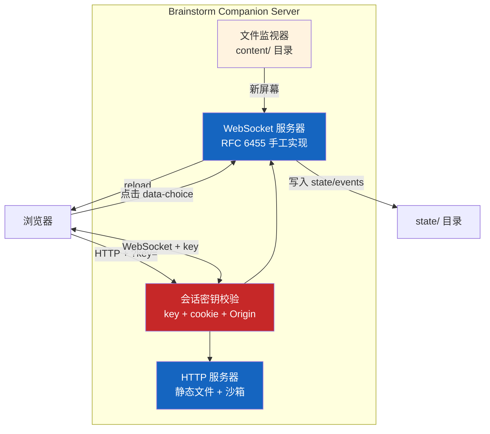
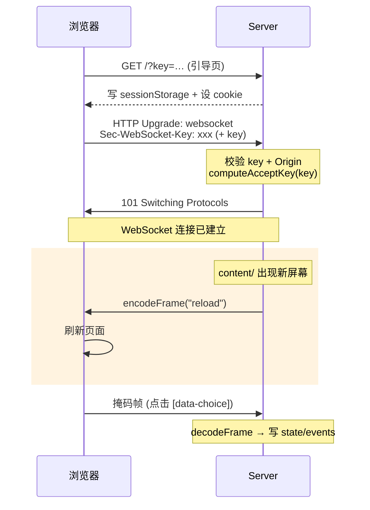

# Brainstorm Companion Server

> 整个 Superpowers 系统中唯一需要运行的服务代码——一个零运行时依赖的 HTTP+WebSocket 服务器，
> 手写了 RFC 6455 WebSocket 协议，为头脑风暴工作流提供"在浏览器里给你看"的可视化伴随（Visual Companion）。
> 6.0.0 起它拥有完整的安全模型，不再是"无认证"。

## 1. 零依赖服务器概述

Superpowers 的绝大部分内容是 Markdown 文件——技能、工作流、指南都是纯文本。但头脑风暴（Brainstorm）工作流有时需要把界面、布局、流程、外观不同的选项直接展示给你，而不是用文字描述。这就是 Brainstorm Companion Server 存在的唯一原因。

服务器位于 `skills/brainstorming/scripts/server.cjs`，7.0.1 中约 723 行（5.x 时期约 338 行，增长主要来自认证、沙箱和生命周期加固）。它**零运行时依赖**：不使用 Express、不使用 `ws` 库，只依赖 Node.js 内置模块。选择 `.cjs` 扩展名是因为项目根 `package.json` 设置了 `"type": "module"`，而服务器使用 CommonJS 的 `require()`。（`tests/brainstorm-server/` 自带的 `package.json` 依赖 `ws`，仅用于测试。）

何时被使用：`brainstorming` 把可视化伴随当作**工具而非模式**，**逐题判断**——标准是"看到是否比读到更好理解"。适合的情形：用户会看的东西（界面、页面、标牌）、布局、流程、彼此外观不同的选项、更适合看的结构（图、时间线、地图）。需求与范围、权衡清单、概念性选择、技术决策、澄清问题保持文本。首次出现适合的时刻时，智能体会**单独发一条消息**询问"要不要打开浏览器页面给你看一些草图"；被拒绝就留在文本，不再主动提。

服务器不是孤立运行的，同目录还有：

- `start-server.sh` / `stop-server.sh` — 生命周期管理脚本
- `helper.js` — 浏览器端客户端（约 167 行）
- `frame-template.html` — HTML 模板框架
- 同级的 `visual-companion.md` — 启动服务前智能体必须先读的使用说明

## 2. 安全模型（6.0.0 新增）

5.x 时代的服务器绑定到 `127.0.0.1` 但**没有任何认证**：在共享机器或远程环境里，任何能触及端口的人都能读到你的头脑风暴，甚至注入智能体会当成"用户输入"的事件（issue #1014）。6.0.0 起：

**会话密钥（Session Key）：**

- 启动时生成 64 位十六进制的随机密钥（`crypto.randomBytes(32)`）。可由 `BRAINSTORM_TOKEN` 或 `BRAINSTORM_TOKEN_FILE`（需匹配 `/^[0-9a-f]{32,}$/i`）指定。
- 智能体拿到的 URL 形如 `http://localhost:PORT/?key=<token>`。
- 首次访问时返回引导页：把密钥写入 `sessionStorage`，再 `location.replace('/')`；之后浏览器通过**标签页范围的 cookie** `brainstorm-key-<端口>`（`HttpOnly; SameSite=Strict; Path=/`）携带密钥。
- 校验函数先看查询串 `?key=`，没有再看 cookie，均使用常量时间比较；**查询串里带了错误的 key 会直接拒绝，不回退去查 cookie**。未授权请求返回 403 和 "Session key required" 页面，且不计入活动。

**WebSocket：**

- 升级请求必须通过密钥校验**并且**通过 Origin 校验：没有 Origin 头则放行；有 Origin 时必须严格等于 `http://<Host 头>`；否则直接销毁连接。
- 为什么用密钥而不是 Host / Origin 白名单：密钥同时覆盖本机的流氓标签页、可路由的远程主机，以及 DNS 重绑定（Origin 白名单挡不住这一种）。

**静态文件沙箱：**

- `/files/*` 只取 `path.basename`，拒绝空名和以 `.` 开头的文件
- 必须是普通文件、非符号链接、`nlink === 1`（拒绝硬链接），且 `realpath` 在 content 目录之内；不满足返回 404
- MIME 白名单仅有 html / css / js / json / png / jpg / jpeg / gif / svg，其余按 `application/octet-stream`
- 所有响应带 `Referrer-Policy: no-referrer`、`Cache-Control: no-store`、`X-Frame-Options: DENY`、CSP `frame-ancestors 'none'`、`Cross-Origin-Resource-Policy: same-origin`
- 保存密钥的文件以仅所有者可读写的权限写入；`start-server.sh` 里 `umask 077`

**内容注入（7.0.0 修复）：** 服务器此前用 `String.replace` 把内容插入模板，会把内容里的 `$'`、`$&` 之类序列当成替换模式，导致屏幕内容被吃掉（#2362）。现在以字面方式插入。

## 3. RFC 6455 WebSocket 手工实现

不使用 `ws` 库是零依赖设计哲学的直接结果。RFC 6455 的核心协议并不复杂，仍由三个函数构成（并导出供测试使用）：

- **`computeAcceptKey(key)`** — 将客户端的 `Sec-WebSocket-Key` 与 WebSocket 魔术字符串拼接，经 `crypto` 做 SHA-1 后 Base64，生成 `Sec-WebSocket-Accept`。
- **`encodeFrame(data)`** — 编码 WebSocket 帧。负载长度分三种：≤125 字节用 7 位，≤65535 字节用 16 位扩展，更大使用 64 位 BigInt。
- **`decodeFrame(buffer)`** — 解码帧并处理掩码：客户端帧必须带掩码，服务器用 4 字节掩码密钥逐字节异或还原。

相对 5.x 的加固：**单帧负载上限 10 MB**（`MAX_FRAME_PAYLOAD_BYTES`），**不支持的 opcode 以 1003 关闭连接**。覆盖文本帧（0x1）与关闭帧（0x8）。

## 4. 生命周期管理

### 启动与端口

`start-server.sh` 的参数：`--project-dir`、`--host`、`--url-host`、`--idle-timeout-minutes`、`--open`、`--foreground`（别名 `--no-daemon`）、`--background`（别名 `--daemon`）。读取的环境变量包括：`BRAINSTORM_PORT`、`BRAINSTORM_PORT_FILE`、`BRAINSTORM_HOST`（默认 `127.0.0.1`）、`BRAINSTORM_URL_HOST`、`BRAINSTORM_DIR`、`BRAINSTORM_OWNER_PID`、`BRAINSTORM_TOKEN`、`BRAINSTORM_TOKEN_FILE`、`BRAINSTORM_OPEN`、`BRAINSTORM_OPEN_CMD`、`BRAINSTORM_IDLE_TIMEOUT_MS`、`BRAINSTORM_LIFECYCLE_CHECK_MS`（默认 60 秒）。

**端口选择顺序：** `BRAINSTORM_PORT` → `BRAINSTORM_PORT_FILE` 中记录的端口（需 >1023）→ 从 49152 起的随机高位端口。首选端口被占用时回退到随机端口一次；回退时不覆盖持久化文件，且若密钥来自文件会重新生成。若密钥来自 `BRAINSTORM_TOKEN` 环境变量，端口冲突则直接退出，不回退。

### 重启后保持不变（6.0.0）

给定 `--project-dir` 时，端口与密钥保存在 `.superpowers/brainstorm/.last-port` 和 `.last-token`。服务器重启后端口和密钥都不变，已打开的浏览器标签页会自动重连。没有项目目录时，会话目录是 `/tmp/brainstorm-<pid>-<ts>`，不持久化。

### 目录与运行时文件

会话目录分为两个并列子目录：

- `content/` — 放智能体生成的 `*.html` 屏幕，经 HTTP 提供给浏览器
- `state/` — 服务器状态与用户交互数据，**不通过 HTTP 暴露**：`server-info`（启动 JSON，含端口、`url`（带密钥）、`screen_dir`、`state_dir`、空闲超时，权限 0600）、`server-stopped`（关闭原因与时间）、`server.pid`、`server.log`、`server-instance-id`、`events`（只记录带 `choice` 的用户点击，出现新屏幕时清空）

（5.0.6 前，状态与内容混放在一起，导致服务器状态可经 HTTP 读取。）

### 空闲超时与进程归属

- **空闲超时默认 4 小时**（5.x 为 30 分钟），可由 `--idle-timeout-minutes` 或 `BRAINSTORM_IDLE_TIMEOUT_MS` 修改。只有通过认证的请求才算活动。
- **owner PID 监控：** 启动时校验 `BRAINSTORM_OWNER_PID`——已经死亡则记录 `owner-pid-invalid` 并关闭监控，只靠空闲超时；`EPERM`（跨用户 PID，如 Tailscale SSH）视为**存活**，不再误判为死亡；WSL 下祖父进程 PID 可能是短命子进程，也靠启动时校验规避。5.0.6 修复了这两类导致"60 秒内误关闭"的问题。
- **`stop-server.sh` 先确认进程归属：** 读取 `state/server-instance-id`，核对 node 命令行里的 `--brainstorm-server-id=<id>`，不匹配就不发信号（输出 `{"status":"stale_pid"}`）；匹配则 SIGTERM，等约 2 秒，再 SIGKILL。因此重启后不会误杀一个无关的 `node` 进程（#1703）。只有位于 `/tmp/*` 下的会话目录才会被删除，`.superpowers/` 下的保留。

## 5. 浏览器端（`helper.js`）

- **自动重连：** 指数退避，最小 500 ms，最大 30 s。
- **状态指示：** 页面上的状态药丸（pill）显示 `Connecting…` / `Connected` / `Reconnecting…` / `Disconnected`。
- **"暂停"遮罩：** 断开超过 15 秒显示全屏的 "Companion paused"；重新连上后带密钥重新加载页面。
- **事件：** 点击 `[data-choice]` 元素发送事件；断线时事件入队，重连后补发。暴露 `window.brainstorm.send` 与 `window.brainstorm.choice`。
- **注入：** 服务器在 `</body>` 前注入 helper 脚本；非完整文档的片段会先被包进 `frame-template.html`（替换 `<!-- CONTENT -->`）。

## 6. 遥测与品牌标识

页面上的 Prime Radiant logo 默认从官方网站加载，请求里**只带 Superpowers 的版本号**，不包含项目、提示词或所用的编码智能体，并带 `referrerpolicy="no-referrer"`。这是为了粗略了解有多少人在用、用的哪个版本；100% 可选。设置以下任一环境变量为真值即可关闭，关闭后不再加载 logo，文字改为 "Prime Radiant Superpowers v…"：`SUPERPOWERS_DISABLE_TELEMETRY`、`DISABLE_TELEMETRY`、`CLAUDE_CODE_DISABLE_NONESSENTIAL_TRAFFIC`（`0/false/no/off` 视为未关闭）。

## 7. Windows 与其他平台适配

- **owner PID 监控在 Windows / MSYS2 下仍被禁用**：MSYS2 报告的 PID 属于它自己的命名空间，与 Windows 的不一致。`start-server.sh` 在检测到类 Windows shell 时清空 `OWNER_PID`，改靠空闲超时（4 小时）收尾；`tests/brainstorm-server/windows-lifecycle.test.sh` 验证这一行为。Windows 下还会自动切换为前台模式。
- 设置了 `CODEX_CI` 时同样自动前台运行。
- `--open` 或 `BRAINSTORM_OPEN` 才会在首个屏幕出现时自动打开浏览器，支持 macOS、Windows、WSL 与 Linux。
- 服务器本身用 Node.js 编写，天然跨平台；主要差异在辅助 shell 脚本，它们依赖 bash（Windows 上由 Git for Windows 提供）。

## 下一步

了解了 Brainstorm Companion Server 的实现细节后，下一章将介绍如何为 Superpowers 创建新技能，并介绍 7.x 引入的微测试方法。

---

[⬅️ 上一篇：平台适配层](./07-platform-adapters.md) | [返回目录](./README.md) | [下一篇：技能开发指南 ➡️](./09-writing-skills.md)
