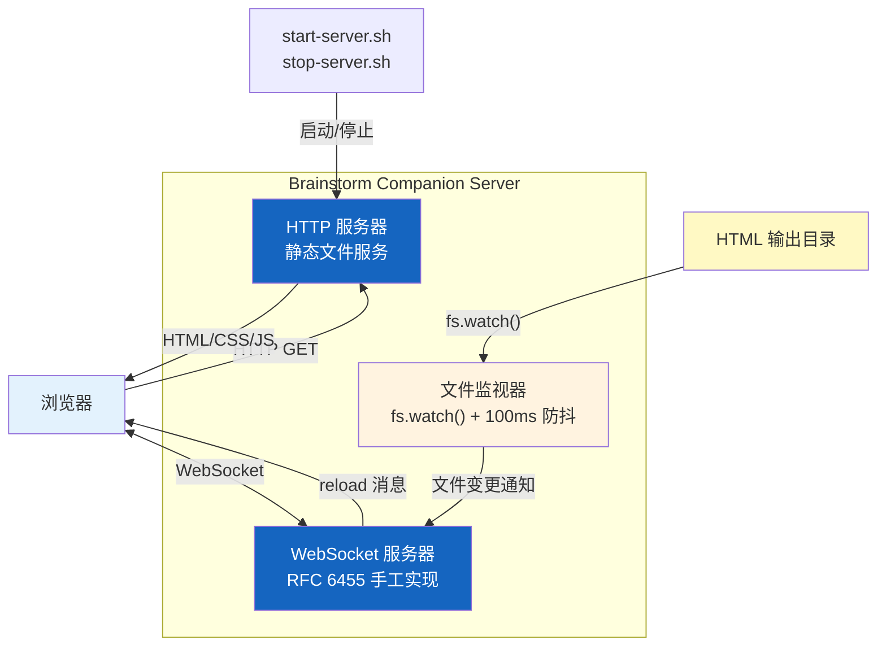
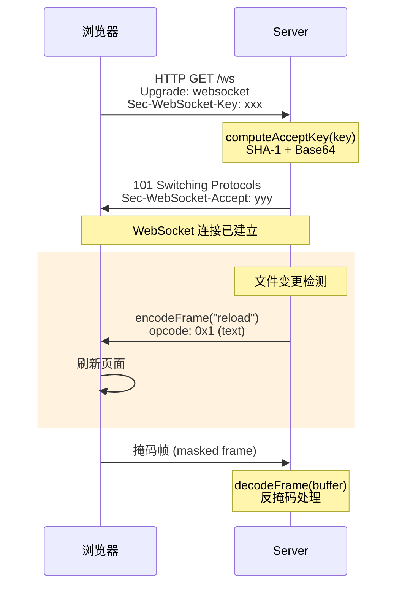

# Brainstorm Companion Server

> 整个 Superpowers 系统中唯一的"真正代码"——一个零依赖的 HTTP+WebSocket 服务器，
> 用 ~338 行 CommonJS 实现了完整的 RFC 6455 WebSocket 协议，为头脑风暴工作流提供浏览器实时预览。

## 1. 零依赖服务器概述

Superpowers 的绝大部分内容是 Markdown 文件——技能、工作流、指南都是纯文本。但头脑风暴（Brainstorm）工作流需要在浏览器中实时预览 AI 生成的 HTML 输出。这就是 Brainstorm Companion Server 存在的唯一原因：它是系统中唯一需要运行的代码。

服务器位于 `skills/brainstorming/scripts/server.cjs`，约 338 行代码，零外部依赖。不使用 Express、不使用 ws 库、不使用任何 npm 包——只依赖 Node.js 内置模块（`http`、`fs`、`path`、`crypto`）。选择 `.cjs` 扩展名是因为项目根 `package.json` 设置了 `"type": "module"`（ESM），而服务器使用 CommonJS 的 `require()` 语法。

服务器不是孤立运行的——它有一整套辅助文件协同工作：

- `start-server.sh` / `stop-server.sh` — 生命周期管理脚本
- `helper.js` — 浏览器端 JavaScript 客户端
- `frame-template.html` — HTML 模板框架
- 运行时输出文件：`.server-info`（JSON）、`.server-stopped`（JSON）、`.events`（JSONL）、`.server.pid`、`.server.log`

## 2. RFC 6455 WebSocket 手工实现

不使用 `ws` 库是零依赖设计哲学的直接结果。RFC 6455 的核心协议并不复杂——只需要三个函数就可以实现完整的 WebSocket 通信：

- **`computeAcceptKey(key)`** — 将客户端发送的 `Sec-WebSocket-Key` 与 WebSocket 魔术字符串（WS_MAGIC）拼接，通过 Node.js `crypto` 模块执行 SHA-1 哈希后进行 Base64 编码，生成 `Sec-WebSocket-Accept` 响应头。这是 WebSocket 握手（Handshake）的关键步骤。
- **`encodeFrame(data)`** — 将数据编码为 WebSocket 帧（Frame）。FIN 位标识消息是否完整，opcode 标识帧类型。负载长度编码分三种情况：≤125 字节使用 7 位编码，≤65535 字节使用 16 位扩展编码，更大的帧使用 64 位 BigInt 编码。
- **`decodeFrame(buffer)`** — 解码接收到的 WebSocket 帧，包含掩码（Masking）处理。根据 RFC 6455 规范，客户端发送的帧必须被掩码——服务器需要使用 4 字节掩码密钥（Masking Key）逐字节异或还原原始数据。

HTTP 升级（Upgrade）过程是连接建立的起点：客户端发送带有 `Upgrade: websocket` 头的 HTTP 请求，服务器验证 `Sec-WebSocket-Key`，调用 `computeAcceptKey()` 计算响应密钥，返回 `101 Switching Protocols` 响应。此后连接从 HTTP 切换到 WebSocket 双向通信。服务器实现覆盖了文本帧（opcode 0x1）和连接关闭帧（opcode 0x8）。

## 3. 生命周期管理

服务器通过 `start-server.sh` 脚本启动。端口选择策略：优先使用环境变量 `BRAINSTORM_PORT`，否则随机选择 49152–65534 范围内的端口（动态端口范围，避免与常用服务冲突）。绑定地址默认为 `127.0.0.1`（仅本地访问），可通过 `BRAINSTORM_HOST` 配置。此外，`BRAINSTORM_URL_HOST` 和 `BRAINSTORM_DIR` 分别控制对外 URL 地址和 HTML 输出目录路径。

启动成功后，服务器写入 `.server-info` 文件（JSON 格式），包含 PID、端口、启动时间等信息。这个文件是其他脚本和智能体发现运行中服务器的主要方式。同时写入 `.server.pid` 文件供进程管理使用，`.server.log` 记录运行日志。

服务器实现了 30 分钟空闲自动关闭（Idle Auto-Shutdown）。每次 WebSocket 消息或 HTTP 请求都会重置空闲计时器。如果 30 分钟内没有任何活动，服务器自动退出并写入 `.server-stopped` 文件（JSON 格式，包含停止原因）。`stop-server.sh` 也可以随时手动关闭服务器。

服务器通过 `BRAINSTORM_OWNER_PID` 环境变量接收启动它的进程 PID。服务器定期检查该进程是否仍在运行——如果 owner 进程已退出，服务器也自动关闭，防止孤儿进程（Orphan Process）残留。所有生命周期事件记录到 `.events` 文件（JSONL 格式——每行一个 JSON 对象）：启动、连接、断开、文件变更、关闭等，为调试提供完整的审计轨迹。

## 4. 文件监视与浏览器实时通信

服务器使用 Node.js 的 `fs.watch()` 监视 HTML 输出目录。当 AI 智能体生成或更新 HTML 文件时，`fs.watch()` 触发变更事件。服务器实现了 100ms 防抖（Debounce）——在 100ms 内的多次变更只触发一次通知，避免文件保存过程中的中间状态触发不必要的刷新。

文件变更触发后，服务器通过 WebSocket 向所有连接的浏览器客户端发送 `reload` 消息。浏览器端的 `helper.js` 接收到消息后自动刷新页面，实现热重载（Hot Reload）效果。整个流程从文件保存到浏览器刷新通常在 200ms 以内。

HTTP 部分负责从监视目录提供静态文件服务，支持 HTML、CSS、JavaScript 等常见 MIME 类型。默认行为是提供目录中最新的 HTML 文件。`frame-template.html` 提供基础页面框架，自动注入 `helper.js` 以建立 WebSocket 连接，让每个页面无需手动配置即可获得实时刷新能力。

## 5. Windows 平台适配

在 Windows 的 MSYS2 环境中，进程 ID 命名空间（PID Namespace）与原生 Windows 不同。MSYS2 报告的 PID 是其内部命名空间的值，与 Windows 任务管理器中显示的 PID 不一致。这导致通过 `BRAINSTORM_OWNER_PID` 进行的 owner PID 监控功能无法正常工作——服务器查询到的 PID 状态与实际不符。

作为应对方案，服务器检测到 Windows 平台时自动禁用 owner PID 监控功能。30 分钟空闲自动关闭仍然有效，作为 Windows 上防止孤儿进程的替代机制。`stop-server.sh` 脚本也可以手动关闭服务器。

服务器本身使用 Node.js 编写，天然跨平台。主要的平台差异在于辅助 shell 脚本——它们依赖 bash，在 Windows 上通过 Git for Windows 提供的 bash 或 MSYS2 bash 执行。

## 下一步

了解了 Brainstorm Companion Server 的实现细节后，下一章将介绍如何为 Superpowers 系统创建新技能——包括使用本服务器的头脑风暴技能在内。

---

[⬅️ 上一篇：平台适配层](./07-platform-adapters.md) | [返回目录](./README.md) | [下一篇：技能开发指南 ➡️](./09-writing-skills.md)
