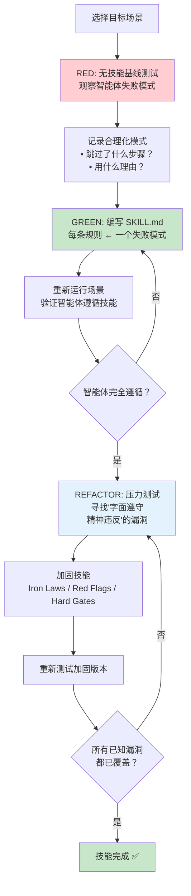

# 技能开发指南

> 技能（Skill）是 Superpowers 的核心单元——每个技能是一份 Markdown 文件，
> 定义了 AI 智能体在特定场景下应该如何行为。本章讲述如何用 TDD 的思维方式创建高质量技能。

## 9.1 TDD 应用于技能开发

技能开发借用了测试驱动开发（Test-Driven Development, TDD）的核心方法论，但应用对象不是代码——而是流程文档。技能文件（SKILL.md）的质量通过"压力场景"来验证，就像生产代码的质量通过测试用例来验证一样。

这个类比不是修辞，而是精确的方法论映射：

| TDD 概念 | 技能开发对应物 |
|----------|--------------|
| 测试用例（Test Case） | 压力场景（Pressure Scenario）——智能体可能偏离预期行为的具体情境 |
| 生产代码（Production Code） | SKILL.md 文件——定义智能体行为规范的 Markdown 文档 |
| RED 阶段 | 运行基线场景，智能体在没有技能指导下失败（合理化、跳过步骤等） |
| GREEN 阶段 | 编写技能文件后，智能体遵循技能要求正确执行 |
| REFACTOR 阶段 | 找到并堵住漏洞——智能体可能"字面遵守但精神违反"的情况 |

传统方法是凭直觉编写指南，然后期望智能体遵守。TDD 方法颠倒了这个流程——先发现智能体在哪里失败，再编写针对性的技能。这确保了每条规则都有存在的理由，不会出现"写了但没人遵守"的冗余规则。

就像 TDD 中通过新测试发现新 bug 一样，技能开发通过新压力场景发现新漏洞。技能不是一次性产物——它需要持续迭代，直到覆盖所有已知的失败模式。

## 9.2 压力测试方法论

### RED——建立基线

在没有技能的情况下，让智能体执行目标场景。观察并记录智能体的失败模式——它在哪里合理化了跳过步骤？在哪里选择了更简单但不正确的路径？如何"解释"为什么不需要遵循最佳实践？RED 阶段记录下的合理化模式是宝贵的设计输入，它们揭示了智能体最可能偏离的方向——这些方向就是技能文件需要重点防御的地方。

### GREEN——编写技能

根据观察到的失败模式编写 SKILL.md 文件。技能的每条规则都应该直接对应至少一个观察到的失败模式。重新运行相同的场景，验证智能体现在遵循了技能要求。如果仍然失败，继续迭代技能内容直到通过。

### REFACTOR——堵住漏洞

这是最关键的步骤。智能体可能"字面遵守但精神违反"（Letter Compliance Without Spirit）——例如，技能要求"先写测试"，智能体写了一个永远通过的空测试，然后声称满足了要求。REFACTOR 阶段要找出这些漏洞，加入铁律（Iron Laws）、红旗信号（Red Flags）、硬门槛（Hard Gates）等加固机制。

## 9.3 目录结构和命名规范

技能使用扁平命名空间（Flat Namespace）——所有技能位于 `skills/<name>/` 目录下，不允许嵌套子目录。每个技能目录至少包含一个 `SKILL.md` 文件，可以包含可选的辅助文件（模板、脚本、参考资料等）。目录名使用小写连字符命名（如 `skills/my-new-skill/`）。

技能分为三类：

| 类型 | 说明 | 示例 |
|------|------|------|
| **Technique（技术技能）** | 定义具体的开发技术 | TDD、代码审查方法 |
| **Pattern（模式技能）** | 定义架构或设计模式的应用方式 | SDD 子智能体编排模式 |
| **Reference（参考技能）** | 提供工具映射、平台差异等参考信息 | 平台适配参考表 |

SKILL.md 的 YAML frontmatter 只需要两个字段：`name`（技能名称）和 `description`（技能描述，最大 1024 字符）。description 必须以 "Use when..." 开头——这是 CSO（Compact Skill Ontology）设计的核心约束。description 只描述触发条件，不是工作流摘要。原因在第五章 CSO 一节中已经解释过：如果 description 包含工作流摘要，智能体会认为自己已经"知道"该怎么做，从而跳过读取完整技能内容。

## 9.4 编写最佳实践

### 标准章节结构

技能文件遵循固定的章节顺序：

1. **Overview** — 技能概述，一两段话说明这个技能解决什么问题
2. **When to Use** — 使用场景和触发条件
3. **Core Pattern** — 核心模式，定义关键行为
4. **Quick Reference** — 快速参考速查卡片
5. **Implementation** — 实现细节和具体步骤
6. **Common Mistakes** — 常见错误和避坑指南

### Token 效率

技能文件会被注入到智能体的上下文窗口中，因此 token 效率至关重要。不同使用频率的技能有不同的字数上限：

- 入门级技能（getting-started）：**< 150 词**
- 高频使用技能（frequent）：**< 200 词**
- 其他技能：**< 500 词**

每多一个词都在消耗智能体理解其他内容的空间。能用表格说清楚的不要用段落，能用一行说清楚的不要用三行。

### 反合理化加固

对于关键技能，必须加入加固机制防止智能体合理化：

- **Iron Laws（铁律）：** 绝对不可违反的规则，用 "NEVER" / "ALWAYS" / "NO...WITHOUT..." 措辞，不留任何解释余地
- **Red Flags（红旗信号）：** 列出智能体即将违规时的内心想法模式，如"这太简单了不需要..."
- **Hard Gates（硬门槛）：** 用 `<HARD-GATE>` 标记的阻断点，必须通过才能继续，无法跳过

这三者不是可选的最佳实践建议——对于涉及 TDD、调试和验证的核心技能，它们是必须的结构性组成部分。

## 9.5 创建新技能的步骤指南

1. **识别需求** — 观察到智能体在某个场景中反复失败或偏离预期。记录具体的失败模式和合理化理由。这是整个流程的起点，没有观察到的失败就不需要新技能。

2. **创建目录** — 在 `skills/` 下创建新目录：`skills/my-new-skill/`。创建空的 `SKILL.md` 文件，写好 frontmatter：name + description（以 "Use when..." 开头）。

3. **RED 阶段** — 设计压力场景，用子智能体（Subagent）运行场景，确认没有技能指导时智能体确实失败。记录所有观察到的合理化模式。

4. **编写 SKILL.md** — 按照标准六段结构（Overview → When to Use → Core Pattern → Quick Reference → Implementation → Common Mistakes）编写技能内容。每条规则对应至少一个步骤 3 中观察到的失败模式。

5. **GREEN 阶段** — 重新运行同一压力场景，验证智能体在技能指导下正确执行。如果仍然失败，回到步骤 4 修改技能。

6. **REFACTOR 阶段** — 设计更刁钻的压力场景，寻找"字面遵守精神违反"的漏洞。加入 Iron Laws、Red Flags、Hard Gates 进行加固。

7. **Token 审计** — 计算技能文件的字数，确保符合 token 效率要求（< 150 / < 200 / < 500 词）。删除冗余内容，将段落压缩为表格或列表。

## 下一步

技能开发是 Superpowers 系统可扩展性的基础——每个新技能都让系统覆盖更多场景。下一章将从更宏观的视角出发，将 Superpowers 与其他主流 AI 编程增强方案进行对比分析，帮助你理解这套系统在整个生态中的定位和独特价值。

---

[⬅️ 上一篇：Brainstorm Companion Server](./08-brainstorm-server.md) | [返回目录](./README.md) | [下一篇：对比分析 ➡️](./10-comparison.md)
