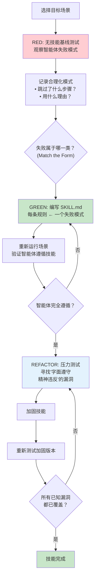

# 技能开发指南

> 技能（Skill）是 Superpowers 的核心单元——每个技能是一份 Markdown 文件，
> 定义了 AI 智能体在特定场景下应该如何行为。本章讲述如何用 TDD 的思维方式创建和验证高质量技能。

> **先看贡献政策：** 技能的写法与技能能不能进上游是两件事。`AGENTS.md` 和 `README.md` 明确：**通常不接受新技能的贡献**；任何对已有技能的修改必须在所有支持的平台上都成立，并附评测证据。PR 目标分支是 `dev`，必须填完模板的每一节，包括**由人类用自己的话写的摘要**（不超过 200 词）。也不接受由智能体代写的、去修别人提的 issue 的 PR——如果你的人类伙伴遇到了同样的问题，请把他的报告补充到现有 issue 里。本章的方法对你**自己的项目**和本地技能同样适用。

## 9.1 TDD 应用于技能开发

技能开发借用了测试驱动开发（Test-Driven Development, TDD）的核心方法论，但应用对象不是代码——而是流程文档。技能文件（SKILL.md）的质量通过"压力场景"来验证，就像生产代码的质量通过测试用例来验证一样。`writing-skills` 的铁律是：`NO SKILL WITHOUT A FAILING TEST FIRST`。

这个类比不是修辞，而是精确的方法论映射：

| TDD 概念 | 技能开发对应物 |
|----------|--------------|
| 测试用例（Test Case） | 压力场景（Pressure Scenario）——智能体可能偏离预期行为的具体情境 |
| 生产代码（Production Code） | SKILL.md 文件——定义智能体行为规范的 Markdown 文档 |
| RED 阶段 | 运行基线场景，智能体在没有技能指导下失败（合理化、跳过步骤等） |
| GREEN 阶段 | 编写技能文件后，智能体遵循技能要求正确执行 |
| REFACTOR 阶段 | 找到并堵住漏洞——智能体可能"字面遵守但精神违反"的情况 |

传统方法是凭直觉编写指南，然后期望智能体遵守。TDD 方法颠倒了这个流程——先发现智能体在哪里失败，再编写针对性的技能。这确保了每条规则都有存在的理由。

## 9.2 压力测试方法论

### RED——建立基线

在没有技能的情况下，让智能体执行目标场景。观察并记录智能体的失败模式——它在哪里合理化了跳过步骤？在哪里选择了更简单但不正确的路径？如何"解释"为什么不需要遵循最佳实践？这些合理化模式是宝贵的设计输入，它们揭示了技能文件需要重点防御的地方。

### GREEN——编写技能

根据观察到的失败模式编写 SKILL.md。技能的每条规则都应直接对应至少一个观察到的失败模式。重新运行相同的场景，验证智能体现在遵循了技能要求；如果仍然失败，继续迭代。

### REFACTOR——堵住漏洞

这是最关键的步骤。智能体可能"字面遵守但精神违反"（Letter Compliance Without Spirit）——例如，技能要求"先写测试"，智能体写了一个永远通过的空测试，然后声称满足了要求。REFACTOR 阶段要找出这些漏洞，加入铁律、红旗信号、合理化防御表等加固机制（见 `references/bulletproofing.md`）。

### 选对形式（Match the Form to the Failure）

6.0.0 加入。写 GREEN 版本之前，先对基线失败分类，再选形式：

| 基线失败 | 适用形式 |
|---------|---------|
| 违反规则 | 禁止 + 合理化防御表 + 红旗 |
| 输出形状不对 | 正向的配方或契约（给示范，而不是写禁令） |
| 遗漏必需元素 | 结构化的必填槽位 |
| 行为依赖条件 | 可观察的条件谓词 |

另外：不要写"除非……"之类的细微差别子句，豁免子句不起作用。

### 微测试措辞（Micro-Test Wording）

在跑完整压力场景之前，先用微测试验证一段措辞，成本低得多。五条要求：

1. 每次调用使用**新的上下文样本**
2. 必须有**无指导的对照组**
3. 每个变体至少重复 **5 次**
4. **人工审读每一个命中**
5. 把**运行间方差**当作警告信号

微测试不能取代纪律类技能的压力场景。6.2.0 的压缩运动里就用它发现过：删掉 TDD 的"为什么顺序重要"一节会让先写测试的比例从 8/10 降到 5/10，于是论据被改写成合理化防御表的行，而不是整节恢复。

## 9.3 目录结构和命名规范

所有技能位于 `skills/<name>/` 下，目录名使用小写连字符。每个技能目录至少包含一个 `SKILL.md`，可以包含辅助文件。7.0.1 的写法有几种：

| 形态 | 示例 |
|------|------|
| 只有 `SKILL.md` | `finishing-a-development-branch`、`using-git-worktrees`、`dispatching-parallel-agents` |
| `SKILL.md` + 同级辅助文件 | `systematic-debugging`（`root-cause-tracing.md`、`defense-in-depth.md` 等） |
| `SKILL.md` + `references/` | `writing-skills`、`subagent-driven-development`、`diagnosing-superpowers` |
| 附带提示模板 | `subagent-driven-development/implementer-prompt.md`、`task-reviewer-prompt.md` |
| 附带脚本 | `subagent-driven-development/scripts/`、`executing-plans/scripts/`、`brainstorming/scripts/` |

技能分为三类（`writing-skills` 中的 Skill Types），所有技能处于同一个扁平命名空间（Flat Namespace），便于统一检索：

| 类型 | 说明 | 原文示例 |
|------|------|---------|
| **Technique（技术）** | 有具体步骤可循的方法 | condition-based-waiting、root-cause-tracing |
| **Pattern（模式）** | 看待问题的思路 | flatten-with-flags、test-invariants |
| **Reference（参考）** | API 文档、语法指南、工具文档 | office docs |

### Frontmatter 规则

- `name`：只能用字母、数字、连字符
- `description`：**必填**，第三人称，只描述触发条件，**不描述工作流**，通常以 "Use when..." 开头；建议尽量控制在 500 字符内
- 整个 frontmatter 不超过 1024 字符（来自 agentskills.io 规范）；其他可选字段也由该规范定义
- 其中"Use when"是写作约定与检查项，不是机制强制——例如 `brainstorming` 的 description 就用了 "You MUST use this before any creative work"

为什么 `description` 不能写工作流，见[第 5 章](./05-anti-rationalization.md)的 SDO 一节：智能体会照着摘要走，而不去读完整技能内容。该技术旧称 CSO（Claude Search Optimization），6.0.0 起更名为 **Skill Discovery Optimization（SDO）**，细节在 `writing-skills/references/discovery.md`。

## 9.4 编写最佳实践

### 标准章节结构

`references/discovery.md` 里给出的 SKILL.md 推荐模板：

1. **Overview** — 技能概述，一两段话说明这个技能解决什么问题
2. **When to Use** — 使用场景和触发条件
3. **Core Pattern** — 核心模式，定义关键行为
4. **Quick Reference** — 快速参考速查卡片
5. **Implementation** — 实现细节和具体步骤
6. **Common Mistakes** — 常见错误和避坑指南
7. **Real-World Impact** — 实际影响（可选）

注意：6.2.0 的压缩运动删掉了大量**写给已经调用了技能的读者**的总结、社会证明和"好处推销"类文字（Bottom Line / Key Principles / Real-World Impact / Advantages 等）。这些内容对一个已经加载技能的智能体没有行为价值，每个词还在占用上下文。新写的技能请遵循同样的克制。

### Token 效率

技能文件会被注入到智能体的上下文窗口中，因此 token 效率至关重要。`discovery.md` 给出的字数目标（仍在，用 `wc -w` 检查）：

- 入门级技能（getting-started）：**< 150 词**
- 高频使用技能（frequent）：**< 200 词**
- 其他技能：**< 500 词**

实际的大技能（如 `subagent-driven-development`）显然超出这些数字，所以还有一条**硬上限**：`tests/skill-size/test-skill-size.sh` 在任何 `SKILL.md` 达到 **20,000 字节**时失败。原因是 Claude Code 在上下文压缩后会把每个技能截断在 20,000 字符，之后的内容在会话剩余时间里丢失（#2481）。超过时的做法是把只在某一步用到的内容拆到 `references/`，并在 SKILL.md 里写明"到这一步再读哪个文件"。当前最大的两个：`subagent-driven-development` 约 19.05 KB，`executing-plans` 约 17.68 KB。

### 反合理化加固

对于关键技能，需要加入加固机制防止智能体合理化：

- **铁律：** 绝对不可违反的规则，用 "NO...WITHOUT..." 措辞
- **红旗信号：** 列出智能体即将违规时的内心想法
- **合理化防御表：** "借口 → 现实"
- **硬门：** `<HARD-GATE>` 标记的阻断点（7.0.1 中仅 `brainstorming` 使用）
- **精神条款：** "违反字面就是违反精神"

用什么形式取决于失败的类型（见 9.2 的"选对形式"）。

### 跨平台写法

技能正文用动作描述（"派发子智能体""你的指令文件"），而不是某个平台的工具名；平台特有的差异放到 `skills/using-superpowers/references/` 的工具映射文件里。不要在技能里硬编码 `gh pr create` 一类的特定工具（`finishing-a-development-branch` 在 6.0.0 改为与代码托管平台无关）。还要注意：Claude Code 会把技能正文里的 `$1` 替换成技能调用的参数，所以示例命令里不要出现 `$1`（`requesting-code-review` 为此把 `awk '{print $1}'` 换成了 `cut -d' ' -f1`）。

## 9.5 创建新技能的步骤指南

1. **识别需求** — 观察到智能体在某个场景中反复失败或偏离预期。记录具体的失败模式和合理化理由。没有观察到的失败就不需要新技能。
2. **创建目录** — 在 `skills/` 下创建 `skills/my-new-skill/SKILL.md`，写好 frontmatter：`name` + `description`（只写触发条件）。
3. **RED 阶段** — 设计压力场景，用子智能体运行，确认没有技能指导时智能体确实失败，记录所有合理化模式。
4. **先做微测试** — 对关键措辞做微测试（新上下文、对照组、≥5 次、人工读结果）。
5. **编写 SKILL.md** — 按推荐结构编写，每条规则对应一个观察到的失败模式；按失败类型选形式。
6. **GREEN 阶段** — 重新运行同一压力场景，验证智能体在技能指导下正确执行。
7. **REFACTOR 阶段** — 设计更刁钻的场景，寻找"字面遵守精神违反"的漏洞并加固。
8. **Token 与大小审计** — 检查字数目标和 20,000 字节硬上限；超长内容拆到 `references/`。

## 9.6 测试体系

测试分成两类（`docs/testing.md`）：

- **`tests/`** — 插件的**非 LLM** 代码测试，包括钩子、各平台清单、Brainstorm 服务器（`auth`、`branding`、`helper`、`lifecycle`、`server`、`ws-protocol` 等）、`skill-size`（20,000 字节上限）、`shell-lint`、`version-bump`、`writing-skills`（`render-graphs.js`）、`systematic-debugging`（`find-polluter.sh`）、`diagnosing-superpowers` 等。Brainstorm 服务器目录有自己的 `package.json`，其 `npm test` 串行运行 node 与 bash 测试（不含 `windows-lifecycle.test.sh`）；仓库根目录的 `package.json` 没有 `scripts`，所以**根目录没有 `npm test`**。
- **evals** — 技能**行为**测试，驱动真实的编码智能体 CLI 会话，由 QA 智能体评分。套件现名 **Quorum**（原名 Drill，命令如 `bun run quorum run scenarios/...`），位于独立的 `superpowers-evals` 仓库，需要单独克隆到 `evals/`。6.0.2 起不再以子模块形式随插件发布，因为它曾导致部分用户安装失败。

仓库**没有** `.github/workflows` 下的 GitHub Actions CI。文档称只有静态门禁适合公共 CI；`.pre-commit-config.yaml` 只针对 `evals/*.py` 做 ruff 与 ty 检查。

## 下一步

技能开发是 Superpowers 系统可扩展性的基础。下一章将从更宏观的视角出发，将 Superpowers 与其他主流 AI 编程增强方案进行对比分析。

---

[⬅️ 上一篇：Brainstorm Companion Server](./08-brainstorm-server.md) | [返回目录](./README.md) | [下一篇：对比分析 ➡️](./10-comparison.md)
