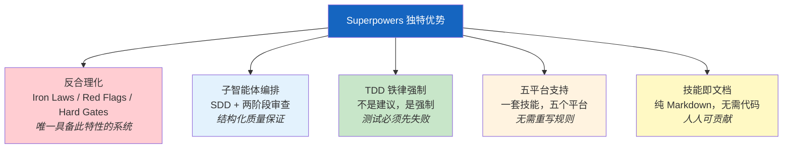

# 对比分析

> Superpowers 不是唯一的 AI 编程增强方案——但它是唯一将反合理化作为核心架构关注点的系统。
> 本章客观对比 Superpowers 与其他主流方案的异同。

## 10.1 对比对象概览

AI 编程增强方案的生态已经相当丰富，大致可分为以下几类：平台专属配置文件、通用 AI 编程助手、IDE 扩展、AI 编程工具，以及最原始的自定义系统提示。Superpowers 在这个生态中定位为跨平台技能系统（Cross-Platform Skill System）——既不是一个新的 IDE，也不是一个新的 AI 助手，而是一套可以注入到多个平台中的结构化行为规范。

以下是本章对比的六个方案：

- **Cursor Rules**（`.cursorrules`）——Cursor IDE 专属的静态规则文件，用于定义编码风格和项目约定。一个 JSON/文本文件，加载到 Cursor 的上下文中。
- **CLAUDE.md / AGENTS.md**——Claude Code 的项目级指令文件，提供上下文和行为指导。每个项目放一份，Claude Code 启动时自动读取。
- **Aider**——开源 AI 编程助手，有自己的约定和工作流，通过 CLI 与 LLM 交互，专注于代码编辑循环。
- **Continue.dev**——开源 AI 编码 IDE 扩展，配置驱动（JSON），支持多种模型后端，无技能或工作流概念。
- **Cline/Roo**——AI 编程工具，各自有独特的自动化方法论，支持浏览器操作和终端交互。
- **自定义系统提示（Custom System Prompts）**——直接在对话中粘贴的临时性提示，无结构化管理、无版本控制、无反合理化。

## 10.2 多维度对比

以下表格从架构方式、工作流覆盖、平台支持等多个维度进行对比：

| 维度 | Superpowers | Cursor Rules | CLAUDE.md / AGENTS.md | Aider | Continue.dev | Cline/Roo |
|------|-----------|------------|----------|-------|-------------|-----------|
| **架构方式** | 提示注入 + 技能系统 | 静态规则文件 | 项目级 Markdown 指令 | CLI 工具 + 内置约定 | IDE 扩展 + JSON 配置 | AI 工具 + 自动化 |
| **工作流覆盖** | 完整管线（brainstorm→plan→implement→finish） | 无工作流 | 无工作流 | 部分（编辑循环） | 无工作流 | 部分（任务执行） |
| **平台支持** | 5 个平台 | 仅 Cursor | 仅 Claude Code | 仅 Aider CLI | VS Code 等多 IDE | 各自平台 |
| **反合理化** | 核心架构（5 种机制） | 无 | 无 | 无 | 无 | 无 |
| **子智能体编排** | Controller-Worker + 两阶段审查 | 无 | 无 | 无 | 无 | 部分支持 |
| **TDD 强制** | 铁律级强制 | 无 | 可手动指定 | 无 | 无 | 无 |
| **可扩展性** | 添加 SKILL.md（Markdown） | 编辑单一规则文件 | 编辑 .md 文件 | 配置文件 | 插件系统（Plugin） | 各自扩展机制 |
| **技能系统** | 结构化 SKILL.md + CSO 分类 | 无 | 无 | 无 | 无 | 无 |
| **社区生态** | 开源，技能可跨项目复用 | 社区分享规则模板 | 项目级，不可复用 | 开源社区 | 开源社区 + 插件市场 | 各自社区 |

关键观察：在"反合理化"和"子智能体编排"两个维度上，Superpowers 是目前唯一提供系统级支持的方案。其他工具侧重于"让 AI 更方便地写代码"，而 Superpowers 侧重于"让 AI 更可靠地遵循流程"——这是根本性的设计取向差异。

## 10.3 Superpowers 的独特优势

**反合理化作为核心架构关注点。** 这是 Superpowers 与所有其他方案最根本的区别。其他工具假设 AI 会忠实遵循指令——Superpowers 假设 AI 会寻找借口不遵循指令，并在架构层面防御这种行为。铁律（Iron Laws）、红旗信号（Red Flags）、硬门槛（Hard Gates）不是可选的最佳实践建议，而是系统的结构性组成部分。这种"默认不信任"的设计哲学，在当前 AI 编程工具生态中是独一无二的。

**子智能体编排与两阶段审查。** Superpowers 的 SDD（Spec-Driven Development）模式不只是"派遣子智能体执行任务"。它包含结构化的两阶段审查：第一阶段检查规格合规性（做了没有），第二阶段检查代码质量（做好没有）。每个子智能体获得新鲜上下文，审查由独立的子智能体执行，避免了"自己审查自己"的盲区。这种编排深度在 Cursor Rules 或 CLAUDE.md 中无法实现，因为它们缺乏工作流引擎。

**TDD 铁律级强制。** Aider、Continue.dev 等工具最多是"建议使用 TDD"或在文档中提及 TDD 最佳实践。Superpowers 通过铁律将 TDD 从建议提升为强制——测试必须先写且先失败、每次只修一个测试、禁止在 GREEN 阶段重构。违反铁律会被红旗表捕获。这种强制级别在其他系统中不存在。

**真正的跨平台支持。** 一套技能文件通过平台适配层在 Claude Code、Cursor、Gemini CLI、Codex 和 OpenCode 五个平台上运行。Cursor Rules 只能用于 Cursor，CLAUDE.md 只能用于 Claude Code，Aider 的约定只在 Aider 中有效。Superpowers 的"写一次，跑五处"模式消除了跨平台规则维护的重复劳动。

**技能即文档。** 技能是纯 Markdown 文件——不需要写代码、不需要学习 DSL（Domain-Specific Language）、不需要特定的运行时。任何能编辑文本的人都可以创建新技能。技能文件可以在团队间分享、在项目间复用，版本控制与代码完全一致。

## 10.4 局限性与诚实评估

任何技术方案都有其适用边界，Superpowers 也不例外。以下是当前版本的已知局限性：

**无 CI/CD 集成管线。** Superpowers 目前不提供持续集成/持续部署（CI/CD）管线。技能的验证依赖手动压力测试，没有自动化的回归测试系统。对于需要在 CI 中验证 AI 行为一致性的团队，这是一个明显的缺口。

**平台 API 依赖。** Superpowers 依赖各平台的实验性 API——例如 Claude Code 的钩子系统、Cursor 的 rules 加载机制。这些 API 可能在平台更新时发生破坏性变更（Breaking Change），导致适配层需要紧急修改。五个平台意味着五倍的兼容性维护压力。

**版本同步挑战。** 五个平台各有自己的清单文件（manifest），版本号需要同步维护。当前没有自动化工具确保所有清单的一致性——这是已知的维护负担，尤其在快速迭代期间容易出现版本漂移。

**Brainstorm 服务器无认证。** Brainstorm Companion Server 绑定到 `127.0.0.1`，只接受本地连接，但不提供任何认证机制。在共享开发机器或远程开发环境中，这可能是一个安全考量。

**技能文件的测试覆盖有限。** 虽然 brainstorm 服务器有单元测试覆盖，但技能文件本身的"测试"依赖手动压力测试流程（RED-GREEN-REFACTOR），缺乏自动化验证手段。

| 局限性 | 影响范围 | 缓解措施 |
|--------|---------|---------|
| 无 CI/CD 管线 | 回归测试 | 手动压力测试流程 |
| 平台 API 依赖 | 平台升级时的兼容性 | 关注平台变更日志，快速适配 |
| 版本同步 | 五个清单的一致性 | 手动检查，计划开发自动化工具 |
| 服务器无认证 | 共享环境安全性 | 绑定 127.0.0.1，仅本地访问 |
| 有限测试覆盖 | 技能质量保证 | TDD 压力测试方法论补充 |

## 10.5 总结

Superpowers 在反合理化、子智能体编排、TDD 强制和跨平台支持方面具有独特优势——这些特性的组合在当前 AI 编程工具生态中是唯一的。它解决的核心问题不是"如何让 AI 写更多代码"，而是"如何让 AI 更可靠地遵循工程规范"。

同时，它在 CI/CD 集成、平台 API 稳定性和自动化测试方面存在已知局限性。选择使用 Superpowers 的团队应该评估这些权衡是否适合自己的场景——如果团队更看重跨平台一致性和流程合规性，Superpowers 的价值最大；如果团队只使用单一平台且不需要严格流程控制，平台原生方案（如 Cursor Rules 或 CLAUDE.md）可能更轻量。

值得强调的是，Superpowers 与其他工具不是完全互斥的。可以在使用 CLAUDE.md 的项目中同时使用 Superpowers 的技能系统，也可以在 Cursor 项目中同时保留 `.cursorrules` 和 Superpowers 技能——它们在不同层面发挥作用，能够互补共存。

---

[⬅️ 上一篇：技能开发指南](./09-writing-skills.md) | [返回目录](./README.md) | [下一篇：附录 ➡️](./11-appendix.md)
