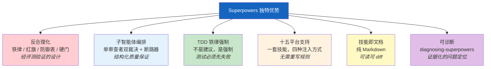

# 对比分析

> Superpowers 不是唯一的 AI 编程增强方案——但它把反合理化作为核心架构关注点，这一点很少见。
> 本章客观对比 Superpowers 与其他主流方案的异同。

> **时效说明：** Superpowers 一侧的事实已按 7.0.1 重新核对。**其他工具的描述沿用最初撰写时（2026-03）的理解，本次更新没有逐一重新核验**，这些工具迭代很快，请以各自官方文档为准，尤其是表格里写"无"的单元格。

## 10.1 对比对象概览

AI 编程增强方案的生态已经相当丰富，大致可分为：平台专属配置文件、通用 AI 编程助手、IDE 扩展、AI 编程工具，以及最原始的自定义系统提示。Superpowers 在这个生态中定位为跨平台技能系统（Cross-Platform Skill System）——既不是新的 IDE，也不是新的 AI 助手，而是一套可以注入到多个平台中的结构化行为规范。

本章对比的六个方案：

- **Cursor Rules**（`.cursorrules` 及其后继形式）——Cursor IDE 专属的规则文件，用于定义编码风格和项目约定。
- **CLAUDE.md / AGENTS.md**——项目级指令文件，提供上下文和行为指导。每个项目放一份，智能体启动时自动读取。注意它们与 Superpowers 的关系是互补而非互斥：Superpowers 的指令优先级把这些文件视为**用户指令**，优先于技能。
- **Aider**——开源 AI 编程助手，通过 CLI 与 LLM 交互，专注于代码编辑循环。
- **Continue.dev**——开源 AI 编码 IDE 扩展，配置驱动，支持多种模型后端。
- **Cline/Roo**——AI 编程工具，各自有自动化方法论，支持浏览器操作和终端交互。
- **自定义系统提示（Custom System Prompts）**——直接在对话中粘贴的临时性提示，无结构化管理、无版本控制。

## 10.2 多维度对比

| 维度 | Superpowers | Cursor Rules | CLAUDE.md / AGENTS.md | Aider | Continue.dev | Cline/Roo |
|------|-----------|------------|----------|-------|-------------|-----------|
| **架构方式** | 提示注入 + 技能系统 | 静态规则文件 | 项目级 Markdown 指令 | CLI 工具 + 内置约定 | IDE 扩展 + 配置 | AI 工具 + 自动化 |
| **工作流覆盖** | 完整管线（头脑风暴 → 计划 → 执行 → 收尾） | 无工作流 | 无工作流 | 部分（编辑循环） | 无工作流 | 部分（任务执行） |
| **平台支持** | 15 个平台 | 仅 Cursor | 取决于读取该文件的工具 | 仅 Aider CLI | VS Code 等多 IDE | 各自平台 |
| **反合理化** | 核心架构（铁律 / 红旗 / 防御表 / 硬门 / 精神条款） | 无 | 无 | 无 | 无 | 无 |
| **子智能体编排** | Controller-Worker + 单审查者双裁决 + 五轮断路器 | 无 | 无 | 无 | 无 | 部分支持 |
| **TDD 强制** | 铁律级强制 | 无 | 可手动指定 | 无 | 无 | 无 |
| **可扩展性** | 添加 SKILL.md（Markdown） | 编辑规则文件 | 编辑 .md 文件 | 配置文件 | 插件系统 | 各自扩展机制 |
| **技能系统** | 结构化 SKILL.md + SDO 触发约定 | 无 | 无 | 无 | 无 | 无 |
| **社区生态** | 开源（MIT），15 个技能；上游**不鼓励新增技能** | 社区分享规则模板 | 项目级，不可复用 | 开源社区 | 开源社区 + 插件市场 | 各自社区 |

关键观察：在"反合理化"和"子智能体编排"两个维度上，Superpowers 提供的是系统级支持。其他工具侧重于"让 AI 更方便地写代码"，而 Superpowers 侧重于"让 AI 更可靠地遵循流程"——这是设计取向上的差异。

## 10.3 Superpowers 的独特优势

**反合理化作为核心架构关注点。** 其他工具通常假设 AI 会忠实遵循指令——Superpowers 假设 AI 会寻找借口不遵循指令，并在架构层面防御这种行为。铁律、红旗、合理化防御表、硬门不是可选的最佳实践建议，而是系统的结构性组成部分，并经过评测验证（例如删除 TDD 的论据段落会使先写测试的比例从 8/10 降到 5/10）。

**子智能体编排与审查。** SDD 不只是"派遣子智能体执行任务"。每个子智能体获得新鲜上下文；每个任务由独立的审查者读一次 diff，同时给出规格合规与代码质量两个裁决，还有"无法从 diff 验证"的第三种结果；修复循环有五轮断路器；最后有一次最强模型的整分支评审；账本让控制者在上下文被压缩后仍能续跑。这种编排深度在静态规则文件里无法实现，因为它们缺乏工作流引擎。

**TDD 铁律级强制。** 很多工具最多是"建议使用 TDD"。Superpowers 通过铁律把 TDD 从建议提升为强制——没有先失败的测试就不能写生产代码，"绿"以项目完整测试套件为准，并配套 `writing-good-tests.md` 要求每个测试说明"哪个生产改动会让它失败"。

**跨平台支持。** 一套技能文件通过平台适配层在 15 个平台上运行，包括钩子、进程内插件、指令文件、技能发现四种注入方式。静态规则文件通常只服务于单一工具。

**技能即文档。** 技能是纯 Markdown 文件——不需要学习 DSL，不需要特定的运行时。任何能编辑文本的人都可以阅读、diff 和修改技能，版本控制与代码完全一致。

**可诊断。** `diagnosing-superpowers` 让你在会话跑偏时，用带 `path:line` 证据的方式查清发生了什么，并产出脱敏的材料用于反馈。

## 10.4 局限性与诚实评估

任何技术方案都有其适用边界，Superpowers 也不例外。下面是 7.0.1 的已知局限，其中几项相对 5.x 时期已经改善。

**没有公共 CI 管线，但有若干自动门禁。** 仓库没有 `.github/workflows`，没有 GitHub Actions。不过存在 `tests/` 下的非 LLM 测试、`tests/skill-size`（20,000 字节上限）、`scripts/lint-shell.sh` 与 shell-lint 测试，以及面向 evals 的 pre-commit 检查。技能**行为**的验证依赖独立仓库里的 evals 套件（Quorum），需要真实的智能体会话和评分，成本高、结果有随机性，不适合放进公共 CI。

**平台 API 依赖。** Superpowers 依赖各平台的钩子、插件和技能发现机制，这些 API 可能在平台更新时变化。7.0.0 的 SessionStart 因宿主启动时 `PATH` 损坏而丢失 bootstrap（anthropics/claude-code#43127）、Antigravity 因被当作 Gemini 扩展导入而每个会话报错，都是真实案例。15 个平台意味着相应的兼容性维护压力；有的平台甚至没有压缩后的重新注入机制（如 Hermes），超长会话需要开新会话。

**上下文压缩会截断技能。** Claude Code 在压缩后把每个技能截断到 20,000 字符，导致 SDD 丢失五轮上限、对同一任务跑了 18 轮修复的实例（#2481）。7.0.1 的对策是拆分到 `references/` 并加测试守住大小上限，但这仍是需要持续注意的约束，也是新增技能时的设计约束。

**提问质量仍在调优。** 7.0.0 重写的头脑风暴被反馈"问题很快变得烦人、套路化"，7.0.1 做了调整（先读上下文、尽量不问已有答案、提问建立在答案之上），项目方表示会继续调优。

**版本同步已经自动化。** 5.x 时期这是个手工负担；现在 `.version-bump.json` 列出 12 个清单，`scripts/bump-version.sh` 支持写入、`--check` 查漂移和 `--audit` 查残留旧版本号，并有对应测试。

**Brainstorm 服务器已有认证。** 6.0.0 加入会话密钥、cookie、WebSocket Origin 校验、文件沙箱和安全响应头；仍然默认绑定 `127.0.0.1`。在 Windows / MSYS2 下 owner PID 监控仍然被禁用，改靠 4 小时空闲超时收尾。

**对贡献的限制。** 上游通常不接受新技能的贡献，也不接受智能体代写的、去修他人 issue 的 PR；这保护了项目质量，但意味着想要新技能的团队需要在自己的环境里维护。

| 局限性 | 影响范围 | 现状 / 缓解措施 |
|--------|---------|---------|
| 无公共 CI 管线 | 回归测试 | 有非 LLM 测试与大小门禁；行为测试靠独立 evals 套件 |
| 平台 API 依赖 | 平台升级时的兼容性 | 平台独立清单与测试；关注平台变更日志 |
| 压缩截断技能 | 长会话中的规则丢失 | 拆分到 `references/` + 20,000 字节门禁 |
| 头脑风暴提问质量 | 用户体验 | 7.0.1 已调整，持续调优中 |
| 版本同步 | 12 个清单的一致性 | 已自动化（`bump-version.sh`） |
| 服务器认证 | 共享环境安全性 | 已有会话密钥 + Origin 校验 + 沙箱 |
| 新技能难以上游合并 | 想要扩展的团队 | 在自己的项目里维护本地技能 |

## 10.5 总结

Superpowers 在反合理化、子智能体编排、TDD 强制和跨平台支持方面具有突出特点。它解决的核心问题不是"如何让 AI 写更多代码"，而是"如何让 AI 更可靠地遵循工程规范"。

同时，它在公共 CI 集成、平台 API 稳定性和技能行为的自动化验证方面存在已知局限。选择使用 Superpowers 的团队应该评估这些权衡是否适合自己的场景——如果团队更看重跨平台一致性和流程合规性，Superpowers 的价值最大；如果团队只使用单一平台且不需要严格流程控制，平台原生方案（如规则文件或 `AGENTS.md`）可能更轻量。

值得强调的是，Superpowers 与其他工具不是互斥的。可以在使用 `CLAUDE.md` / `AGENTS.md` 的项目中同时使用 Superpowers，二者在不同层面发挥作用；当两者冲突时，你的指令文件优先于技能。

---

[⬅️ 上一篇：技能开发指南](./09-writing-skills.md) | [返回目录](./README.md) | [下一篇：附录 ➡️](./11-appendix.md)
